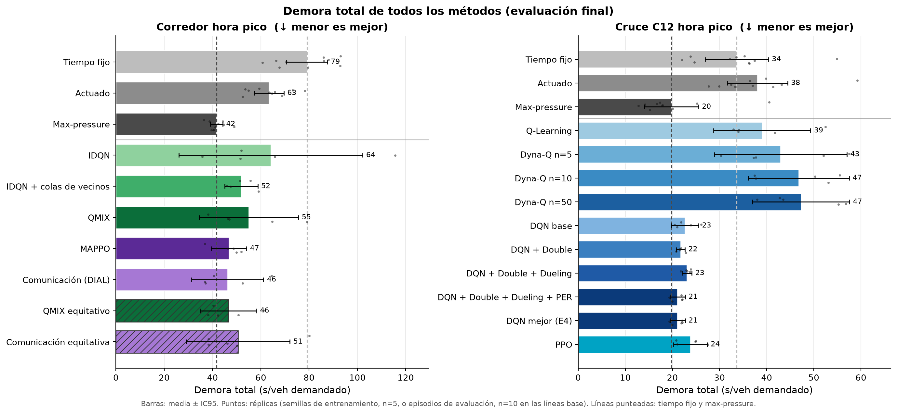

# Resumen de resultados E1 a E8

Semáforos inteligentes en Av. La Reforma con RL multiagente (CC3104). Todo sale de `runs/` con `python -m analysis.make_all`; las figuras están en `docs/figures/` (PNG y PDF) y las tablas completas en `analysis/results/`.

## Cómo leer los números

- **Métrica principal: demora total** (`total_delay`, s por vehículo *demandado*). Cuenta la espera dentro de la red, el retraso de inserción y el tiempo que esperaron afuera los vehículos que nunca entraron. La espera media (`mean_waiting_time`) solo promedia sobre los vehículos insertados y se puede «mejorar» dejando autos fuera (`docs/ajuste_aprendizaje.md` §3), así que va como métrica secundaria junto con el backlog (% de la demanda que no entró).
- **Réplicas.** Métodos aprendidos: la unidad es la **semilla de entrenamiento** (media de sus 10 episodios de evaluación; n = 5) y el IC95 es el de la t de Student entre semillas. Líneas base: la unidad es el **episodio de evaluación** (n = 10, semillas 1000 a 1009; son deterministas, solo cambia la demanda). Cada fila de las tablas lo dice entre paréntesis: `(sem.)` o `(ep.)`. Todas las cifras son «media ± IC95».
- **Comparaciones.** Prueba t de Welch sobre esas réplicas, con corrección de Holm sobre las 48 comparaciones de la tabla principal (24 pares × 2 métricas) y, aparte, sobre las 32 de E7 (`comparaciones_estadisticas.md`). Con n = 5 el poder es bajo: «sin diferencia detectable» no significa «iguales».
- **E7 usa una sola semilla de entrenamiento por familia**, elegida por validación (DQN: `E3/dqn_double_dueling_per` semilla 1; PPO: semilla 0; MAPPO: semilla 3; comunicación: semilla 0). Su IC95 es solo sobre los 10 episodios de evaluación y **no incluye la variabilidad entre semillas de entrenamiento**. Además, en la hora pico esas semillas resultaron ser la mejor de las 5 de su experimento (MAPPO semilla 3: 36.8 s, contra 46.8 ± 7.3 s en promedio de las 5), así que en E7 los agentes se ven mejor de lo que es el método en promedio.
- Las líneas base de `cruce_mediodia` y `cruce_pico_x13` salen de E7 (E1 no las evaluó); en los escenarios comunes coinciden exactamente con E1.
- Presupuesto igual en todos los experimentos de entrenamiento: 200 episodios = 144 000 pasos de entorno por semilla, checkpoint elegido por validación (semillas 2000 y 2001), evaluación final en las semillas 1000 a 1009.

## Titular

En el **corredor de hora pico** (`reforma_pico`) todo el RL aprendido tiene una media de demora total menor que la del tiempo fijo (significativa con MAPPO; los IC95 de IDQN y QMIX son muy anchos) y varios están por debajo del actuado, pero **ninguno le gana a max-pressure** en demora total: max-pressure 41.7 ± 2.5 s, MAPPO 46.8 ± 7.3, comunicación 46.2 ± 14.9, QMIX 55.0 ± 20.5, IDQN 64.1 ± 38.1, actuado 63.4 ± 6.1, tiempo fijo 79.1 ± 8.5. En el cruce aislado (`cruce_pico`) pasa lo mismo: DQN 21.1 ± 1.6 y PPO 23.8 ± 3.6 contra max-pressure 19.8 ± 5.8 y tiempo fijo 33.6 ± 6.7. Los métodos tabulares ni siquiera alcanzan al tiempo fijo y dejan backlog. Fuera de la hora de entrenamiento (E7) la ventaja sobre el tiempo fijo se mantiene casi siempre, pero con +30 % de demanda MAPPO empeora hasta igualar o superar al tiempo fijo y max-pressure queda claramente mejor. Con el incidente los aprendidos mejoran al tiempo fijo en las dos redes, pero ninguno le gana a max-pressure (en el cruce max-pressure es claramente mejor).

## E1. ¿Qué tan bueno es lo actual?

Tablas: `E1_eval.md`. Figura: `E1_eval_bars`.

- **Corredor, hora pico:** max-pressure es el mejor en demora total (41.7 ± 2.5 s), después el actuado (63.4 ± 6.1) y el tiempo fijo (79.1 ± 8.5). Max-pressure también tiene el menor backlog (0.12 %) y el mayor throughput (6864 veh/h).
- **Cruce, hora pico:** max-pressure 19.8 ± 5.8 s, tiempo fijo 33.6 ± 6.7, actuado 38.0 ± 6.4 (el actuado deja más backlog, 0.80 %, y queda peor que el fijo en demora total aunque tiene menor espera media).
- **Mediodía** (poca demanda): el actuado y max-pressure bajan la demora a entre la mitad y dos tercios de la del fijo (corredor: 18.7 y 21.1 contra 30.4 s; cruce: 9.3 y 8.0 contra 16.7).
- **+30 % de demanda:** el corredor se satura (backlog 12.7 % a 15.7 % en las tres líneas base) y la demora total pasa de 40 a 80 s a 250 a 350 s; max-pressure sigue primero (252 ± 12 s contra 346 ± 10 del fijo). En el cruce con +30 %: 99.7 ± 8.0 (max-pressure), 200.7 (actuado), 223.4 (fijo).
- Max-pressure no es el mejor en todo: en el corredor de mediodía el actuado es mejor (18.7 contra 21.1 s) y en equidad (E8) max-pressure es el que más espera hace pasar a la transversal del cruce.

## E2. ¿Cuánto ayuda planificar? (Q-Learning contra Dyna-Q)

Tablas: `E2_eval.md`, `E2_sample_efficiency.md`, `E2_training.md`. Figuras: `E2_learning_curves`, `E2_eval_bars`.

- **Planificar no ayudó.** Demora total en `cruce_pico`: Q-Learning 39.0 ± 10.3 s, Dyna-Q n=5 43.0 ± 14.1, n=10 46.8 ± 10.7, n=50 47.3 ± 10.3. Dyna-Q n=50 contra Q-Learning: +8.2 s [−3.9, +20.3], p = 0.16: no hay diferencia detectable, y si algo, la tendencia va en contra de planificar más.
- **Ninguno llega al tiempo fijo** (33.6 s) ni, por supuesto, a max-pressure (19.8 s). Q-Learning contra tiempo fijo: +5.4 s, p = 0.29 (sin diferencia detectable, pero la media es peor).
- **Los tabulares dejan backlog:** 1.3 % a 2.1 % de la demanda no entra, contra 0.25 % del tiempo fijo. Se ven bien en espera media (19 a 26 s contra 31 s del fijo) y mal en demora total: es la firma de dejar autos afuera.
- **Eficiencia de muestras** (validación, cada 14 400 pasos): bajar de 1.5 veces la demora del tiempo fijo (50 s) lo logran 4 de 5 semillas de Q-Learning y de Dyna-Q n=5 (mediana 101 k pasos), 2 de 5 con n=10 y 1 de 5 con n=50. Ninguna semilla de ningún método baja del nivel del tiempo fijo en validación. Más pasos de planificación por paso real no mejoraron la eficiencia de muestras aquí.
- En `cruce_mediodia` (no vista) Q-Learning queda en 17.4 ± 4.5 s contra 16.7 del fijo y 8.0 de max-pressure; los Dyna-Q 17.7 a 25.4 s.

## E3. ¿Qué variante de DQN aporta más?

Tablas: `E3_eval.md`. Figuras: `E3_learning_curves`, `E3_eval_bars`.

- **Ninguna variante se separa del ruido.** Demora total en `cruce_pico`: DQN base 22.7 ± 2.9 s, +Double 21.7 ± 0.9, +Double+Dueling 23.1 ± 1.0, +Double+Dueling+PER 21.1 ± 1.6. DQN completo contra DQN base: −1.6 s [−4.5, +1.3], p = 0.23.
- Las cuatro variantes están en la misma banda de max-pressure y por debajo del tiempo fijo y el actuado. La que tiene la media más baja es la completa (Double+Dueling+PER), y también la de menor demora total en `cruce_mediodia` (13.7 ± 1.1 contra 19.7 a 20.3 de las otras tres, que tienen intervalos de ±10 a ±17 s). Por eso `dqn_best` (E4) y E7 usan Double+Dueling+PER.
- **Eficiencia de muestras idéntica:** en las cuatro variantes las 5 semillas bajan de 1.5 veces el tiempo fijo hacia los 43 k pasos y del nivel del tiempo fijo hacia los 58 k pasos (mediana), antes que cualquier método tabular o multiagente; ninguna llega al nivel de max-pressure en validación. El mejor checkpoint de validación ronda 28 s en las cuatro (el último, 39 a 42 s: el valor de la política oscila entre checkpoints).

## E4. DQN contra PPO

Tablas: `E4_eval.md`. Figuras: `E4_learning_curves`, `E4_eval_bars`. Cruce de hora pico, 144 000 pasos cada uno.

- **Demora total:** DQN 21.1 ± 1.6 s, PPO 23.8 ± 3.6 s, max-pressure 19.8 ± 5.8, tiempo fijo 33.6 ± 6.7, actuado 38.0 ± 6.4. PPO contra DQN: +2.8 s [−0.8, +6.3], p = 0.10 (sin diferencia detectable). Los dos contra max-pressure: sin diferencia detectable (DQN p = 0.63, PPO p = 0.18). Contra el tiempo fijo, DQN −12.6 s (p = 0.002, p Holm = 0.09) y PPO −9.8 s (p = 0.011, p Holm = 0.41): la dirección es clara y con la corrección conservadora de Holm no queda formalmente significativa. Contra el actuado, DQN −17.0 s (p Holm = 0.008).
- **Perfil distinto.** PPO tiene la menor espera media de todos (15.8 ± 0.5 s) pero más backlog (0.70 % contra 0.25 % de DQN), y menos espera máxima en la transversal (168 ± 42 contra 222 ± 65 s). En validación (semillas 2000 y 2001) DQN llega más abajo: las 5 semillas bajan del nivel del tiempo fijo hacia los 58 k pasos (mejor checkpoint 28.3 s), mientras que de PPO lo logran 2 de 5 (mediana 65 k; mejor checkpoint 35.5 s). En la evaluación final PPO queda algo peor en demora total (23.8 contra 21.1 s) sin diferencia detectable, así que no hay una ganadora clara.
- **En mediodía (no vista) PPO generaliza mejor:** 7.5 ± 2.1 s (max-pressure 8.0, fijo 16.7) contra DQN 13.7 ± 1.1.
- Respuesta: en este cruce, valor y política rinden parecido en la hora de entrenamiento; PPO es más eficiente en muestras y más robusto en mediodía, DQN deja menos backlog.

## E5. ¿Ayuda entrenar centralizado? (IDQN, QMIX, MAPPO)

Tablas: `E5_eval.md`, `E5_sample_efficiency.md`, `E5_training.md`. Figuras: `E5_learning_curves`, `E5_eval_bars`, `seleccion_validacion_marl`.

- **Demora total en `reforma_pico`:** MAPPO 46.8 ± 7.3 s, QMIX 55.0 ± 20.5, IDQN 64.1 ± 38.1; max-pressure 41.7 ± 2.5, actuado 63.4 ± 6.1, fijo 79.1 ± 8.5. Entre los tres métodos aprendidos no hay diferencia detectable con n = 5 (MAPPO contra QMIX +8.3 s a favor de MAPPO, p = 0.34; contra IDQN p = 0.28), pero **el orden de las medias es el esperado** (MAPPO < QMIX < IDQN) y MAPPO tiene un tercio de la dispersión entre semillas de QMIX (IC95 de ±7.3 contra ±20.5 s) y una quinta parte de la de IDQN (±38.1 s).
- **Contra las líneas base:** MAPPO le gana al tiempo fijo (−32.3 s, −41 %, p Holm < 0.001) y al actuado (−16.7 s, −26 %, p Holm = 0.043), pero **no a max-pressure** (+5.1 s [−2.1, +12.3], p = 0.13). QMIX contra max-pressure: +13.3 s (p = 0.15). IDQN, con una semilla que termina en 115.6 s, queda al nivel del actuado.
- **Espera media:** MAPPO 35.7 ± 0.9 s es incluso menor que la de max-pressure (40.1 ± 2.0), pero deja 1.3 % de backlog contra 0.12 %: por eso la demora total no mejora.
- **Eficiencia de muestras** (validación): MAPPO baja de 1.5 veces el tiempo fijo en las 5 semillas hacia los 43 k pasos y del nivel del tiempo fijo en 5 de 5 (mediana 72 k); QMIX e IDQN lo logran en 4 de 5 (mediana de 50 k y 101 k). Solo 1 semilla de MAPPO y ninguna de QMIX o IDQN llegan al nivel de max-pressure en validación.
- **Estabilidad.** Las curvas de validación entre checkpoints oscilan mucho: QMIX e IDQN empiezan en unos 800 s (media de la validación en el primer checkpoint) y bajan a 60 a 80 s al final, MAPPO parte de 140 s y oscila entre 40 y 130 s sin tendencia clara después de los 60 k pasos, y una semilla de QMIX pasa de 93 s a 173 s entre los dos últimos checkpoints. El checkpoint elegido (estrellas en `seleccion_validacion_marl`) es de los últimos (episodio 140 o más) en casi todas las semillas de IDQN, MAPPO y comunicación, y va del episodio 60 al 200 en QMIX. Es el mínimo de 10 valores medidos en solo 2 episodios, así que su puntaje de validación es optimista: el mejor checkpoint promedia 58.2 s en MAPPO, 57.7 en QMIX y 69.2 en IDQN, contra 63.0, 82.8 y 75.6 s del último (`E5_sample_efficiency.md`).
- **Otros escenarios:** en mediodía MAPPO (19.0 ± 2.3 s) iguala al actuado (18.7) y queda por debajo de max-pressure (21.1) y del fijo (30.4); IDQN 26.9 ± 10.4 y QMIX 40.7 ± 20.3 quedan peor. Con +30 % ver E7: ningún aprendido supera a max-pressure y MAPPO deja 21.5 % de backlog.
- Respuesta: entrenar de forma centralizada **ayuda un poco y de forma estadísticamente débil** (menor demora media y mucho menor varianza con MAPPO) y no basta para superar a max-pressure.

## E6. ¿Mejora la ola verde con comunicación?

Tablas: `E6_eval.md`. Figuras: `E6_learning_curves`, `E6_eval_bars`, `seleccion_validacion_marl`. Referencia: MAPPO de E5.

- **Demora total en `reforma_pico`:** comunicación (DIAL) 46.2 ± 14.9 s, IDQN con colas de vecinos 51.9 ± 6.8, IDQN 64.1 ± 38.1, MAPPO 46.8 ± 7.3 (max-pressure 41.7). Ninguna diferencia es detectable: comunicación contra IDQN −17.9 s [−55.3, +19.6], p = 0.28; contra MAPPO −0.5 s, p = 0.93; colas de vecinos contra IDQN −12.2 s, p = 0.43. Las medias bajan con más información (IDQN 64 → vecinos 52 → comunicación 46), pero el IC95 de IDQN es tan ancho que no se puede afirmar un efecto.
- **No hay señal de ola verde.** Si la comunicación coordinara las fases en el corredor se esperarían menos paradas y menos tiempo de viaje de punta a punta. El tiempo de viaje medio de comunicación es 209.5 ± 17.0 s (IDQN 225.6 ± 11.9, vecinos 219.6 ± 22.8, actuado 200.3, max-pressure 203.0, fijo 228.5; el de comunicación es el menor de los aprendidos pero cae dentro de los IC de los demás) y las paradas por vehículo son 4.1 ± 0.7 (IDQN 4.3, vecinos 4.0), **más que cualquier línea base** (fijo 3.2, actuado 2.7, max-pressure 3.9). El resultado es parecido al de los otros métodos aprendidos: la ganancia viene de reducir la espera en las colas, no de sincronizar.
- **Equidad:** las colas de vecinos aumentan la espera máxima en la transversal frente a IDQN (443 ± 87 contra 301 ± 75 s, p = 0.009 sin corregir, p Holm = 0.36) y comunicación queda en 374 ± 128 s.
- **Con +30 % de demanda** comunicación (305.9 ± 80.3 s) y las colas de vecinos (320.1 ± 82.5) tienen mucha varianza entre semillas; ver E7 para la semilla elegida de comunicación (281.8 ± 13.9 s, la mejor de los aprendidos en esa condición).
- Respuesta: con este presupuesto y 5 semillas **no se puede afirmar que la comunicación mejore la coordinación**; hay una tendencia a menor demora media que no es estadísticamente distinguible y ningún indicio de ola verde en tiempos de viaje ni paradas.

## E7. ¿Generaliza el mejor agente?

Tablas: `E7_robustness.md`. Figuras: `E7_robustness`, `E7_degradation`. Una semilla de entrenamiento por familia (ver «Cómo leer los números»); redes `cruce` (DQN, PPO) y `reforma` (MAPPO, comunicación), siempre con sus propios escenarios y líneas base.

Demora total [s/veh]:

| Red | Método | Pico | Mediodía | Pico +30 % | Pico + incidente |
|---|---|---:|---:|---:|---:|
| Cruce | Tiempo fijo | 33.6 | 16.7 | 223.4 | 228.3 |
| Cruce | Actuado | 38.0 | 9.3 | 200.7 | 200.9 |
| Cruce | Max-pressure | 19.8 | 8.0 | **99.7** | **158.0** |
| Cruce | DQN | **19.4** | 12.3 | 147.1 | 190.4 |
| Cruce | PPO | 20.8 | **7.2** | 148.4 | 191.7 |
| Corredor | Tiempo fijo | 79.1 | 30.4 | 345.7 | 198.4 |
| Corredor | Actuado | 63.4 | 18.7 | 320.4 | 180.5 |
| Corredor | Max-pressure | 41.7 | 21.1 | **252.2** | **161.8** |
| Corredor | MAPPO | **36.8** | **17.2** | 373.3 | 165.5 |
| Corredor | Comunicación | **36.8** | 20.7 | 281.8 | 175.2 |

- **Hora no vista (mediodía):** el orden respecto del tiempo fijo se mantiene. Todos los aprendidos le ganan al fijo (−26.6 % a −57.1 %; p Holm < 0.001 en los cuatro). PPO (7.2 s en el cruce) y MAPPO (17.2 s en el corredor) tienen la menor demora de su red; DQN (12.3 s) queda detrás de max-pressure (8.0 s) y del actuado (9.3 s).
- **+30 % de demanda:** aquí está la caída. En el corredor **MAPPO queda en 373.3 ± 36.9 s, +8 % respecto del tiempo fijo (p Holm = 0.54, sin diferencia detectable) y +48 % respecto de max-pressure** (p Holm < 0.001); su backlog sube a 24.2 % (max-pressure 12.7 %). Con las 5 semillas de E5 el resultado es el mismo: 347.7 ± 28.0 s contra 345.7 del fijo y 252.2 de max-pressure. La política de comunicación (semilla 0) aguanta mejor, 281.8 ± 13.9 s (−18.5 % contra el fijo, pero +11.7 % contra max-pressure); con 5 semillas, 305.9 ± 80.3 s. En el cruce DQN y PPO (147 a 148 s) siguen mejores que el fijo (223 s, −34 %) pero **max-pressure es mucho mejor** (99.7 s, p Holm ≤ 0.003). En estos escenarios max-pressure es el método más robusto a la demanda mayor.
- **Incidente** (de 900 s a 2100 s se cierran 2 de los 3 carriles de paso hacia el norte y queda abierto uno, sin cortar ningún movimiento; corredor: carriles 0 y 1 de `NB_C12_C10`, quedan el carril 2 y la bahía izquierda; cruce: carriles 1 y 2 de la aproximación `NB_C14_C12`, queda el carril 0 con el giro a la derecha): la demora total se multiplica por 5.3 a 9.8 en el cruce y por 2.5 a 4.8 en el corredor. *Corrección:* una primera versión de E7 usaba `NB_C12_C10` también en el cruce, pero en esa red es la arista de salida de C12 (sin conexiones aguas abajo) y el cierre bloqueaba todo el tráfico hacia el norte durante 20 min (419 a 462 s para todos los métodos, ~24 % de backlog); eso medía un bloqueo total que ningún semáforo puede aliviar, así que las filas del cruce con incidente se re-evaluaron con la aproximación. En el **cruce** max-pressure es el mejor (158.0 ± 11.4 s; backlog 3.4 %); DQN (190.4 ± 12.0) y PPO (191.7 ± 13.2) mejoran al tiempo fijo (228.3 ± 11.1; −16.6 % y −16.0 %, p Holm < 0.001 y 0.002) y quedan a la par del actuado (200.9 ± 10.0), pero son **+20.5 % y +21.3 % peores que max-pressure** (p Holm = 0.005 en ambos). PPO tiene la menor espera media (21.0 ± 1.8 s contra 28.5 de max-pressure y 41.1 del fijo), pero deja el doble de backlog que max-pressure (6.9 % contra 3.4 %). En el **corredor** MAPPO (165.5 ± 8.9 s) y comunicación (175.2 ± 8.7) mejoran al tiempo fijo (−16.6 % y −11.7 %, p Holm < 0.001 y 0.010) y al actuado (180.5), pero **no a max-pressure** (161.8 ± 7.2 s: MAPPO +2.3 %, p = 0.47; comunicación +8.3 %, p = 0.015 sin corregir). Lo que sí se ve es que MAPPO tiene la menor espera media bajo el incidente (42.1 ± 2.4 s contra 61.0 ± 4.5 de max-pressure y 87.5 del fijo), pero deja algo más de backlog (5.9 % contra 4.6 %), y por eso la demora total no mejora. **No hay evidencia en estos datos de que el RL (MARL en el corredor, DQN/PPO en el cruce) supere a max-pressure bajo el incidente.**
- **Degradación respecto de pico** (`E7_degradation`, panel izquierdo): con +30 % la demora total se multiplica ×4.4 (fijo), ×5.1 (actuado), ×6.0 (max-pressure), ×10.1 (MAPPO), ×7.7 (comunicación) en el corredor, y ×5.0 (max-pressure), ×7.1 a ×7.6 (PPO, DQN), ×6.6 (fijo) en el cruce. Con el incidente en el cruce pasa lo mismo: ×9.2 (PPO) y ×9.8 (DQN) contra ×8.0 (max-pressure), ×6.8 (fijo) y ×5.3 (actuado). Es decir, **los agentes aprendidos degradan más que max-pressure y el actuado** (y MAPPO, ×10.1, más que el tiempo fijo, ×4.4), aunque partan de un mejor valor en la hora pico.
- Respuesta: la ventaja sobre el tiempo fijo **se mantiene** en mediodía y con el incidente (en las dos redes, entre −12 % y −17 %), y se reduce o desaparece con +30 % (MAPPO). **La ventaja sobre max-pressure no se mantiene en ninguna condición** salvo mediodía (PPO, MAPPO) y la hora pico de la semilla elegida.

## E8. ¿Se sacrifica a las calles transversales?

Tablas: `E8_fairness.md`, `CO2_reforma_pico.md`. Figuras: `E8_fairness_reforma_pico`, `E8_fairness_cruce_pico`, `E8_tradeoff_reforma_pico`, `E8_tradeoff_cruce_pico`, `CO2_reforma_pico`.

- **Corredor, hora pico.** Espera máxima de un vehículo en una transversal (s): tiempo fijo 524 ± 176, actuado 832 ± 375 (la peor), max-pressure 420 ± 164, IDQN 301 ± 75, MAPPO 314 ± 61, comunicación 374 ± 128, QMIX 453 ± 235, IDQN + vecinos 443 ± 87. Con los métodos aprendidos **no se sacrifica a las transversales respecto de las líneas base** (las medias son menores o iguales), pero con n = 5 la única diferencia significativa sin corregir es MAPPO contra actuado (−519 s, p = 0.012; p Holm = 0.45) y MAPPO contra fijo (−210 s, p = 0.026). Los p95 por aproximación (heatmap) muestran la transversal de la 12ª como la más castigada en max-pressure (221 s), QMIX (230 s) y IDQN con vecinos (240 s); MAPPO la lleva a 125 s.
- **Cruce, hora pico: aquí sí hay sacrificio.** Max-pressure y los agentes aprendidos favorecen a Reforma a costa de la transversal C12: espera máxima 271 ± 43 s (max-pressure), 222 ± 65 (DQN), 257 ± 60 (+Double), 168 ± 42 (PPO), contra 113 ± 13 (fijo) y 100 ± 1 (actuado). DQN contra el fijo: +109 s (p = 0.008 sin corregir); PPO contra el fijo: +55 s (p = 0.018); PPO contra max-pressure: −104 s (p Holm = 0.04, el mejor de los aprendidos). A cambio, la espera p95 de Reforma baja (de 169 s a 73 s en SB para DQN). Es el trade-off clásico entre demora total y equidad.
- **Penalización de equidad** (`qmix_fair`, `comm_fair`, λ = 0.5): 
  - QMIX equitativo contra QMIX: demora total 46.5 ± 11.7 s contra 55.0 ± 20.5 (−8.5 s, p = 0.35) y espera máxima transversal 368 ± 103 contra 453 ± 235 s (−85 s, p = 0.40): **mejora en las dos cosas, pero no es detectable con n = 5** (y reduce la varianza entre semillas).
  - Comunicación equitativa contra comunicación: **no ayuda**. Demora total 50.6 ± 21.4 contra 46.2 ± 14.9 (p = 0.66) y espera máxima 647 ± 580 contra 374 ± 128 s (p = 0.27). Una sola semilla (con p95 de 339 s en la transversal de la 15ª) explica casi todo el promedio; hay que mirar el gráfico `E8_tradeoff` y la tabla antes de concluir algo.
  - En el plano demora total contra espera máxima transversal (`E8_tradeoff_reforma_pico`), MAPPO, comunicación y QMIX equitativo quedan juntos (46 a 47 s de demora, 314 a 374 s de espera máxima), cerca de max-pressure (41.7 s, 420 s); la penalización mueve a QMIX hacia esa zona.
- **CO2 en `reforma_pico`** (kg de la hora simulada): fijo 2828 ± 142, actuado 2507 ± 69 (−11.3 %), max-pressure 2557 ± 67 (−9.6 %), comunicación 2590 ± 148 (−8.4 %), comunicación equitativa 2607 (−7.8 %), IDQN con vecinos 2685 (−5.1 %), IDQN 2703 (−4.4 %), MAPPO 2767 (−2.2 %), QMIX equitativo 2806 (−0.8 %), QMIX 2905 ± 232 (+2.7 %). Todos los aprendidos están entre −8.4 % y +2.7 % del fijo y las líneas base adaptativas son las que menos emiten; los métodos aprendidos paran más veces (3.9 a 4.5 paradas por vehículo contra 2.7 a 3.9 en las líneas base). Las diferencias entre los aprendidos no se contrastaron; sus IC95 se solapan.

## Efecto de la selección del checkpoint

`best/` y el último checkpoint no se evaluaron en las semillas de evaluación (no se hizo para no gastar simulaciones). En su lugar, `seleccion_validacion_marl` y `seleccion_validacion_agente_unico` muestran la demora total de validación de cada checkpoint por semilla: oscila entre checkpoints consecutivos en todos los métodos (por ejemplo, una semilla de QMIX pasa de 93 s a 173 s entre los dos últimos). El mejor checkpoint de validación promedia entre 2 s (comunicación) y 25 s (QMIX) menos que el último en E5 y E6, y entre 11 y 14 s menos en las variantes de DQN (E3), pero cada punto usa solo 2 episodios de validación: parte de esa oscilación es ruido de medición y la diferencia incluye el sesgo de elegir el mínimo, así que no mide con precisión la ganancia de seleccionar.

## Pendiente o limitaciones

- Las comparaciones con n = 5 semillas tienen poco poder: varias diferencias plausibles (MAPPO < QMIX < IDQN, planificación en Dyna-Q, comunicación) no son estadísticamente detectables.
- E7 con una sola semilla por familia; un E7 con `select: all` (5 semillas) costaría 5 veces más simulaciones. Además `dqn_best` es la mejor de las 20 corridas DQN de E3/E4 por puntaje de validación, así que las filas aprendidas de E7 son optimistas.
- Las semillas de evaluación 1000 a 1002 se usaron en la fase de chequeo y ajuste de hiperparámetros (`docs/ajuste_aprendizaje.md`), así que no estuvieron estrictamente reservadas para los hiperparámetros de E2 a E6.
- Las métricas de equidad (p95 por aproximación, espera máxima en transversales) solo cuentan a los vehículos insertados e ignoran el retraso de inserción y a los que nunca entraron.
- La recompensa de entrenamiento incluye el backlog de inserción y la de equidad añade `fair_lambda`; la comparación de equidad usa un solo λ.
- El ciclo del tiempo fijo y los conteos de demanda son sintéticos (ver `docs/informe`), así que las cifras absolutas de mejora frente al fijo dependen de ese supuesto; la comparación entre métodos aprendidos y max-pressure no.

## Figuras

Todas en `docs/figures/` (`.png` y `.pdf`).

| Archivo | Descripción |
|---|---|
| `resumen_demora_total` | Demora total de todos los métodos en `reforma_pico` y `cruce_pico`, ordenados por familia; barras con IC95 y puntos por réplica. |
| `E1_eval_bars` | Líneas base en los seis escenarios: demora total, espera media y backlog. |
| `E2_eval_bars` | Q-Learning y Dyna-Q (n=5, 10, 50) contra líneas base en `cruce_pico` y `cruce_mediodia`. |
| `E2_learning_curves` | Retorno de entrenamiento y demora total de validación contra pasos de entorno (eficiencia de muestras). |
| `E3_eval_bars`, `E3_learning_curves` | Ablación de DQN (base, +Double, +Dueling, +PER): evaluación final y curvas. |
| `E4_eval_bars`, `E4_learning_curves` | DQN (mejor variante) contra PPO y líneas base. |
| `E5_eval_bars`, `E5_learning_curves` | IDQN, QMIX y MAPPO con líneas base en `reforma_pico`, `reforma_mediodia` y `reforma_pico_x13`. |
| `E6_eval_bars`, `E6_learning_curves` | IDQN, IDQN con vecinos, comunicación y MAPPO (referencia). |
| `E7_robustness` | Demora total por red y variante (pico, mediodía, +30 %, incidente), métodos con IC95 (una semilla por agente). |
| `E7_degradation` | Factor de degradación respecto de pico (escala log) y diferencia porcentual respecto del tiempo fijo, con IC95 bootstrap. |
| `E8_fairness_reforma_pico`, `E8_fairness_cruce_pico` | Mapa de calor de la espera p95 por aproximación y barra con la espera máxima en transversales. |
| `E8_tradeoff_reforma_pico`, `E8_tradeoff_cruce_pico` | Demora total contra espera máxima transversal con IC95; flechas de QMIX a QMIX equitativo y de comunicación a comunicación equitativa (solo en el corredor). |
| `CO2_reforma_pico` | CO2 por método en el corredor de hora pico. |
| `seleccion_validacion_marl`, `seleccion_validacion_agente_unico` | Demora total de validación por checkpoint y semilla, con el checkpoint elegido marcado (oscilación). |

Tablas en `analysis/results/`: `E{1..6}_eval.md` (todas las métricas por escenario), `E{2..6}_sample_efficiency.md`, `E{1..6}_training.md`, `E7_robustness.md`, `E8_fairness.md`, `CO2_reforma_pico.md`, `comparaciones_estadisticas.md` (y `.csv`).
