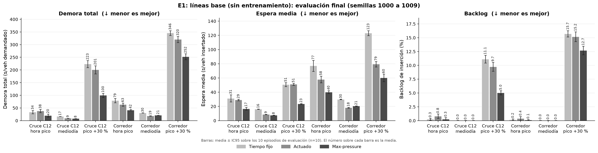
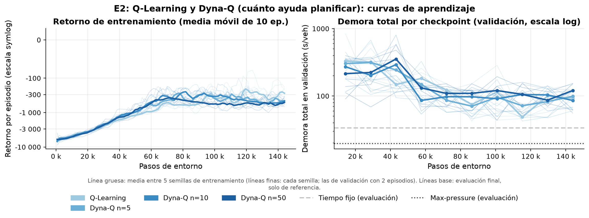
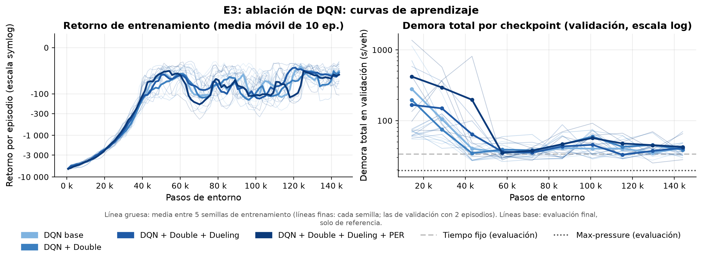
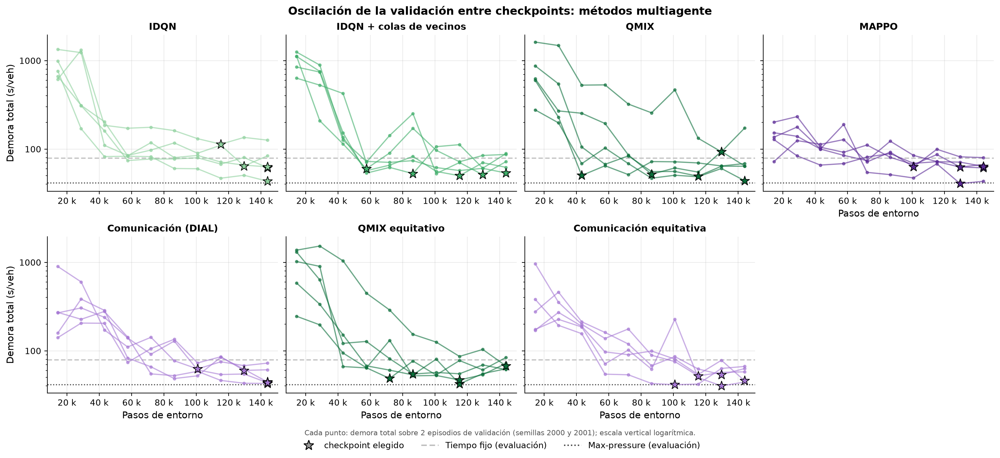
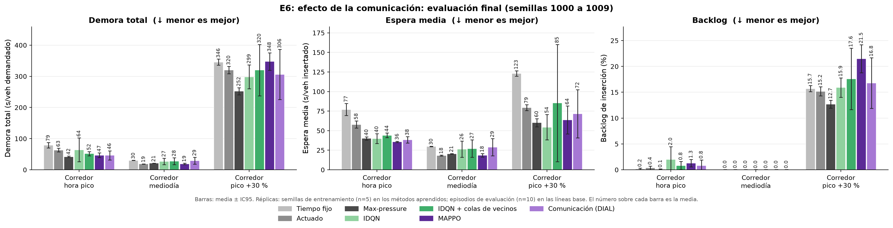
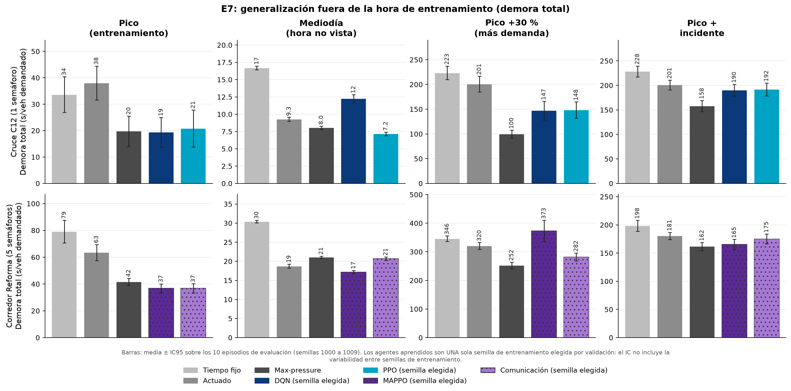
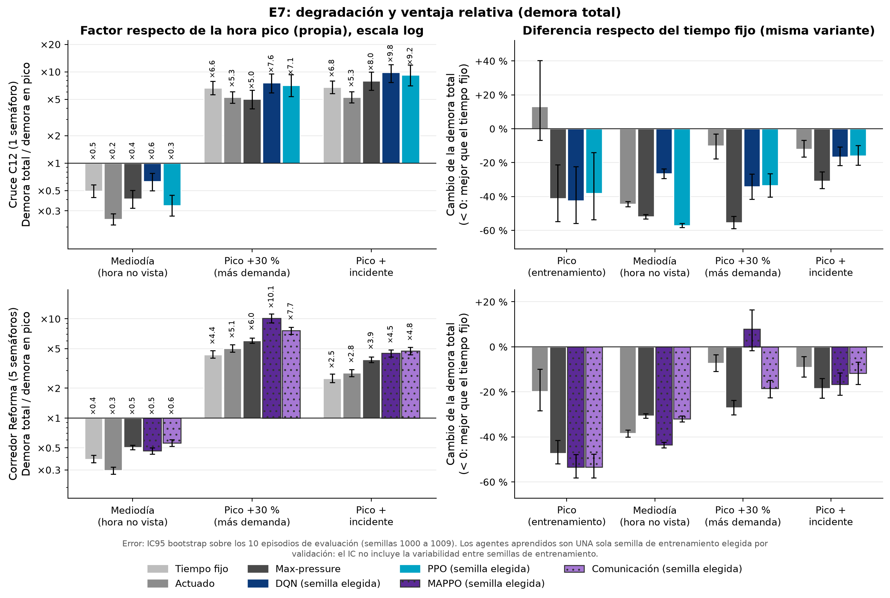
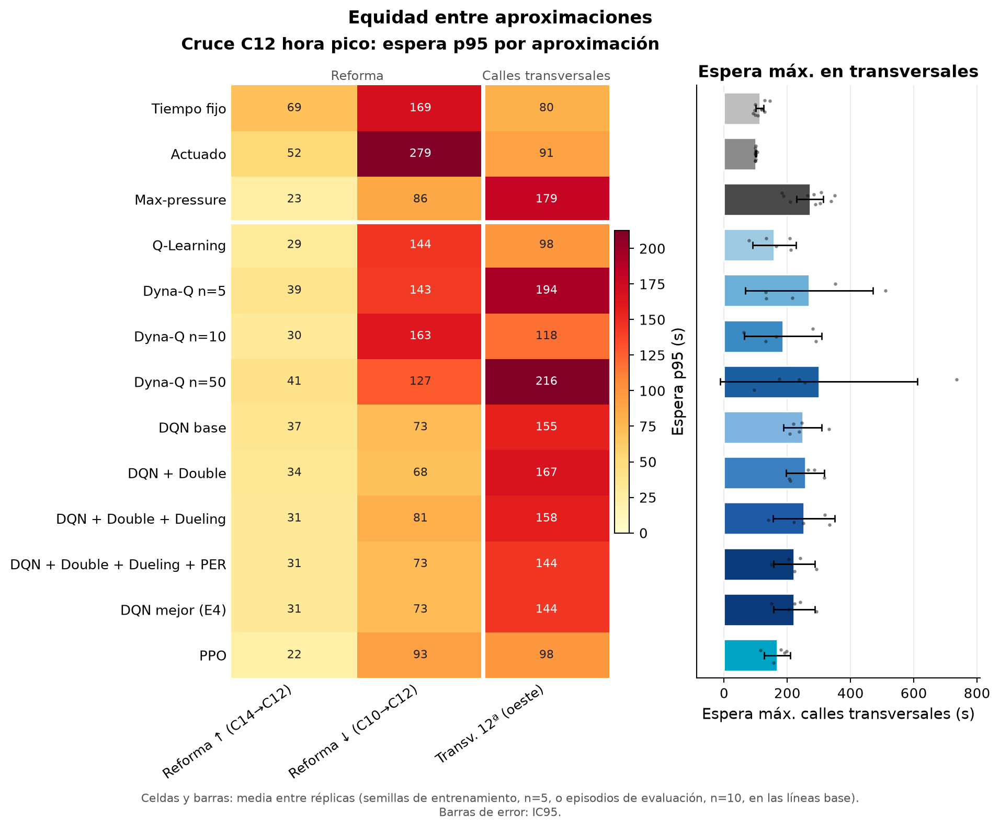

# Semáforos inteligentes en la Avenida La Reforma con aprendizaje por refuerzo multiagente

**Integrantes:** <completar>

**Curso:** CC3104 Aprendizaje por Refuerzo · Universidad del Valle de Guatemala · Ciclo 2, 2026

**Repositorio:** <completar enlace>  ·  **Fecha:** <completar>

<!-- BORRADOR v2 (resultados finales de E1 a E8). Todos los números de las secciones 7 y 8 salen de
     analysis/results/*.md (generados con `python -m analysis.make_all` desde runs/) y las figuras de docs/figures/.
     Lo que sigue marcado con "COMPLETAR", "DATO" o "<completar>" lo tiene que llenar el equipo (datos de campo,
     integrantes, tabla de uso de IA) y NO debe llenarse con valores inventados. -->

---

## Resumen

El control de semáforos con tiempos fijos no se adapta a la demanda real, y en corredores urbanos de la Ciudad de Guatemala eso se traduce en colas largas y esperas que varían mucho a lo largo del día. En este trabajo modelamos en el microsimulador SUMO un corredor de 1.65 km de la Avenida La Reforma (zonas 9 y 10) con cinco intersecciones semaforizadas consecutivas, construido a partir de la geometría de OpenStreetMap. Sobre ese escenario comparamos, con un mismo protocolo (cinco semillas de entrenamiento, diez semillas de evaluación nunca vistas, presupuesto igual de pasos de entorno e intervalos de confianza del 95 %), tres controladores sin aprendizaje (tiempo fijo, actuado y max-pressure) con una escalera de métodos de aprendizaje por refuerzo: Q-Learning y Dyna-Q tabulares y DQN (con las variantes Double, Dueling y PER) y PPO en el cruce más cargado, e IDQN, QMIX, MAPPO y comunicación aprendida entre semáforos en el corredor completo. También evaluamos la generalización ante una hora no vista, una demanda 30 % mayor y un carril cerrado, y la equidad entre la avenida principal y las calles transversales. **Los conteos vehiculares y los tiempos del semáforo fijo usados en esta versión son sintéticos y provisionales**, por lo que los resultados deben leerse como una comparación metodológica y no como una predicción del efecto en la calle.

La métrica principal es la **demora total por vehículo demandado**, que también cuenta a los vehículos que no lograron entrar a la red: con la recompensa original de `sumo-rl`, todos los agentes aprendieron a bloquear una entrada, un atajo que la espera media no detecta, y por eso entrenamos con una recompensa que incluye la espera fuera de la red. En el corredor en hora pico, MAPPO redujo la demora total a 46.8 ± 7.3 s por vehículo, frente a 79.1 ± 8.5 s del tiempo fijo (−41 %, $p$ de Holm < 0.001) y 63.4 ± 6.1 s del actuado (−26 %, $p$ de Holm = 0.043), pero **no superó a max-pressure** (41.7 ± 2.5 s; $p$ = 0.13). Ningún método aprendido lo superó, ni en el corredor ni en el cruce aislado (DQN 21.1 ± 1.6 s frente a 19.8 ± 5.8 s). El entrenamiento centralizado y la comunicación aprendida tuvieron medias menores que los aprendices independientes, pero sin diferencias detectables con cinco semillas. Fuera de la hora de entrenamiento, la ventaja sobre el tiempo fijo se mantuvo a mediodía y con un carril cerrado, mientras que con 30 % más demanda la política elegida de MAPPO quedó 8 % por encima del tiempo fijo y 48 % por encima de max-pressure. En el cruce aislado, max-pressure y los agentes aumentan entre 48 % y 140 % la espera máxima en la calle transversal respecto del tiempo fijo.

**Palabras clave:** control de semáforos, aprendizaje por refuerzo multiagente, QMIX, MAPPO, max-pressure, SUMO, Guatemala.

---

## 1. Introducción

### 1.1 El tráfico en la Ciudad de Guatemala

La Ciudad de Guatemala concentra buena parte de la actividad económica del país y recibe cada día a cientos de miles de personas que viajan desde municipios vecinos del área metropolitana. El crecimiento del parque vehicular, la escasez de alternativas de transporte masivo y una red vial con pocos ejes de alta capacidad hacen que la congestión sea uno de los problemas urbanos más visibles. <!-- DATO: agregar una o dos cifras con fuente verificable (p. ej. parque vehicular de la SAT, tiempos de viaje promedio de la Municipalidad o de un estudio publicado). No incluir cifras sin fuente. -->

La Avenida La Reforma es uno de esos ejes. Atraviesa las zonas 9 y 10, conecta el sur de la ciudad (Plaza Obelisco) con el centro y la cruzan calles transversales de una vía que alternan de sentido. Es un bulevar con arriate central y tres carriles por sentido, con semáforos a distancias muy desiguales entre sí (de poco más de cien metros a más de medio kilómetro). En la hora pico, los semáforos de tiempo fijo reparten el verde sin saber cuántos vehículos esperan en cada aproximación, y la coordinación entre cruces consecutivos depende de desfases calculados para una demanda típica que no siempre se cumple.

### 1.2 Motivación

El aprendizaje por refuerzo (RL) ofrece una forma de diseñar controladores que deciden la siguiente fase a partir del estado observado de la intersección (colas, ocupación, fase actual) y que optimizan directamente una medida de desempeño, como el tiempo de espera, por prueba y error en simulación. En la literatura hay muchos resultados favorables en redes sintéticas y en algunas ciudades de Asia, Europa y Norteamérica, pero muy pocos trabajos usan corredores de Centroamérica, con su geometría, su mezcla de calles y sus patrones de demanda. Además, los métodos multiagente con entrenamiento centralizado (CTDE), como QMIX y MAPPO, rara vez se comparan con líneas base fuertes como max-pressure bajo un protocolo con varias semillas e intervalos de confianza.

Este proyecto tiene también un propósito docente: recorre casi todo el temario del curso (bandidos, MDP, programación dinámica, Monte Carlo, TD, aproximación de funciones, gradiente de política, planificación, Deep RL y MARL) en un mismo problema aplicado, con una demo web en vivo que permite a un público no especialista comparar lado a lado el semáforo fijo y el agente.

### 1.3 Pregunta de investigación y contribuciones

> **Pregunta.** ¿Cuánto reduce el RL multiagente el tiempo de espera en un corredor real de Guatemala frente al control actual, y se mantiene esa mejora ante condiciones que no vio en el entrenamiento?

Las contribuciones de este trabajo son:

1. Un escenario reproducible del corredor de la Av. La Reforma en SUMO (5 intersecciones, georreferenciado en UTM 15N), con un generador de demanda estocástico por semilla a partir de conteos por movimiento y con perfiles de hora pico, mediodía, pico +30 % y noche.
2. Una comparación con protocolo uniforme de 3 líneas base y 16 configuraciones de RL, desde Q-Learning tabular hasta QMIX, MAPPO y comunicación aprendida, todas implementadas sobre la misma fábrica de entornos, con el mismo presupuesto, selección de *checkpoint* por validación y evaluación en semillas nunca vistas.
3. La identificación de un atajo de la recompensa estándar de `sumo-rl` (bloquear una entrada deja la demanda esperando fuera de la red sin costo) y su corrección, junto con una métrica principal, la demora total por vehículo demandado, que no se puede mejorar dejando vehículos fuera.
4. Un análisis de generalización (hora no vista, estrés de demanda e incidente) y de equidad entre la avenida y las calles transversales, incluida una variante de la recompensa que penaliza la espera máxima.
5. Una demo web en vivo (FastAPI + React) con dos simulaciones sincronizadas y la misma demanda, donde se pueden inyectar vehículos, cambiar la hora del día y provocar incidentes.

El resto del informe se organiza así: la sección 2 resume el trabajo relacionado; la 3 formaliza el problema como MDP y Dec-POMDP; la 4 describe el escenario y la demanda; la 5 los métodos; la 6 el protocolo; las secciones 7 y 8 presentan los resultados; la 9 discute ética y limitaciones; la 10 concluye y la 11 declara el uso de herramientas de IA.

---

## 2. Trabajo relacionado

**Control clásico de semáforos.** El diseño de planes de tiempo fijo se basa desde hace décadas en el método de Webster [Webster 1958], que reparte el verde en proporción al grado de saturación de cada grupo de movimientos y fija un ciclo que minimiza la demora esperada. Los controladores actuados extienden el verde mientras los detectores registran vehículos, dentro de un mínimo y un máximo. Max-pressure [Varaiya 2013] elige en cada intervalo la fase cuya "presión" (la diferencia entre los vehículos aguas arriba y aguas abajo de los movimientos que habilita) es mayor. Es una política descentralizada que no necesita conocer la demanda y que, bajo supuestos de capacidad, estabiliza las colas de la red cuando eso es posible. Por eso es una línea base exigente para cualquier método aprendido.

**RL en una intersección.** Los primeros trabajos usaron RL tabular con estados discretizados [Wiering 2000]. Con Deep RL [Mnih et al. 2015] llegaron agentes que aprenden de representaciones más ricas del estado [Genders y Razavi 2016; Wei et al. 2018]. Las mejoras del DQN que usamos en la ablación son el objetivo Double [van Hasselt et al. 2016], la arquitectura Dueling [Wang et al. 2016] y la repetición priorizada de experiencia, PER [Schaul et al. 2016]. Entre los métodos de gradiente de política, PPO [Schulman et al. 2017] con estimación de ventaja generalizada, GAE [Schulman et al. 2016], es el estándar de facto. La base teórica de los métodos tabulares es Q-Learning [Watkins y Dayan 1992], y la de la planificación con modelo aprendido es Dyna [Sutton 1990]; ambas siguen la notación de Sutton y Barto [2018].

**RL multiagente para redes de semáforos.** La forma más simple de escalar a varias intersecciones es entrenar aprendices independientes [Tan 1993], lo que hace que el entorno sea no estacionario desde el punto de vista de cada agente. MA2C [Chu et al. 2020] usa actor-crítico con información de los vecinos y un factor de descuento espacial. PressLight [Wei et al. 2019a] combina RL con una recompensa basada en presión para coordinar un corredor arterial, y CoLight [Wei et al. 2019b] usa atención en grafos para que cada intersección pondere a sus vecinos. Fuera del dominio del tráfico, el paradigma de entrenamiento centralizado con ejecución descentralizada (CTDE) dio lugar a VDN [Sunehag et al. 2018] y a QMIX [Rashid et al. 2018], que factorizan la función de valor conjunta de forma monótona, y a MAPPO [Yu et al. 2022], que muestra que PPO con un crítico centralizado es una línea base sorprendentemente fuerte en juegos cooperativos. La comunicación aprendida entre agentes, con un canal diferenciable entrenado de punta a punta, se propuso en DIAL [Foerster et al. 2016]. El marco formal de estos problemas es el Dec-POMDP [Oliehoek y Amato 2016].

**Herramientas y bancos de prueba.** SUMO [Lopez et al. 2018] es el microsimulador de tráfico abierto más usado en esta línea de investigación. `sumo-rl` [Alegre 2019] lo envuelve con las interfaces de Gymnasium y PettingZoo [Terry et al. 2021] y define la observación y la recompensa que usamos. RESCO [Ault y Sharon 2021] propone un banco de pruebas con escenarios reales y muestra que muchas comparaciones publicadas usan líneas base débiles o protocolos distintos, lo que motiva nuestro énfasis en max-pressure, semillas separadas e intervalos de confianza. Nuestras implementaciones siguen el estilo de un solo archivo de CleanRL [Huang et al. 2022], y PPO de un agente usa Stable-Baselines3 [Raffin et al. 2021].

---

## 3. Formulación

### 3.1 Un cruce como MDP

Para los métodos de un agente modelamos el cruce más cargado (C12, ver sección 4) como un MDP $\langle \mathcal{S}, \mathcal{A}, P, R, \gamma \rangle$. La dinámica $P(s' \mid s, a)$ la define SUMO y es desconocida para el agente: por eso la programación dinámica no se aplica directamente, y solo la usamos como contraste sobre el modelo empírico que aprende Dyna-Q (sección 5.2).

**Observación.** Usamos la observación por defecto de `sumo-rl`. Para un semáforo con $n_g$ fases verdes y $L$ carriles de entrada,

$$
\begin{aligned}
o_t = \big[\, &\underbrace{\mathbb{1}[\text{fase}=1], \dots, \mathbb{1}[\text{fase}=n_g]}_{\text{fase verde actual (one-hot)}},\; \underbrace{\mathbb{1}[\tau_t \ge g_{\min}]}_{\text{verde mínimo cumplido}}, \\
&\underbrace{\rho_1, \dots, \rho_L}_{\text{densidad}},\; \underbrace{q_1, \dots, q_L}_{\text{cola}} \,\big] \in [0,1]^{n_g + 1 + 2L},
\end{aligned}
$$

donde $\tau_t$ es el tiempo transcurrido en la fase actual, $\rho_l$ es el número de vehículos en el carril $l$ dividido entre su capacidad y $q_l$ es el número de vehículos detenidos (velocidad menor que 0.1 m/s) dividido entre la misma capacidad. Para C12, $n_g = 3$ y $L = 10$, así que $o_t \in [0,1]^{24}$.

**Acción.** $a_t \in \{0, \dots, n_g - 1\}$ es el índice de la siguiente fase verde. El agente decide cada $\Delta t = 5$ s. Si elige una fase distinta de la actual, el entorno inserta un amarillo de 3 s antes del nuevo verde, y no se permite cambiar de fase antes de un verde mínimo $g_{\min} = 10$ s. Estas restricciones de seguridad las impone el entorno, no el agente.

**Recompensa.** La recompensa por defecto de `sumo-rl` (`diff-waiting-time`) es la reducción del tiempo de espera acumulado en los carriles de entrada del semáforo. Al entrenar con ella encontramos que todos los agentes aprendían a **bloquear una entrada** (sección 6.2): cuando un carril se llena, su penalización queda acotada por su capacidad, y los vehículos que SUMO no puede insertar esperan fuera de la red sin costo alguno. Por eso entrenamos con una variante, `diff-waiting-time-pending`, que suma también la espera de los vehículos pendientes de inserción en las aristas de entrada del cruce:

$$
r_t = \kappa\,(W_{t-1} - W_t), \qquad W_t = \frac{1}{100} \Big[ \sum_{v \in \mathcal{V}_t} w_v(t) \;+\; \sum_{v \in \mathcal{P}_t} \big(t - t_v^{\text{salida}}\big) \Big],
$$

donde $\mathcal{V}_t$ son los vehículos presentes en los carriles de entrada del semáforo, $w_v(t)$ es el tiempo que el vehículo $v$ lleva detenido en esos carriles, $\mathcal{P}_t$ son los vehículos que deberían haber entrado por una arista de entrada del cruce y siguen pendientes, $t_v^{\text{salida}}$ es su instante de salida programado y $\kappa$ es una escala propia de cada algoritmo (sección 5). La recompensa es positiva si la acción redujo la espera acumulada. Al insertarse, un vehículo pendiente "devuelve" su espera de afuera, igual que un vehículo que cruza la línea de alto, y la suma telescópica a lo largo de un episodio es $\kappa(W_0 - W_T)$: maximizar el retorno no descontado equivale a terminar el episodio con la menor espera acumulada posible, dentro y fuera de la red. Sin vehículos pendientes coincide con la recompensa original. La recompensa solo se usa para entrenar; la evaluación sale del registro de viajes de SUMO (sección 6.2).

**Episodio y descuento.** Un episodio dura una hora simulada (3600 s), es decir, 720 decisiones por agente. Usamos $\gamma = 0.99$, cuyo horizonte efectivo $1/(1-\gamma) = 100$ decisiones equivale a unos 8 minutos de tráfico, del orden de varios ciclos semafóricos. El episodio solo se trunca por tiempo, nunca termina en un estado absorbente; por eso todos los algoritmos siguen haciendo *bootstrap* en el último paso (la bandera `terminated` es siempre 0).

### 3.2 Versión tabular

Para Q-Learning y Dyna-Q discretizamos la observación en

$$
s = \big(\text{fase},\; \mathbb{1}[\tau \ge g_{\min}],\; \ell_1, \dots, \ell_A\big), \qquad \ell_k = \begin{cases} 0 \;(\text{baja}) & \hat q_k < 0.15 \\ 1 \;(\text{media}) & 0.15 \le \hat q_k < 0.45 \\ 2 \;(\text{alta}) & 0.45 \le \hat q_k < 0.8 \\ 3 \;(\text{llena}) & \hat q_k \ge 0.8 \end{cases}
$$

donde $\hat q_k = \max_{l \in k} q_l$ es la cola del peor carril de la aproximación $k$ (una aproximación es una arista de entrada). El espacio tiene $n_g \cdot 2 \cdot 4^A$ estados. En C12 hay $A = 3$ aproximaciones (Reforma norte, Reforma sur y la 12 calle, que es de una vía), así que $|\mathcal{S}| = 3 \cdot 2 \cdot 64 = 384$. La tabla Q es un diccionario y solo ocupa memoria para los estados visitados. Una primera versión con tres niveles y la cola media de cada aproximación no distinguía un acceso lleno de uno solo cargado, y los agentes tabulares convergían a un ciclo de verdes mínimos que dejaba salir de la red la cola de Reforma hacia el norte; el nivel "llena" y el máximo por aproximación redujeron ese efecto (`docs/ajuste_aprendizaje.md`, cambio 7). Aun así, el estado no ve a los vehículos pendientes de inserción ni cuánto tiempo lleva la fase en verde más allá del verde mínimo.

### 3.3 El corredor como Dec-POMDP

En el corredor completo hay $n = 5$ agentes, uno por semáforo. Lo modelamos como un Dec-POMDP cooperativo [Oliehoek y Amato 2016]

$$
\big\langle \mathcal{I}, \mathcal{S}, \{\mathcal{A}_i\}_{i \in \mathcal{I}}, P, R, \{\Omega_i\}_{i \in \mathcal{I}}, O, \gamma \big\rangle,
$$

con $\mathcal{I} = \{\text{C15}, \text{C14}, \text{C12}, \text{C10}, \text{C06}\}$. El estado verdadero $s$ incluye la posición y la velocidad de todos los vehículos del corredor; cada agente solo recibe su observación local $o_i$ (sección 3.1). La observabilidad es parcial: un semáforo no ve los pelotones que vienen desde el cruce anterior hasta que entran a sus carriles, y la misma observación local es compatible con estados globales muy distintos. Cada agente puede recibir su recompensa local $r_i$ (sección 3.1), pero todos los métodos multiagente se entrenan con la recompensa de equipo $r = \sum_i r_i$. Con recompensa local, IDQN y la comunicación aprendida dejaban sin entrar cientos de vehículos por las dos entradas del corredor: un cruce aguas abajo puede llenar el enlace corto que lo separa del anterior con una penalización acotada y empujar la cola hacia un cruce que no puede resolverla, una externalidad que la recompensa local no castiga. Con la recompensa de equipo, E5 compara solo el grado de centralización del aprendizaje y no la recompensa.

En CTDE, durante el entrenamiento se dispone de un estado global $s_t$ que en nuestro caso es la concatenación de las observaciones rellenadas de los cinco agentes más la cola total de cada cruce:

$$
s_t = \big[\tilde o_1, \dots, \tilde o_5,\; Q_1, \dots, Q_5\big], \qquad Q_i = \textstyle\sum_{l} q_{i,l}.
$$

En la ejecución cada semáforo actúa solo con su $o_i$ (y, en los métodos con comunicación, con los mensajes de sus vecinos inmediatos).

### 3.4 Heterogeneidad: relleno y máscaras de acción

Los cruces reales de Reforma no son idénticos. C15 tiene 2 fases verdes y los demás 3; el número de carriles de entrada va de 9 a 11, y las dimensiones de observación son 21, 22, 24, 26 y 22. Para compartir parámetros entre agentes (QMIX, MAPPO y comunicación) aplicamos:

- **Relleno estructurado.** Cada bloque de la observación (fase, bandera, densidad y cola) se rellena con ceros por separado hasta $n_g^{\max} = 3$ y $L^{\max} = 11$, de modo que la columna $k$ significa lo mismo para todos los agentes. La dimensión rellenada es $3 + 1 + 2 \cdot 11 = 26$. Con un relleno al final, la densidad de un cruce caería en la columna de fase de otro.
- **Identificador del agente.** A la entrada de las redes compartidas se agrega un *one-hot* del agente, para que una sola red pueda comportarse distinto en cada cruce.
- **Máscaras de acción.** Las acciones $a \ge n_g^{(i)}$ no existen en el cruce $i$. Se enmascaran con $-10^9$ en el $\arg\max$ greedy, en la exploración $\varepsilon$-greedy, en el máximo del objetivo TD y en los *logits* antes del *softmax* del actor:

$$
\tilde Q_i(o, a) = \begin{cases} Q_i(o, a) & a < n_g^{(i)} \\ -10^{9} & \text{en otro caso.} \end{cases}
$$

IDQN, que por defecto usa una red por agente sin compartir parámetros, no necesita el identificador, pero sí respeta las máscaras.

---

## 4. Escenario

### 4.1 Tramo elegido

El escenario es un tramo de la Avenida La Reforma entre la Plaza Obelisco (16 calle) y la 5a calle, con cinco intersecciones semaforizadas consecutivas (en OpenStreetMap no hay otros semáforos sobre Reforma entre ellas). La Tabla 1 las resume, de sur a norte.

**Tabla 1.** Intersecciones del corredor (de sur a norte). Las fases y carriles son los del modelo en SUMO.

| TLS | Intersección | Transversal (una vía) | Fases verdes | Carriles de entrada | Dim. obs. |
|---|---|---|---|---|---|
| C15 | Reforma y 15 calle | hacia el oeste, 3 carriles | 2 | 9 | 21 |
| C14 | Reforma y 14 calle | hacia el este, 3 carriles | 3 | 9 | 22 |
| C12 | Reforma y 12 calle | hacia el este, 3 carriles | 3 | 10 | 24 |
| C10 | Reforma y 10a calle | hacia el oeste, 4 carriles | 3 | 11 | 26 |
| C06 | Reforma y 6a calle | hacia el este, 3 carriles | 3 | 9 | 22 |

Las distancias entre cruces consecutivos son 123 m, 302 m, 296 m y 547 m, y el corredor mide 1.65 km. Esa desigualdad hace interesante la coordinación: entre C15 y C14 caben muy pocos vehículos, de modo que una cola en C14 bloquea rápidamente a C15, mientras que entre C10 y C06 los pelotones se dispersan. Las transversales son pares de una vía que alternan de sentido, lo típico de las zonas 9 y 10.

Para los métodos de un agente usamos el cruce **C12 (Reforma y 12 calle)**, recortado del corredor. Según los conteos (sintéticos, ver 4.3), la 12 calle es la transversal más cargada. Además, C12 tiene una bahía de giro a la izquierda en el sentido sur.

<!-- La figura 1 se genera con `python docs/informe/figura_escenario.py` (sin simular). -->

### 4.2 Construcción de la red a partir de OpenStreetMap

El plan original era importar el área de OSM con `netconvert` y corregirla a mano en `netedit`. Esa importación (que el repositorio conserva como diagnóstico) produce 280 aristas y 18 semáforos en la zona. En OSM, Reforma tiene cuatro calzadas (las dos centrales y dos carriles auxiliares), hay decenas de enlaces y retornos en el arriate central, y la unión automática de semáforos fusiona la 15 y la 14 calle en un solo controlador con un ciclo de 444 s. Limpiar eso a mano habría tomado días, así que aplicamos la mitigación prevista en el plan y construimos el corredor en XML plano con la geometría real. Del extracto de OSM se toman:

- las coordenadas de cada cruce (la media de sus nodos `highway=traffic_signals`) y de los extremos;
- el sentido de cada transversal de una vía;
- el número de carriles (`lanes=*`).

Con eso se generan los archivos de nodos, aristas, conexiones y programas, y `netconvert` proyecta la red a UTM 15N, de modo que la red queda georreferenciada (la demo web muestra latitud y longitud reales).

El modelo de cada cruce es el siguiente. Reforma es un bulevar dividido con tres carriles por sentido a 50 km/h, y cada cruce del bulevar es un solo nodo y un solo semáforo (el arriate queda dentro del área de la intersección). Hay un cuarto carril exclusivo de giro a la izquierda en el sentido sur en C12 y en el sentido norte en C10. Las transversales son de una vía, a 40 km/h, con una cuadra antes (170 m) y una después (150 m) del cruce. Desde Reforma solo existe el giro legal hacia la transversal (a la derecha o a la izquierda según su sentido); desde la transversal se permiten los tres movimientos, y no hay vueltas en U. Las fases verdes son las de la Tabla 1: Reforma con giro permisivo, un adelanto con izquierda protegida en un sentido (excepto en C15) y la transversal.

### 4.3 Demanda: conteos sintéticos y provisionales

> **Advertencia.** Los conteos vehiculares usados en esta versión del informe son **sintéticos y provisionales**. Los generó un script del repositorio (`env/synthetic_counts.py`) con valores plausibles; **no provienen de conteos en campo**. El plan del proyecto prevé reemplazarlos por conteos propios en video de 15 minutos por intersección, en hora pico y a mediodía. <!-- COMPLETAR: si se llegan a hacer los conteos reales, describir aquí fecha, hora, intersecciones, método de conteo y responsables, y quitar esta advertencia. -->

Los conteos tienen formato largo (intersección, aproximación, movimiento, vehículos en 15 minutos). Los valores sintéticos de hora pico son:

- Reforma recibe 2200 veh/h hacia el norte (desde la Plaza Obelisco) y 2450 veh/h hacia el sur (desde la 5a calle), unos 730 a 820 veh/h por carril. En cada cruce gira hacia la transversal entre 8 % y 18 % de ese flujo, salvo dos giros a la izquierda permisivos en carril compartido de los bordes de entrada (2 % y 8 %).
- Las transversales llevan entre 450 y 700 veh/h (la 12 calle es la más cargada), con un reparto de 58 % recto, 30 % hacia Reforma norte y 12 % hacia Reforma sur.
- Los flujos son consistentes a lo largo del corredor: lo que llega a un cruce es lo que siguió recto en el anterior más lo que entró desde su transversal. En total entran 7352 veh/h al corredor y 4896 veh/h al cruce C12.
- El mediodía tiene cerca del 65 % del volumen del pico (4788 veh/h), con más carga hacia el norte y más giros.

Estos valores son la versión calibrada (v2) de los conteos sintéticos: la versión inicial (1800 y 1600 veh/h en Reforma) dejaba el corredor muy por debajo de su capacidad, casi sin demora en los semáforos (sección 4.5).

**De conteos a rutas.** Usamos un modelo de proporciones de giro, la misma idea de `jtrrouter`, pero resuelto de forma exacta en lugar de por muestreo. Cada arista de entrada al corredor es una fuente con flujo $F_e$ igual a su volumen contado (en veh/h) multiplicado por la escala del perfil. En cada cruce, un vehículo que llega por la aproximación $k$ toma el movimiento $m$ con probabilidad $p_{k,m} = c_{k,m} / \sum_{m'} c_{k,m'}$. Al enumerar todos los caminos, cada ruta $\pi$ (una fuente y una secuencia de movimientos) recibe una tasa

$$
\lambda_\pi = F_{e(\pi)} \prod_{(k, m) \in \pi} p_{k,m},
$$

y sus salidas siguen un proceso de Poisson de tasa $\lambda_\pi$ en $[0, T)$: $N_\pi \sim \text{Poisson}(\lambda_\pi T)$ con tiempos uniformes. Así, el tráfico que sigue recto por Reforma cruza varias intersecciones, y los volúmenes contados aguas abajo se reproducen en valor esperado. La generación es determinista por semilla: semillas distintas dan realizaciones distintas de la misma demanda media. Todos los vehículos son de un tipo `passenger` calibrado (longitud 4.5 m, aceleración 2.2 m/s², desaceleración 4.0 m/s², imperfección del conductor $\sigma = 0.6$, tiempo de reacción $\tau = 1.2$ s, separación mínima 2.5 m y factor de velocidad con distribución normal truncada de media 0.8 y desviación 0.1 en $[0.6, 1.1]$). Con esos parámetros la descarga en verde baja a unos 1530 veh/h por carril y la velocidad deseada a unos 40 km/h, lo que representa de forma gruesa la fricción que la red no modela (buses, carriles auxiliares, calles sin semáforo y peatones).

**Perfiles de demanda.** La Tabla 2 muestra los cuatro perfiles. El entrenamiento usa solo la hora pico; los demás perfiles sirven para evaluar la generalización (E7) y como opciones de la demo.

**Tabla 2.** Perfiles de demanda.

| Perfil | Conteos | Escala | Uso |
|---|---|---|---|
| `pico` | hora pico | 1.0 | entrenamiento |
| `mediodia` | mediodía | 1.0 | evaluación: hora no vista |
| `pico_x13` | hora pico | 1.3 | evaluación: estrés (+30 %) |
| `noche` | hora pico | 0.3 | demo y evaluación extra (sintético) |

### 4.4 Programas de referencia

El **tiempo fijo** debía ser el ciclo medido con cronómetro en campo, es decir, "lo que hay hoy". Mientras no exista esa medición, usamos un ciclo común de 110 s con el verde repartido según Webster, $g_i \propto y_i = q_i / (n_i \cdot 1800)$, a partir de los conteos sintéticos de hora pico (con verdes mínimos), y desfases que forman una onda verde hacia el norte a 40 km/h. El reparto se calculó con la versión inicial de los conteos y la calibración de la sección 4.5 no lo modificó (sirvió justamente de referencia para calibrar). Es, por lo tanto, un **tiempo fijo sintético y provisional**: está diseñado para una demanda con las mismas proporciones que la del simulador, así que probablemente está mejor ajustado que el semáforo real, aunque no corresponde a los volúmenes calibrados. <!-- COMPLETAR: reemplazar por los ciclos cronometrados en campo, si se miden. -->

El **actuado** usa las mismas fases con el controlador `actuated` de SUMO: Reforma entre 15 y 70 s, la izquierda protegida entre 8 y 25 s y la transversal entre 10 y 50 s, con un intervalo máximo entre vehículos (*max-gap*) de 3 s.

### 4.5 Calibración y validación

La validación compara el tiempo de viaje simulado de los vehículos que recorren todo el corredor con el que reportaría Google Maps a la misma hora. La demanda sintética se calibró (ajustando los parámetros del tipo de vehículo y la escala de cada flujo) hasta que, con el tiempo fijo, ese tiempo quedara a ±15 % de la referencia, sin teletransportes (< 1 %) y con un *backlog* de inserción menor que 2 %. Con la versión inicial de los conteos el corredor se recorría en unos 160 s por sentido; con la calibrada, el tiempo fijo da 342 s hacia el norte y 305 s hacia el sur (semillas 1000 a 1002) y 335 s y 304 s con las diez semillas de evaluación, frente a una referencia de 330 s y 300 s. Esa referencia es un **marcador de posición**, no una consulta real a Google Maps, así que la calibración solo garantiza que el corredor simulado opera cerca de su capacidad, no que reproduzca el tráfico real. <!-- COMPLETAR: consultar el tiempo real de Google Maps (día y hora) para el tramo 16 calle → 5a calle en ambos sentidos, actualizar REFERENCE_S en env/validate.py y reportar aquí la tabla de validación. -->

---

## 5. Métodos

Todos los métodos comparten la misma fábrica de entornos (SUMO 1.28 + `sumo-rl` 1.4.5, con `libsumo` para entrenar), la misma interfaz de política (`reset(sumo_env)` y `act(obs) -> {semáforo: fase}`) y el mismo registro de entrenamiento. Los agentes de un cruce trabajan sobre `cruce_pico`, y los multiagente sobre `reforma_pico`.

### 5.1 Líneas base sin aprendizaje

- **Tiempo fijo.** SUMO ejecuta el programa estático de la sección 4.4; el agente no interviene.
- **Actuado.** SUMO ejecuta el programa `actuated` de la sección 4.4.
- **Max-pressure** [Varaiya 2013]. Cada 5 s, y respetando el mismo verde mínimo y el mismo amarillo que los agentes de RL, cada semáforo elige la fase

$$
a_t = \arg\max_{p} \Big[ \sum_{i \in \mathcal{E}(p)} \phi_i(t) - \sum_{o \in \mathcal{O}(p)} \phi_o(t) \Big], \qquad \phi_l(t) = \frac{n_l(t)\,(\ell_{\text{veh}} + 2.5\ \text{m})}{L_l},
$$

donde $\mathcal{E}(p)$ y $\mathcal{O}(p)$ son los **conjuntos** de carriles de entrada y de salida que abre la fase $p$ (cada carril contado una vez), $n_l(t)$ es el número de vehículos en el carril $l$, $\ell_{\text{veh}}$ su longitud y $L_l$ la longitud del carril; $\phi_l$ es la ocupación del carril. En caso de empate se mantiene la fase actual, para no gastar amarillos, y después de $g_{\max} = 60$ s de verde se pasa a la fase con mayor presión que tenga vehículos esperando (`sumo-rl` no impone el verde máximo). Es una versión con pesos unitarios (sin tasas de saturación) de la política original. Las tres decisiones de diseño corrigen una primera versión que sumaba la presión por enlace controlado: las fases de Reforma (unos 8 enlaces) vencían siempre a las transversales (unos 5) con la misma cola por carril, y el corredor se trababa. Usar ocupación y no vehículos crudos evita que un enlace corto lleno (86 m) pese lo mismo que uno largo casi vacío (507 m).

### 5.2 Métodos tabulares: Q-Learning y Dyna-Q

**Q-Learning** [Watkins y Dayan 1992] es control TD *off-policy*:

$$
Q(s,a) \leftarrow Q(s,a) + \alpha \Big[ r + \gamma \max_{a'} Q(s', a') - Q(s,a) \Big],
$$

con $\alpha = 0.1$, $\gamma = 0.99$ y exploración $\varepsilon$-greedy con $\varepsilon$ decreciendo linealmente de 1.0 a 0.05 durante el 70 % del entrenamiento (la misma regla de los bandidos multibrazo: explorar mucho al principio y volverse greedy asintóticamente). Ante un estado nunca visto, la política greedy mantiene la fase actual. El estado es el de la sección 3.2 (384 estados en C12).

**Dyna-Q** [Sutton 1990] agrega un modelo empírico $\hat M(s,a)$ que guarda los últimos 20 resultados $(r, s', \text{term})$ observados para cada par visitado. Después de cada paso real hace $n$ actualizaciones de planificación: muestrea un par $(s,a)$ visitado y uno de sus resultados, y aplica la misma regla de Q-Learning. En E2 variamos $n \in \{5, 10, 50\}$ para medir la eficiencia de muestras. Como contraste con la programación dinámica, al final del entrenamiento se ejecuta iteración de valor sobre el modelo empírico,

$$
Q(s,a) = \frac{1}{|\hat M(s,a)|} \sum_{(r, s') \in \hat M(s,a)} \Big[ r + \gamma \max_{a'} Q(s', a') \Big],
$$

y su política greedy se puede evaluar igual que las demás.

### 5.3 DQN y variantes

La red Q es un perceptrón de dos capas ocultas de 64 unidades con ReLU, entrenado con Adam (tasa de aprendizaje $2.5 \cdot 10^{-4}$), *buffer* de 50 000 transiciones, lotes de 64, copia dura a la red objetivo cada 2000 pasos, inicio del aprendizaje a los 1000 pasos, pérdida de Huber, recorte del gradiente en norma 10, recompensa escalada por $\kappa = 0.1$ y $\varepsilon$ lineal de 1.0 a 0.05 durante el 50 % del presupuesto. Con la recompensa sin escalar la pérdida de Huber trabajaba casi siempre en su tramo lineal y las Q se sobreestimaban, y con tasa $10^{-3}$ la política se degradaba al final del entrenamiento (`docs/ajuste_aprendizaje.md`, cambio 3). El objetivo TD del DQN base [Mnih et al. 2015] es

$$
y = r + \gamma\,(1 - d)\,\max_{a'} Q_{\theta^-}(s', a'),
$$

donde $\theta^-$ son los parámetros de la red objetivo y $d$ es la bandera de estado terminal (siempre 0 aquí, porque el episodio solo se trunca). La ablación E3 agrega tres mejoras de forma acumulativa:

- **Double DQN** [van Hasselt et al. 2016]. La red en línea elige la acción y la red objetivo la evalúa, lo que reduce la sobreestimación del máximo:
$$
y = r + \gamma\,(1-d)\, Q_{\theta^-}\!\Big(s', \arg\max_{a'} Q_\theta(s', a')\Big).
$$
- **Dueling** [Wang et al. 2016]. La red tiene un cuerpo compartido y dos cabezas, una para el valor y otra para la ventaja, combinadas de forma identificable:
$$
Q(s,a) = V(s) + A(s,a) - \frac{1}{|\mathcal{A}|}\sum_{a'} A(s,a').
$$
- **PER** [Schaul et al. 2016]. Las transiciones se muestrean con probabilidad proporcional a su error TD, mediante un árbol de sumas, y el sesgo se corrige con pesos de muestreo por importancia:
$$
P(i) = \frac{p_i^{\alpha}}{\sum_k p_k^{\alpha}}, \qquad p_i = |\delta_i| + \epsilon, \qquad w_i = \frac{\big(N\,P(i)\big)^{-\beta}}{\max_j w_j},
$$
con $\alpha = 0.6$ y $\beta$ que crece linealmente de 0.4 a 1 a lo largo del entrenamiento. Las transiciones nuevas entran con la prioridad máxima vista.

Las configuraciones de E3 son `dqn_vanilla`, `dqn_double`, `dqn_double_dueling` y `dqn_double_dueling_per`.

### 5.4 PPO

PPO [Schulman et al. 2017] (implementación de Stable-Baselines3) optimiza el objetivo recortado

$$
L^{\text{CLIP}}(\theta) = \mathbb{E}_t\Big[\min\big(\rho_t(\theta)\,\hat A_t,\; \operatorname{clip}(\rho_t(\theta), 1-\epsilon, 1+\epsilon)\,\hat A_t\big)\Big], \qquad \rho_t(\theta) = \frac{\pi_\theta(a_t \mid s_t)}{\pi_{\theta_{\text{old}}}(a_t \mid s_t)},
$$

con ventajas GAE [Schulman et al. 2016]

$$
\delta_t = r_t + \gamma V(s_{t+1}) - V(s_t), \qquad \hat A_t = \sum_{l \ge 0} (\gamma\lambda)^l\, \delta_{t+l},
$$

y pérdida total $-L^{\text{CLIP}} + c_v L^{V} - c_e \mathcal{H}[\pi_\theta]$. La recompensa se normaliza con una media móvil de su retorno (`VecNormalize` solo sobre la recompensa), porque con el término de *backlog* tiene colas pesadas y, sin escalar, la pérdida del valor dominaba la actualización. Los hiperparámetros son $\epsilon = 0.2$, $\lambda = 0.95$, $c_v = 0.5$, $c_e = 0.01$, tasa de aprendizaje $3 \cdot 10^{-4}$, *rollouts* de 720 pasos (un episodio), 10 épocas, lotes de 64 y redes de actor y crítico de 2×64. En la evaluación se usa la moda de la política categórica. Usamos PPO, y no SAC o TD3, porque la acción es discreta: TD3 es un método de gradiente de política determinista y SAC, en su forma original, usa el truco de reparametrización; ambos necesitan diferenciar Q respecto de una acción continua.

### 5.5 IDQN: aprendices independientes

IDQN entrena un Double DQN por semáforo, cada uno con su red (2×128), su optimizador, su *buffer* y su red objetivo (actualizada con promedio de Polyak, $\tau = 0.005$), con tasa de aprendizaje $10^{-4}$ y la recompensa de equipo escalada por $\kappa = 0.02$ (equivalente a 0.1 por cruce). Cada agente trata a los demás como parte del entorno, de modo que, desde su punto de vista, $P(o_i' \mid o_i, a_i)$ cambia a medida que los vecinos aprenden. Esto viola el supuesto de Markov del objetivo TD y hace que las transiciones viejas del *buffer* describan vecinos que ya no existen. Aun así, IDQN es una línea base multiagente fuerte en control de tráfico [Chu et al. 2020]. Con la opción `neighbor_obs`, a la observación de cada agente se le agregan los vectores de cola por carril de sus vecinos inmediatos en el corredor (la "comunicación v1" de E6).

### 5.6 QMIX

QMIX [Rashid et al. 2018] aprende una utilidad por agente $Q_i(o_i, a_i)$ con una red compartida (2×128, con observación rellenada e identificador del agente) y las combina en un valor conjunto mediante una red mezcladora cuyos pesos generan hiperredes condicionadas al estado global $s$:

$$
Q_{\text{tot}}(s, \mathbf{a}) = \mathbf{w}_2(s)^{\top}\, \operatorname{ELU}\!\Big( W_1(s)^{\top} \mathbf{Q} + \mathbf{b}_1(s) \Big) + V(s), \qquad \mathbf{Q} = \big[Q_1(o_1,a_1), \dots, Q_n(o_n,a_n)\big],
$$

con $W_1(s) = |\,h_1(s)\,|$ y $\mathbf{w}_2(s) = |\,h_2(s)\,|$ (valor absoluto elemento a elemento). Como los pesos son no negativos y ELU es creciente,

$$
\frac{\partial Q_{\text{tot}}}{\partial Q_i} \ge 0 \quad \forall i \quad\Longrightarrow\quad \arg\max_{\mathbf{a}} Q_{\text{tot}}(s, \mathbf{a}) = \Big( \arg\max_{a_1} Q_1, \dots, \arg\max_{a_n} Q_n \Big),
$$

es decir, cada semáforo puede actuar de forma greedy con su propia $Q_i$ en la ejecución (propiedad IGM), mientras que el entrenamiento usa la recompensa de equipo. El objetivo TD es Double-Q con máscaras sobre transiciones conjuntas:

$$
a_i^{*} = \arg\max_{a \text{ válida}} Q_i(o_i', a; \theta), \qquad y = r + \gamma\,(1-d)\, Q_{\text{tot}}\big(s', \{Q_i(o_i', a_i^{*}; \theta^-)\}_i;\, \theta^-\big),
$$

con pérdida de Huber sobre $Q_{\text{tot}}(s, \mathbf{a}) - y$ (con la pérdida cuadrática del artículo original, QMIX divergía en este problema). A diferencia del artículo original, la red de agente es un perceptrón sin GRU: la observación ya incluye la fase actual y la bandera de verde mínimo, y así el *buffer* sigue siendo por transición. La dimensión de la mezcla es 32 y la de las hiperredes 64; $\varepsilon$ decae de 1.0 a 0.05 durante el 30 % del presupuesto, la tasa de aprendizaje es $10^{-4}$, la red objetivo se actualiza con Polyak ($\tau = 0.005$) y la recompensa de equipo se escala por $\kappa = 0.02$. El objetivo suave fue lo que estabilizó la mezcladora: con copias duras frecuentes la pérdida crecía y aparecían teletransportes (`docs/ajuste_aprendizaje.md`, cambio 5). La misma implementación admite una mezcla aditiva, VDN [Sunehag et al. 2018], o ninguna.

### 5.7 MAPPO

MAPPO [Yu et al. 2022] usa un actor compartido $\pi_\theta(a_i \mid [\tilde o_i, \text{id}_i])$ (2×128, Tanh, con las fases inválidas enmascaradas antes del *softmax*) y un crítico centralizado $V_\phi(s)$ (2×256) sobre el estado global, que solo se usa durante el entrenamiento. Las ventajas se calculan con GAE sobre la recompensa de equipo, con *bootstrap* $V(s_T)$ en la truncación, y se comparten entre agentes. Cada agente aporta un término recortado

$$
L^{\text{CLIP}} = \mathbb{E}_{t,i}\Big[\min\big(\rho_{t,i} \hat A_t,\; \operatorname{clip}(\rho_{t,i}, 1-\epsilon, 1+\epsilon)\, \hat A_t\big)\Big], \qquad \rho_{t,i} = \frac{\pi_\theta(a_{t,i} \mid o_{t,i})}{\pi_{\theta_{\text{old}}}(a_{t,i} \mid o_{t,i})},
$$

más un bono de entropía, una pérdida de valor recortada y una normalización móvil del valor, como recomienda el artículo. En E5, cada *rollout* tiene 240 pasos (3 actualizaciones por episodio), con 5 épocas y 4 minilotes por actualización, recompensa escalada por $\kappa = 0.1$ y tasa de aprendizaje $5 \cdot 10^{-4}$ con decaimiento lineal a cero (con tasa constante, el retorno de entrenamiento empeoraba después de unos 100 episodios).

### 5.8 Comunicación aprendida

Siguiendo la idea de DIAL [Foerster et al. 2016], cada semáforo $j$ emite un mensaje continuo de dimensión 6,

$$
m_j = \tanh\big(f_{\text{msg}}([\tilde o_j, \text{id}_j])\big), \qquad Q_i = f_Q\big([\tilde o_i, \text{id}_i, m_{N(i)_1}, m_{N(i)_2}]\big),
$$

donde $N(i)$ son los vecinos inmediatos de $i$ en el corredor (las posiciones vacías de los extremos reciben un mensaje nulo). El *buffer* guarda observaciones, no mensajes: al entrenar, los mensajes se recalculan con el codificador actual, de modo que el gradiente de la pérdida TD del receptor $i$ atraviesa $m_j$ y llega al emisor $j$ (canal diferenciable). El aprendiz es el mismo Double-Q conjunto de QMIX (con los mismos hiperparámetros), pero sin mezcladora y con la recompensa de equipo de cada paso como objetivo de cada agente, igual que `idqn_neighbor_obs`. Así, E6 compara "colas de los vecinos diseñadas a mano" contra "mensajes aprendidos". La ejecución sigue siendo descentralizada: cada agente solo necesita los mensajes de sus vecinos.

**Nota para la ablación.** `comm` comparte parámetros entre agentes (con identificador) y `idqn_neighbor_obs` no. Una comparación estricta requeriría además IDQN con `shared_params: true` y `neighbor_obs: true`, variante que **no se corrió**; por eso la diferencia entre ambos en E6 mezcla el efecto de los mensajes con el de compartir parámetros.

### 5.9 Detalles comunes de implementación

Los agentes multiagente son implementaciones propias en estilo CleanRL (cada algoritmo cabe en un archivo de 200 a 300 líneas). Preferimos no usar BenchMARL ni EPyMARL por la incompatibilidad de versiones con el entorno de PettingZoo de `sumo-rl` (fijado en la versión 1.24.3) y por la necesidad de relleno estructurado y máscaras en varios puntos de cada algoritmo. Todas las corridas registran una fila por episodio (retorno, espera media, pasos de entorno y tiempo), guardan la configuración resuelta y la semilla, y se entrenan con la recompensa de la sección 3.1. Los hiperparámetros finales de cada método salieron de corridas cortas de sanidad con una semilla, documentadas con sus números de antes y después en `docs/ajuste_aprendizaje.md`; no hubo una búsqueda sistemática. La Tabla 3 resume la escalera de métodos.

**Tabla 3.** Métodos comparados.

| Método | Familia | Escenario | Implementación | Experimentos |
|---|---|---|---|---|
| Tiempo fijo, actuado | sin RL | ambos | programas de SUMO | E1, E7, E8 |
| Max-pressure | sin RL | ambos | propia (TraCI) | E1, E7, E8 |
| Q-Learning, Dyna-Q ($n$ = 5, 10, 50) | tabular | `cruce_pico` | propia | E2 |
| DQN (vanilla, +Double, +Dueling, +PER) | basado en valor | `cruce_pico` | propia (estilo CleanRL) | E3, E4, E7 |
| PPO | gradiente de política | `cruce_pico` | Stable-Baselines3 | E4, E7 |
| IDQN (± colas de vecinos) | MARL independiente | `reforma_pico` | propia | E5, E6 |
| QMIX | MARL CTDE (valor) | `reforma_pico` | propia | E5 |
| MAPPO | MARL CTDE (actor-crítico) | `reforma_pico` | propia | E5, E7 |
| Comunicación (DIAL) | MARL con mensajes | `reforma_pico` | propia | E6, E7 |
| QMIX y comunicación con penalización de equidad | MARL | `reforma_pico` | propia | E8 |

---

## 6. Protocolo experimental

### 6.1 Semillas, presupuesto y selección del modelo

- **Semillas de entrenamiento.** Cada configuración de RL se entrena con 5 semillas (0 a 4). Dentro de una corrida, el episodio $e$ usa una semilla de demanda derivada de $(\text{semilla}, e)$, de modo que cada episodio ve una realización distinta, pero reproducible, de la demanda de hora pico.
- **Presupuesto igual.** Todas las configuraciones de RL de E2 a E6 y las variantes de E8 reciben 200 episodios de 3600 s, es decir, $200 \times 720 = 144\,000$ decisiones por agente y por corrida (en el corredor, cada uno de los cinco semáforos toma 144 000 decisiones). PPO usa el mismo número de pasos de entorno que DQN, y las programaciones de $\varepsilon$ y de la tasa de aprendizaje se escalan con el presupuesto. El presupuesto se fijó con corridas de sanidad: la mayoría de los métodos llega a una meseta del retorno de entrenamiento entre los episodios 60 y 140, e IDQN es el único que sigue mejorando despacio al final (`docs/ajuste_aprendizaje.md` §6).
- **Selección del *checkpoint*.** Cada corrida guarda un *checkpoint* cada 20 episodios (10 por corrida). Al terminar, cada uno se evalúa en el escenario de entrenamiento con episodios completos de 3600 s y las semillas de validación 2000 y 2001 (las dos primeras de `VAL_SEEDS` = 2000 a 2004; las otras tres no se usaron, para limitar el costo), y el de menor demora total (sección 6.2) se copia a `best/`. Ese es el modelo que se evalúa. Las curvas de validación oscilan mucho entre *checkpoints* consecutivos (sección 7.5), y evaluar el último modelo habría mezclado esa oscilación con la comparación entre métodos. Como el puntaje de validación es el mínimo de 10 valores medidos con 2 episodios, es optimista; la evaluación final, en semillas aparte, no hereda ese sesgo.
- **Evaluación final.** El modelo de `best/` se evalúa en 10 episodios con las semillas de demanda 1000 a 1009 (`EVAL_SEEDS`), que nunca se usan para entrenar ni para elegir nada, en el escenario de entrenamiento y en los de evaluación (`cruce_{pico, mediodia}` para los agentes de un cruce y `reforma_{pico, mediodia, pico_x13}` para los multiagente). La semilla de SUMO coincide con la de demanda. Las tres familias de semillas son disjuntas.
- **Semilla para E7.** De cada familia se evalúa una sola semilla de entrenamiento, la de mejor puntaje de validación (`selection.csv`), sin mirar `EVAL_SEEDS`: DQN = Double+Dueling+PER de E3, semilla 1; PPO, semilla 0; MAPPO, semilla 3; comunicación, semilla 0.
- **Cómputo.** Toda la matriz (88 trabajos) se corrió en una Mac con CPU de 10 núcleos, con 8 procesos en paralelo y `libsumo` (SUMO enlazado en el mismo proceso). El entrenamiento, la selección y la evaluación final sumaron unas 28 horas-proceso (`runs/manifest.csv`) en unas 4 horas de pared. Una corrida tarda entre 6 y 7 minutos con los métodos tabulares, entre 7 y 9 con DQN y PPO, y entre 25 y 33 con los métodos multiagente. No se usó Google Colab. La demo web usa TraCI por *socket*, porque corre dos simulaciones a la vez. Los vehículos detenidos más de 300 s se teletransportan para evitar bloqueos permanentes: las líneas base no tuvieron teletransportes en E1, y los métodos aprendidos tuvieron menos de uno por episodio en hora pico (2.6 con la comunicación equitativa) y hasta unos 11 por episodio con la demanda +30 %.

### 6.2 Recompensa de entrenamiento y métrica principal

**Un atajo de la recompensa estándar.** En la primera tanda de corridas de sanidad, entrenada con la recompensa `diff-waiting-time` de `sumo-rl`, todos los agentes parecían aprender y superaban al tiempo fijo en espera media. Pero todos habían aprendido a **cerrar una entrada**. En el cruce, un DQN dejaba fuera de la red a 195 de los 2115 vehículos que debían entrar por Reforma hacia el norte (semilla 1000), mientras la espera de los que sí entraban bajaba; con 40 episodios, su espera media era de 14.9 s frente a 29.2 s del tiempo fijo, pero con 4.92 % de la demanda sin entrar, y la demora total contando a esos vehículos era de 97.1 s frente a 31.6 s (3 semillas de evaluación, `docs/ajuste_aprendizaje.md` §3). La causa es que la recompensa solo cuenta la espera de los vehículos que están sobre los carriles de entrada: cuando un carril se llena, su penalización queda acotada por su capacidad (unos 37 vehículos por carril) y la demanda que no cabe espera fuera sin costo. Con una demanda cercana a la capacidad, dejar un acceso detenido es óptimo para esa recompensa, y la espera media por vehículo insertado lo premia.

**Corrección.** Entrenamos todos los métodos con `diff-waiting-time-pending` (sección 3.1), que agrega la espera de los vehículos pendientes de inserción; con los mismos 40 episodios, el DQN anterior pasó a 0.46 % de *backlog* y 34.4 s de demora total. En el corredor, además, la recompensa de equipo eliminó un bloqueo parecido que la recompensa local no castigaba (sección 3.3). La recompensa nunca se usa para evaluar.

**Métrica principal: demora total.** Por la misma razón, la métrica principal no es la espera media sino la demora total por vehículo **demandado**:

$$
D = \frac{1}{N_{\text{dem}}} \Big[ \sum_{v \in \mathcal{I}} \big(w_v + d_v\big) + \sum_{v \in \mathcal{D} \setminus \mathcal{I}} \big(T - t_v^{\text{salida}}\big) \Big],
$$

donde $\mathcal{D}$ son los $N_{\text{dem}}$ vehículos del archivo de rutas con salida antes de $T = 3600$ s, $\mathcal{I} \subseteq \mathcal{D}$ los que SUMO logró insertar, $w_v$ la espera dentro de la red y $d_v$ el retraso de inserción (lo que esperó afuera antes de entrar). Un vehículo que nunca entró cuenta como si hubiera esperado afuera hasta el final del episodio, así que $D$ no se puede reducir dejando vehículos fuera. La espera media (sobre los insertados) y el porcentaje de la demanda que no entró (*backlog*) se reportan como métricas secundarias, junto con las de la Tabla 4.

**Variante con penalización de equidad (E8).** Para estudiar el intercambio entre eficiencia y equidad se entrenaron QMIX y la comunicación aprendida con una recompensa que además penaliza el crecimiento de la espera máxima por aproximación:

$$
r_t^{\text{eq}} = \kappa \Big[ (W_{t-1} - W_t) - \lambda\, \frac{M_t - M_{t-1}}{100} \Big], \qquad M_t = \max_{k} \; \max_{v \in k} \, w_v(t),
$$

donde $M_t$ es la espera del vehículo que más tiempo lleva esperando en cualquier aproximación del cruce (en los carriles o pendiente de inserción) y $\lambda = 0.5$. Mientras la cabeza de una cola desatendida sigue esperando, el agente paga $\lambda$ "vehículos equivalentes" adicionales; cuando se la atiende, $M_t$ baja y el término se devuelve, así que también es telescópico. Una calle transversal con pocos vehículos casi no pesa en $W_t$, pero sí en $M_t$. Se probó un solo valor de $\lambda$.

**Tabla 4.** Métricas de evaluación (por episodio, calculadas igual para todos los métodos).

| Métrica | Definición | Fuente |
|---|---|---|
| **Demora total (s/veh demandado)** | ecuación anterior: espera + retraso de inserción, más la espera afuera de los que nunca entraron, entre toda la demanda | `tripinfo` + archivo de rutas |
| Espera media (s/veh insertado) | media de `waitingTime` sobre los vehículos insertados | `tripinfo` de SUMO |
| *Backlog* (%) | porcentaje de la demanda que no pudo entrar a la red | `tripinfo` + archivo de rutas |
| Tiempo de viaje medio (s) | media de `duration` por vehículo insertado | `tripinfo` |
| Throughput (veh/h) | vehículos que llegaron a su destino por hora | `tripinfo` |
| Paradas por vehículo | media de `waitingCount` | `tripinfo` |
| Espera p95 por aproximación (s) | percentil 95 de la espera, agrupando por arista de entrada | `tripinfo` |
| Espera máxima en transversales (s) | máximo de la espera de los vehículos que entran por una calle distinta de Reforma | `tripinfo` |
| CO₂ (kg) | suma de emisiones del modelo por defecto de SUMO en la hora | `tripinfo` con dispositivo de emisiones |
| Teletransportes | vehículos retirados por bloqueo (>300 s detenidos) | TraCI |

Los promedios por vehículo incluyen a los vehículos que seguían en la red al terminar el episodio (SUMO los escribe con su espera y su duración acumuladas).

### 6.3 Reporte estadístico

Reportamos la media ± el semiancho del intervalo de confianza del 95 % con la $t$ de Student,

$$
\bar x \pm t_{0.975,\, n-1}\, \frac{s}{\sqrt{n}}.
$$

**Unidad de replicación.** En los métodos aprendidos la unidad es la **semilla de entrenamiento**: primero se promedian los 10 episodios de evaluación de cada semilla y luego se calcula el intervalo entre las 5 semillas ($n = 5$). Así el intervalo incluye la variabilidad del entrenamiento, que es la que importa para decir si un método es mejor que otro. En las líneas base, que no se entrenan y son deterministas dada la demanda, la unidad es el **episodio de evaluación** ($n = 10$, semillas 1000 a 1009). En E7 los agentes son una sola semilla de entrenamiento, así que su intervalo es sobre los 10 episodios de evaluación y no incluye la variabilidad entre semillas.

**Comparaciones.** Para los pares de interés usamos la prueba $t$ de Welch de dos colas sobre esas réplicas, y corregimos por comparaciones múltiples con el método de Holm: sobre las 48 comparaciones de la tabla principal (24 pares × 2 métricas, demora total y espera máxima en transversales) y, aparte, sobre las 32 de E7 (`analysis/results/comparaciones_estadisticas.md`). Con $n = 5$ el poder es bajo y Holm es conservador: "sin diferencia detectable" no significa que los métodos sean iguales. En las tablas, la negrita marca la menor media de cada columna y no implica significancia. Las curvas de aprendizaje muestran el retorno de entrenamiento (media móvil de 10 episodios) y la demora total de validación de cada *checkpoint*, con la media entre semillas en trazo grueso y cada semilla en trazo fino.

### 6.4 Matriz de experimentos

**Tabla 5.** Matriz de experimentos.

| Exp. | Compara | Pregunta | Escenario de entrenamiento / evaluación |
|---|---|---|---|
| E1 | Tiempo fijo, actuado y max-pressure | ¿Qué tan bueno es lo actual? | solo evaluación: `reforma_{pico, mediodia, pico_x13}` y `cruce_pico` (los otros dos escenarios del cruce se evaluaron en E7) |
| E2 | Q-Learning vs. Dyna-Q ($n$ = 5, 10, 50) | ¿Cuánto ayuda planificar? | `cruce_pico` / `cruce_{pico, mediodia}` |
| E3 | DQN vanilla → +Double → +Dueling → +PER | ¿Qué variante aporta más? | `cruce_pico` / `cruce_{pico, mediodia}` |
| E4 | Mejor DQN vs. PPO | ¿Basado en valor o en política? | `cruce_pico` / `cruce_{pico, mediodia}` |
| E5 | IDQN vs. QMIX vs. MAPPO | ¿Ayuda entrenar centralizado? | `reforma_pico` / `reforma_{pico, mediodia, pico_x13}` |
| E6 | IDQN con colas de vecinos vs. mensajes aprendidos | ¿Mejora la coordinación (ola verde) con comunicación? | `reforma_pico` / `reforma_{pico, mediodia, pico_x13}` |
| E7 | Mejores agentes + líneas base | ¿Generalizan a hora no vista, +30 % e incidente? | `pico`, `mediodia`, `pico_x13`, `pico` + incidente, en las dos redes |
| E8 | Todos los métodos + QMIX y comunicación con penalización de equidad | ¿Se sacrifica a las calles transversales? | `cruce_pico`, `reforma_pico` |

El incidente de E7 cierra, entre los segundos 900 y 2100, dos de los tres carriles rectos de la arista `NB_C12_C10` (Reforma hacia el norte, después de la 12 calle); quedan abiertos el carril recto izquierdo y la bahía de giro, como si un choque ocupara dos carriles. En el corredor esa arista une C12 con C10 (276 m), así que la cola puede propagarse hacia los cruces anteriores. En el cruce recortado es la salida norte de C12 (287 m), un cuello de botella aguas abajo del único semáforo. Todas las tablas y figuras se regeneran desde `runs/` con un solo comando (`python -m analysis.make_all`).

---

## 7. Resultados

La Figura 2 resume la demora total de todos los métodos en los dos escenarios de entrenamiento. El patrón general es el mismo en el corredor y en el cruce: los mejores métodos aprendidos (MAPPO y la comunicación en el corredor; DQN y PPO en el cruce) mejoran claramente al tiempo fijo y al actuado, pero quedan en la misma banda que max-pressure o algo por encima, y los métodos tabulares no alcanzan al tiempo fijo.

### 7.1 E1: líneas base

**Tabla 6.** E1: líneas base (media ± IC95, $n = 10$ episodios de evaluación). Las filas marcadas con * provienen de la evaluación de E7, que usa las mismas semillas.

| Escenario | Método | Demora total (s) | Espera media (s) | *Backlog* (%) | Tiempo de viaje (s) | Throughput (veh/h) | Espera máx. transv. (s) |
|---|---|---:|---:|---:|---:|---:|---:|
| `reforma_pico` | Tiempo fijo | 79.1 ± 8.5 | 77.1 ± 7.7 | 0.18 ± 0.14 | 228.5 ± 11.4 | 6764 ± 21 | 524 ± 176 |
| | Actuado | 63.4 ± 6.1 | 57.9 ± 4.7 | 0.37 ± 0.36 | **200.3 ± 6.0** | 6831 ± 65 | 832 ± 375 |
| | Max-pressure | **41.7 ± 2.5** | **40.1 ± 2.0** | **0.12 ± 0.06** | 203.0 ± 4.7 | **6864 ± 33** | **420 ± 164** |
| `reforma_mediodia` | Tiempo fijo | 30.4 ± 0.3 | 29.9 ± 0.3 | 0.04 ± 0.02 | 143.2 ± 0.7 | 4593 ± 59 | 161 ± 10 |
| | Actuado | **18.7 ± 0.5** | **18.2 ± 0.5** | 0.04 ± 0.02 | **131.9 ± 0.7** | **4599 ± 59** | **124 ± 9** |
| | Max-pressure | 21.1 ± 0.3 | 20.5 ± 0.3 | 0.04 ± 0.02 | 138.0 ± 0.6 | 4598 ± 58 | 158 ± 15 |
| `reforma_pico_x13` | Tiempo fijo | 345.7 ± 9.7 | 123.1 ± 3.5 | 15.71 ± 0.58 | 301.3 ± 4.7 | 7276 ± 39 | 666 ± 113 |
| | Actuado | 320.4 ± 11.9 | 79.4 ± 3.8 | 15.18 ± 0.88 | **228.9 ± 5.0** | 7543 ± 66 | **422 ± 77** |
| | Max-pressure | **252.2 ± 11.5** | **60.2 ± 5.3** | **12.69 ± 0.77** | 259.8 ± 6.8 | **7655 ± 68** | 1049 ± 409 |
| `cruce_pico` | Tiempo fijo | 33.6 ± 6.7 | 31.3 ± 5.1 | **0.25 ± 0.18** | 102.4 ± 8.4 | 4737 ± 30 | 113 ± 13 |
| | Actuado | 38.0 ± 6.4 | 29.0 ± 1.0 | 0.80 ± 0.41 | 98.6 ± 1.7 | 4707 ± 35 | **100 ± 1** |
| | Max-pressure | **19.8 ± 5.8** | **16.7 ± 2.0** | 0.27 ± 0.28 | **90.9 ± 4.4** | **4742 ± 31** | 271 ± 43 |
| `cruce_mediodia`* | Tiempo fijo | 16.7 ± 0.3 | 16.2 ± 0.3 | 0.02 ± 0.02 | 76.3 ± 0.3 | 2987 ± 46 | **90 ± 7** |
| | Actuado | 9.3 ± 0.3 | 8.8 ± 0.3 | 0.02 ± 0.02 | 67.7 ± 0.3 | 2986 ± 46 | 92 ± 4 |
| | Max-pressure | **8.0 ± 0.3** | **7.5 ± 0.3** | 0.02 ± 0.02 | **67.1 ± 0.4** | 2987 ± 47 | 106 ± 16 |
| `cruce_pico_x13`* | Tiempo fijo | 223.4 ± 13.8 | 50.8 ± 2.7 | 11.13 ± 0.69 | 134.1 ± 3.4 | 5439 ± 37 | 173 ± 25 |
| | Actuado | 200.7 ± 16.0 | 51.1 ± 1.4 | 9.73 ± 0.80 | 128.3 ± 1.4 | 5511 ± 43 | **102 ± 5** |
| | Max-pressure | **99.7 ± 8.0** | **23.5 ± 0.7** | **5.04 ± 0.37** | **108.9 ± 1.7** | **5837 ± 41** | 330 ± 17 |

**Max-pressure es la línea base a vencer.** Con la versión corregida (sección 5.1), max-pressure reduce la demora total del tiempo fijo en 47 % en el corredor de hora pico (41.7 frente a 79.1 s) y en 41 % en el cruce (19.8 frente a 33.6 s), con el menor *backlog* y el mayor *throughput*. Con 30 % más demanda la red se satura (las tres líneas base dejan entre 12.7 % y 15.7 % de la demanda del corredor sin entrar y la demora total sube a 250 a 350 s), y max-pressure sigue primero (252 frente a 346 s del fijo; en el cruce, 99.7 frente a 223.4 s). No es el mejor en todo: a mediodía en el corredor gana el actuado (18.7 frente a 21.1 s), y max-pressure es el que más hace esperar a la transversal del cruce (271 s de espera máxima frente a 113 s del fijo). La versión que usamos es simple (presión por ocupación con pesos unitarios y verde máximo de 60 s), pero ya captura lo esencial de la política original: decide con la cola aguas arriba y aguas abajo de cada fase, y en una red cercana a la capacidad eso basta para ganarle a un plan fijo. Una primera versión que sumaba la presión por enlace controlado trababa el corredor (10.7 % de *backlog*, `env/net/README.md`); la comparación con los agentes sería muy distinta con esa línea base débil, que es justamente el problema de protocolo que señala RESCO [Ault y Sharon 2021].

**Espera media frente a demora total.** El actuado ilustra por qué la métrica principal es la demora total: en `cruce_pico` tiene menor espera media que el fijo (29.0 frente a 31.3 s), pero deja más demanda afuera (0.80 % frente a 0.25 %) y su demora total es mayor (38.0 frente a 33.6 s). El tiempo fijo, recordemos, es sintético y está diseñado con Webster para una demanda con las mismas proporciones que la simulada; un plan real probablemente sería peor.

### 7.2 E2: Q-Learning frente a Dyna-Q

**Tabla 7.** E2: evaluación final de los métodos tabulares (media ± IC95, $n = 5$ semillas; líneas base con $n = 10$ episodios).

| Método | Demora total `cruce_pico` (s) | Espera media (s) | *Backlog* (%) | Espera máx. transv. (s) | Demora total `cruce_mediodia` (s) |
|---|---:|---:|---:|---:|---:|
| Tiempo fijo | 33.6 ± 6.7 | 31.3 ± 5.1 | **0.25 ± 0.18** | **113 ± 13** | 16.7 ± 0.3 |
| Max-pressure | **19.8 ± 5.8** | **16.7 ± 2.0** | 0.27 ± 0.28 | 271 ± 43 | **8.0 ± 0.3** |
| Q-Learning | 39.0 ± 10.3 | 19.4 ± 4.6 | 1.48 ± 0.80 | 159 ± 68 | 17.4 ± 4.6 |
| Dyna-Q $n$ = 5 | 43.0 ± 14.1 | 26.3 ± 10.8 | 1.30 ± 0.57 | 268 ± 202 | 25.4 ± 16.3 |
| Dyna-Q $n$ = 10 | 46.8 ± 10.7 | 20.6 ± 7.9 | 1.77 ± 0.94 | 186 ± 122 | 22.6 ± 12.3 |
| Dyna-Q $n$ = 50 | 47.3 ± 10.3 | 22.5 ± 9.3 | 2.14 ± 0.95 | 299 ± 312 | 17.7 ± 6.6 |

**Planificar no ayudó.** La demora total empeora en promedio con más pasos de planificación (Q-Learning 39.0 s, Dyna-Q 43.0, 46.8 y 47.3 s), aunque sin diferencia detectable: Dyna-Q con $n = 50$ contra Q-Learning da +8.2 s [−3.9, +20.3], $p$ = 0.16. Lo mismo pasa con la eficiencia de muestras medida en validación: alcanzar 1.5 veces la demora del tiempo fijo (50 s) lo logran 4 de 5 semillas de Q-Learning y de Dyna-Q con $n = 5$ (mediana de 101 000 pasos), 2 de 5 con $n = 10$ y 1 de 5 con $n = 50$. El retorno final de entrenamiento sigue el mismo orden (−320 ± 163 con Q-Learning y −542 ± 91 con $n = 50$). La planificación es barata en tiempo de pared (6.1 frente a 7.0 minutos por corrida), así que el problema no es su costo sino su modelo.

**Por qué.** Dyna-Q promete eficiencia de muestras si el modelo describe bien la dinámica. Aquí el modelo se aprende sobre el estado discreto de la sección 3.2, que agrega 24 variables continuas en 384 celdas: estados verdaderos muy distintos caen en la misma celda, y el modelo empírico mezcla sus resultados. Repetir esos resultados $n$ veces por paso real propaga el error de agregación en lugar de la información, y amplifica el sesgo hacia el ciclo de verdes mínimos que ya habíamos visto en la sanidad. La iteración de valor sobre el modelo empírico (`qtable_vi.npz`) se calculó en cada corrida pero no se evaluó.

**Limitación de la representación tabular.** Ningún método tabular llega al nivel del tiempo fijo en validación, y en la evaluación Q-Learning queda en 39.0 s frente a 33.6 s del fijo ($p$ = 0.29, sin diferencia detectable pero con la media peor). Su espera media (19 a 26 s) sí es menor que la del fijo (31.3 s), pero dejan afuera entre 1.3 % y 2.1 % de la demanda, contra 0.25 % del fijo: es la firma de dejar vehículos fuera de la red. Aunque la recompensa sí incluye a los vehículos pendientes, el estado tabular no los ve (solo ve la cola de los carriles), así que el agente no puede distinguir un acceso lleno con demanda esperando afuera de uno lleno sin ella. DQN, con la misma recompensa y la observación completa, reduce la demora total del Dyna-Q con $n = 50$ en 26.2 s [−36.4, −15.9] ($p$ = 0.002, $p$ de Holm = 0.08). A mediodía, Q-Learning queda al nivel del fijo (17.4 frente a 16.7 s).

### 7.3 E3: ablación de DQN

**Tabla 8.** E3: ablación acumulativa de DQN (media ± IC95, $n = 5$ semillas).

| Variante | Demora total `cruce_pico` (s) | Espera media (s) | *Backlog* (%) | Espera máx. transv. (s) | Demora total `cruce_mediodia` (s) |
|---|---:|---:|---:|---:|---:|
| DQN base | 22.7 ± 2.9 | 20.9 ± 4.0 | 0.14 ± 0.15 | 248 ± 60 | 19.9 ± 17.3 |
| + Double | 21.7 ± 0.9 | 19.8 ± 1.9 | **0.12 ± 0.11** | 257 ± 60 | 19.7 ± 10.1 |
| + Double + Dueling | 23.1 ± 1.0 | 20.2 ± 2.4 | 0.20 ± 0.22 | 252 ± 97 | 20.3 ± 14.4 |
| + Double + Dueling + PER | **21.1 ± 1.6** | **18.2 ± 2.5** | 0.25 ± 0.29 | **222 ± 65** | **13.7 ± 1.1** |

**Ningún componente se separa del ruido en la hora de entrenamiento.** Las cuatro variantes quedan entre 21.1 y 23.1 s de demora total, todas en la banda de max-pressure (19.8 s) y por debajo del fijo (33.6 s). DQN completo contra DQN base da −1.6 s [−4.5, +1.3], $p$ = 0.23. La eficiencia de muestras es idéntica: en las cuatro variantes las 5 semillas bajan de 1.5 veces el tiempo fijo hacia los 43 000 pasos y del nivel del fijo hacia los 58 000 (mediana), antes que cualquier método tabular o multiagente. Double baja la $Q$ media del último 10 % del entrenamiento de 2.9 a 2.4 (`train_log.csv`), lo que es consistente con menos sobreestimación, sin efecto visible en la evaluación.

**Donde sí aparece una diferencia es fuera de la distribución.** A mediodía, la variante completa tiene 13.7 ± 1.1 s, frente a 19.7 a 20.3 s de las otras tres, cuyos intervalos son de ±10 a ±17 s: lo que agrega PER (sobre Double+Dueling) es sobre todo menor varianza entre semillas cuando cambia la demanda. Por eso `dqn_best` (E4 y E7) es Double+Dueling+PER. Con 5 semillas y un problema de 3 acciones, las mejoras de DQN pensadas para Atari (sobreestimación con muchas acciones, recompensas escasas) tienen poco margen; el factor que más cambió el desempeño de DQN fue el ajuste de la escala de la recompensa y de la red objetivo durante la sanidad (sección 5.3).

### 7.4 E4: DQN frente a PPO

**Tabla 9.** E4: mejor DQN (Double+Dueling+PER) y PPO con el mismo número de pasos de entorno (media ± IC95, $n = 5$ semillas).

| Método | Demora total `cruce_pico` (s) | Espera media (s) | *Backlog* (%) | Espera máx. transv. (s) | Demora total `cruce_mediodia` (s) | Tiempo por corrida (min) |
|---|---:|---:|---:|---:|---:|---:|
| Tiempo fijo | 33.6 ± 6.7 | 31.3 ± 5.1 | 0.25 ± 0.18 | 113 ± 13 | 16.7 ± 0.3 | – |
| Actuado | 38.0 ± 6.4 | 29.0 ± 1.0 | 0.80 ± 0.41 | **100 ± 1** | 9.3 ± 0.3 | – |
| Max-pressure | **19.8 ± 5.8** | 16.7 ± 2.0 | 0.27 ± 0.28 | 271 ± 43 | 8.0 ± 0.3 | – |
| DQN | 21.1 ± 1.6 | 18.2 ± 2.5 | **0.25 ± 0.29** | 222 ± 65 | 13.7 ± 1.1 | 8.9 |
| PPO | 23.8 ± 3.6 | **15.8 ± 0.5** | 0.70 ± 0.32 | 168 ± 42 | **7.5 ± 2.1** | 7.3 |

**En la hora de entrenamiento no hay una ganadora.** PPO queda 2.8 s por encima de DQN en demora total ([−0.8, +6.3], $p$ = 0.10), y ninguno de los dos se distingue de max-pressure (DQN $p$ = 0.63, PPO $p$ = 0.18). Frente al tiempo fijo, DQN reduce la demora en 12.6 s (−37 %, $p$ = 0.002) y PPO en 9.8 s (−29 %, $p$ = 0.011), pero con la corrección de Holm sobre las 48 comparaciones ninguno queda formalmente significativo ($p$ de Holm = 0.09 y 0.41). Frente al actuado, DQN sí (−17.0 s, $p$ de Holm = 0.008).

**Perfiles distintos.** PPO tiene la menor espera media de todos los métodos del cruce (15.8 ± 0.5 s), pero deja casi tres veces más demanda afuera (0.70 % frente a 0.25 %), y por eso su demora total es mayor; a cambio, hace esperar menos a la transversal (168 frente a 222 s de espera máxima). En validación, DQN llega más abajo y con más semillas: sus 5 semillas bajan del nivel del fijo hacia los 58 000 pasos (mejor *checkpoint* 28.3 s en promedio), contra 2 de 5 de PPO (mejor *checkpoint* 35.5 s). Es lo esperable de un método *off-policy* con repetición de experiencia frente a uno *on-policy* que descarta los datos tras cada actualización. Pero PPO **generaliza mejor a la hora no vista**: a mediodía tiene 7.5 ± 2.1 s, al nivel de max-pressure (8.0 s), frente a 13.7 ± 1.1 s de DQN. Una explicación plausible es que la política estocástica regularizada por entropía y el recorte de PPO producen una política más suave en el espacio de observaciones, mientras que el $\arg\max$ de DQN puede cambiar bruscamente en regiones poco visitadas; no lo verificamos directamente.

### 7.5 E5: IDQN, QMIX y MAPPO en el corredor

**Tabla 10.** E5: métodos multiagente en el corredor (media ± IC95, $n = 5$ semillas; líneas base con $n = 10$ episodios). Las cuatro primeras columnas numéricas son de `reforma_pico`.

| Método | Demora total (s) | Espera media (s) | *Backlog* (%) | Paradas por veh. | Demora total mediodía (s) | Demora total +30 % (s) |
|---|---:|---:|---:|---:|---:|---:|
| Tiempo fijo | 79.1 ± 8.5 | 77.1 ± 7.7 | 0.18 ± 0.14 | 3.20 ± 0.28 | 30.4 ± 0.3 | 345.7 ± 9.7 |
| Actuado | 63.4 ± 6.1 | 57.9 ± 4.7 | 0.37 ± 0.36 | **2.69 ± 0.23** | **18.7 ± 0.5** | 320.4 ± 11.9 |
| Max-pressure | **41.7 ± 2.5** | 40.1 ± 2.0 | **0.12 ± 0.06** | 3.89 ± 0.14 | 21.1 ± 0.3 | **252.2 ± 11.5** |
| IDQN | 64.1 ± 38.1 | 39.8 ± 6.2 | 1.99 ± 2.49 | 4.27 ± 0.51 | 26.9 ± 10.4 | 298.5 ± 38.4 |
| QMIX | 55.0 ± 20.5 | 48.3 ± 13.0 | 0.69 ± 1.09 | 4.32 ± 0.31 | 40.7 ± 20.3 | 292.6 ± 33.5 |
| MAPPO | 46.8 ± 7.3 | **35.7 ± 0.9** | 1.29 ± 0.70 | 4.46 ± 0.28 | 19.0 ± 2.3 | 347.7 ± 28.0 |

**¿Ayuda entrenar centralizado?** Un poco, y de forma estadísticamente débil. El orden de las medias es el esperado (MAPPO 46.8 s < QMIX 55.0 s < IDQN 64.1 s), pero ninguna diferencia entre los tres es detectable con 5 semillas (QMIX contra MAPPO +8.3 s, $p$ = 0.34; IDQN contra MAPPO +17.3 s, $p$ = 0.28). Lo más claro es la **estabilidad entre semillas**: el IC95 de MAPPO (±7.3 s) es un tercio del de QMIX (±20.5 s) y una quinta parte del de IDQN (±38.1 s), donde una sola semilla termina en 115.6 s. Esa varianza es la que predice la teoría para los aprendices independientes: cada agente de IDQN aprende contra vecinos que cambian, y las transiciones viejas de su *buffer* describen vecinos que ya no existen. QMIX reduce el problema con un objetivo conjunto, pero conserva la fragilidad de los métodos de valor con *bootstrap* (su entrenamiento divergía antes de usar un objetivo suave, sección 5.6). MAPPO combina el crítico centralizado con actualizaciones *on-policy* recortadas, que no reutilizan datos de políticas viejas de los vecinos.

**Contra las líneas base.** MAPPO le gana al tiempo fijo (−32.3 s, −41 %, $p$ de Holm < 0.001) y al actuado (−16.7 s, −26 %, $p$ de Holm = 0.043), pero no a max-pressure: queda 5.1 s por encima ([−2.1, +12.3], $p$ = 0.13). Su espera media (35.7 s) es incluso menor que la de max-pressure (40.1 s), pero deja 1.3 % de la demanda afuera contra 0.12 %, y por eso la demora total no mejora. Además, todos los métodos aprendidos paran más que las líneas base (4.3 a 4.5 paradas por vehículo, frente a 2.7 a 3.9).

**Eficiencia de muestras y estabilidad.** MAPPO es el más rápido y el más consistente: sus 5 semillas bajan de 1.5 veces el tiempo fijo hacia los 43 000 pasos y todas llegan al nivel del fijo (mediana de 72 000 pasos), y es el único con una semilla que llega al nivel de max-pressure en validación (a los 130 000 pasos). QMIX e IDQN llegan al nivel del fijo con 4 de 5 semillas (medianas de 50 000 y 101 000 pasos). Las curvas de validación oscilan mucho (Figura 8): QMIX e IDQN empiezan en unos 800 s y bajan a 60 a 80 s, MAPPO parte de unos 140 s y oscila entre 40 y 130 s, y una semilla de QMIX pasa de 93 a 173 s entre los dos últimos *checkpoints*. El mejor *checkpoint* promedia 25 s menos que el último en QMIX (57.7 frente a 82.8 s), 6 s en IDQN y 5 s en MAPPO; esa diferencia mezcla ruido de medición (2 episodios) con el sesgo de elegir el mínimo, pero muestra que evaluar el último modelo habría castigado sobre todo a QMIX.

**Otros escenarios.** A mediodía, MAPPO (19.0 ± 2.3 s) iguala al actuado (18.7 s) y queda por debajo de max-pressure (21.1 s); QMIX (40.7 ± 20.3 s) queda en promedio peor que el tiempo fijo (30.4 s). Con 30 % más demanda, ningún método aprendido se acerca a max-pressure: MAPPO queda 95.4 s por encima ([+67.9, +123.0], $p$ de Holm = 0.006) y al nivel del tiempo fijo (+1.9 s, $p$ = 0.87), con 21.5 % de la demanda sin entrar. La sección 8.1 vuelve sobre esta caída.

### 7.6 E6: comunicación entre semáforos

**Tabla 11.** E6: aprendices independientes con y sin información de los vecinos, y mensajes aprendidos (media ± IC95, $n = 5$ semillas), en `reforma_pico` salvo la última columna.

| Método | Demora total (s) | Espera media (s) | *Backlog* (%) | Tiempo de viaje (s) | Paradas por veh. | Espera máx. transv. (s) | Demora total +30 % (s) |
|---|---:|---:|---:|---:|---:|---:|---:|
| Max-pressure | **41.7 ± 2.5** | 40.1 ± 2.0 | **0.12 ± 0.06** | 203.0 ± 4.7 | 3.89 ± 0.14 | 420 ± 164 | **252.2 ± 11.5** |
| Actuado | 63.4 ± 6.1 | 57.9 ± 4.7 | 0.37 ± 0.36 | **200.3 ± 6.0** | **2.69 ± 0.23** | 832 ± 375 | 320.4 ± 11.9 |
| IDQN | 64.1 ± 38.1 | 39.8 ± 6.2 | 1.99 ± 2.49 | 225.6 ± 11.9 | 4.27 ± 0.51 | **301 ± 75** | 298.5 ± 38.4 |
| IDQN + colas de vecinos | 51.9 ± 6.8 | 44.1 ± 3.0 | 0.83 ± 0.80 | 219.6 ± 22.8 | 4.02 ± 0.82 | 443 ± 87 | 320.1 ± 82.5 |
| Comunicación (DIAL) | 46.2 ± 14.9 | 38.2 ± 4.1 | 0.80 ± 1.11 | 209.5 ± 17.0 | 4.08 ± 0.74 | 374 ± 128 | 305.9 ± 80.3 |
| MAPPO (referencia) | 46.8 ± 7.3 | **35.7 ± 0.9** | 1.29 ± 0.70 | 231.2 ± 16.8 | 4.46 ± 0.28 | 314 ± 61 | 347.7 ± 28.0 |

**La media baja con más información, pero no se puede afirmar un efecto.** La demora total pasa de 64.1 s (IDQN) a 51.9 s con las colas de los vecinos y a 46.2 s con mensajes aprendidos, al nivel de MAPPO. Ninguna diferencia es detectable: comunicación contra IDQN da −17.9 s [−55.3, +19.6], $p$ = 0.28; colas de vecinos contra IDQN, −12.2 s, $p$ = 0.43; comunicación contra MAPPO, −0.5 s, $p$ = 0.93. El intervalo de IDQN es tan ancho que cualquiera de estas diferencias es compatible con cero. La comunicación es, eso sí, el método con la menor distancia entre el mejor *checkpoint* de validación y el último (50.6 frente a 52.9 s), es decir, el más estable al final del entrenamiento. Recordemos que `comm` comparte parámetros entre agentes y `idqn_neighbor_obs` no (sección 5.8), así que esa diferencia no se puede atribuir solo a los mensajes.

**No hay señal de ola verde.** Si la comunicación coordinara las fases a lo largo del corredor se esperarían menos paradas y un menor tiempo de viaje. El tiempo de viaje medio con comunicación (209.5 ± 17.0 s) es el menor de los métodos aprendidos, pero cae dentro de los intervalos de los demás y no mejora al actuado (200.3 s) ni a max-pressure (203.0 s); las paradas por vehículo (4.1 ± 0.7) son más que las de cualquier línea base (2.7 a 3.9). La ganancia de los métodos aprendidos viene de vaciar las colas, no de sincronizar los cruces. Con 30 % más demanda, las dos variantes con información de los vecinos tienen mucha varianza entre semillas (±80 s) y muchos teletransportes (unos 11 por episodio en promedio, frente a menos de uno con IDQN): los mensajes y las colas vecinas toman valores que no aparecieron en el entrenamiento.

---

## 8. Robustez y equidad

### 8.1 E7: generalización

**Tabla 12.** E7: demora total (s por vehículo demandado, media ± IC95 sobre los 10 episodios de evaluación). Los agentes aprendidos son **una sola semilla de entrenamiento**, elegida por validación (sección 6.1); su intervalo no incluye la variabilidad entre semillas.

| Red | Método | Pico (entrenamiento) | Mediodía (no vista) | Pico +30 % | Pico + incidente |
|---|---|---:|---:|---:|---:|
| Cruce | Tiempo fijo | 33.6 ± 6.7 | 16.7 ± 0.3 | 223.4 ± 13.8 | 445.9 ± 15.0 |
| | Actuado | 38.0 ± 6.4 | 9.3 ± 0.3 | 200.7 ± 16.0 | **419.5 ± 12.2** |
| | Max-pressure | 19.8 ± 5.8 | 8.0 ± 0.3 | **99.7 ± 8.0** | 423.2 ± 13.7 |
| | DQN | **19.4 ± 5.6** | 12.3 ± 0.6 | 147.1 ± 18.7 | 462.3 ± 8.6 |
| | PPO | 20.8 ± 7.0 | **7.2 ± 0.2** | 148.4 ± 16.3 | 440.4 ± 10.1 |
| Corredor | Tiempo fijo | 79.1 ± 8.5 | 30.4 ± 0.3 | 345.7 ± 9.7 | 198.4 ± 9.8 |
| | Actuado | 63.4 ± 6.1 | 18.7 ± 0.5 | 320.4 ± 11.9 | 180.5 ± 6.3 |
| | Max-pressure | 41.7 ± 2.5 | 21.1 ± 0.3 | **252.2 ± 11.5** | **161.8 ± 7.2** |
| | MAPPO | 36.8 ± 3.3 | **17.2 ± 0.4** | 373.3 ± 36.9 | 165.5 ± 8.9 |
| | Comunicación | **36.8 ± 3.4** | 20.7 ± 0.4 | 281.8 ± 13.9 | 175.2 ± 8.7 |

Una advertencia antes de leer la tabla: las semillas elegidas por validación resultaron ser, en la hora pico, mejores que el promedio de su método (MAPPO semilla 3: 36.8 s, contra 46.8 ± 7.3 s de las 5 semillas). Por eso en la columna de pico los agentes aparecen por debajo de max-pressure (MAPPO −4.9 s, $p$ = 0.017, $p$ de Holm = 0.17), cosa que con las 5 semillas no ocurre (sección 7.5).

**Hora no vista (mediodía).** El orden respecto del tiempo fijo se mantiene: los cuatro agentes le ganan (entre −27 % y −57 %, $p$ de Holm < 0.001 en los cuatro). PPO (7.2 s) y MAPPO (17.2 s) tienen la menor demora de su red y superan a max-pressure ($p$ de Holm < 0.001), mientras que DQN (12.3 s) queda detrás de max-pressure (8.0 s) y del actuado (9.3 s).

**Demanda +30 %: la caída.** Es la condición donde los agentes fallan. En el corredor, MAPPO queda en 373.3 ± 36.9 s, **8 % por encima del tiempo fijo** (sin diferencia detectable, $p$ de Holm = 0.67) y **48 % por encima de max-pressure** ($p$ de Holm < 0.001), con 24.2 % de la demanda sin entrar (max-pressure 12.7 %). No es un artefacto de la semilla elegida: con las 5 semillas de E5 el resultado es el mismo (347.7 ± 28.0 s, frente a 345.7 del fijo). La política de comunicación aguanta mejor (281.8 ± 13.9 s, −18.5 % respecto del fijo) pero sigue 11.7 % por encima de max-pressure ($p$ de Holm = 0.023). En el cruce, DQN y PPO (147 y 148 s) siguen mejorando al fijo (−34 %), pero max-pressure es mucho mejor (99.7 s, $p$ de Holm ≤ 0.003). Respecto de su propia hora pico, la demora total del corredor se multiplica por 4.4 con el tiempo fijo, por 5.1 con el actuado, por 6.0 con max-pressure, por 7.7 con la comunicación y por 10.1 con MAPPO (Figura 11). Los agentes aprendidos se degradan más que las líneas base aunque partan de un valor mejor. La explicación más probable es un cambio de distribución: con +30 % las colas llegan al tope de la capacidad de los carriles, la observación (densidad y cola normalizadas por capacidad) se satura en valores que la política casi no vio al entrenar, y el agente no tiene forma de distinguir "lleno" de "lleno con demanda esperando afuera". Max-pressure no extrapola nada: su regla sigue siendo la misma en saturación, y es precisamente el régimen para el que fue diseñada (estabiliza las colas cuando la demanda está dentro de la región de capacidad).

**Incidente.** El cierre de dos carriles multiplica la demora total por 11 a 24 en el cruce y por 2.5 a 4.8 en el corredor. En el **cruce ningún método se separa del tiempo fijo**: todos quedan entre 419 y 462 s, con entre 23.7 % y 25.1 % de la demanda sin entrar y entre 15 y 21 teletransportes por episodio (DQN es 3.7 % peor que el fijo, $p$ = 0.049 sin corregir y $p$ de Holm = 0.35; PPO −1.2 %, sin diferencia; max-pressure y actuado, unos 5 % mejores). En el cruce recortado, el carril cerrado está en la salida norte, aguas abajo del único semáforo: el cuello de botella queda fuera de su control, y lo único que puede hacer cualquier controlador es no mandar más vehículos de los que caben. En el **corredor**, MAPPO (165.5 ± 8.9 s) y la comunicación (175.2 ± 8.7 s) mejoran al tiempo fijo (−16.6 % y −11.7 %, $p$ de Holm < 0.001 y 0.012) y al actuado (180.5 s), pero **no a max-pressure** (161.8 ± 7.2 s; MAPPO +2.3 %, $p$ = 0.47; comunicación +8.3 %, $p$ = 0.015 sin corregir). MAPPO tiene la menor espera media bajo el incidente (42.1 ± 2.4 s frente a 61.0 ± 4.5 s de max-pressure y 87.5 s del fijo), pero deja algo más de demanda afuera (5.9 % frente a 4.6 %), y por eso la demora total no mejora. En estos datos no hay evidencia de que el RL multiagente supere a max-pressure ante un incidente.

**Respuesta a la segunda mitad de la pregunta.** La mejora frente al tiempo fijo se mantiene a mediodía y con el incidente en el corredor, se reduce con +30 % (comunicación) o desaparece (MAPPO), y desaparece con el incidente en el cruce. La ventaja frente a max-pressure no existe en promedio en la hora de entrenamiento y solo aparece a mediodía (PPO y MAPPO).

### 8.2 E8: equidad entre la avenida y las transversales

Un controlador que minimiza la demora total puede lograrlo dando casi todo el verde a Reforma, que lleva la mayor parte del flujo, y dejando esperar mucho a los pocos vehículos de las transversales. Por eso E8 reporta la espera p95 por aproximación y la espera máxima en las calles transversales.

**Tabla 13.** E8: equidad en el corredor (`reforma_pico`; media ± IC95, $n = 5$ semillas o $n = 10$ episodios). p95 = percentil 95 de la espera por aproximación (s); se muestran Reforma en los dos sentidos y las tres transversales con mayor espera p95 en alguno de los métodos.

| Método | p95 Reforma ↑ | p95 Reforma ↓ | p95 10a calle | p95 12 calle | p95 15 calle | Espera máx. transv. (s) | Demora total (s) |
|---|---:|---:|---:|---:|---:|---:|---:|
| Tiempo fijo | 163 ± 32 | 189 ± 22 | 231 ± 47 | 134 ± 17 | 222 ± 60 | 524 ± 176 | 79.1 ± 8.5 |
| Actuado | 139 ± 12 | 215 ± 43 | 112 ± 7 | **100 ± 2** | 141 ± 7 | 832 ± 375 | 63.4 ± 6.1 |
| Max-pressure | **80 ± 5** | 98 ± 13 | 104 ± 9 | 221 ± 43 | 88 ± 11 | 420 ± 164 | **41.7 ± 2.5** |
| IDQN | 89 ± 21 | **96 ± 23** | 90 ± 54 | 152 ± 68 | 137 ± 106 | **301 ± 75** | 64.1 ± 38.1 |
| IDQN + vecinos | 101 ± 36 | 121 ± 29 | 81 ± 22 | 240 ± 114 | 105 ± 45 | 443 ± 87 | 51.9 ± 6.8 |
| QMIX | 97 ± 35 | 134 ± 118 | 120 ± 61 | 230 ± 93 | 115 ± 82 | 453 ± 235 | 55.0 ± 20.5 |
| MAPPO | 95 ± 10 | 104 ± 26 | **38 ± 5** | 125 ± 47 | 112 ± 39 | 314 ± 61 | 46.8 ± 7.3 |
| Comunicación | 91 ± 38 | 112 ± 29 | 89 ± 58 | 150 ± 50 | 95 ± 33 | 374 ± 128 | 46.2 ± 14.9 |
| QMIX equitativo | 87 ± 18 | 98 ± 23 | 76 ± 26 | 187 ± 51 | **80 ± 22** | 368 ± 103 | 46.5 ± 11.7 |
| Comunicación equitativa | 89 ± 19 | 117 ± 25 | 106 ± 54 | 163 ± 44 | 339 ± 641 | 647 ± 580 | 50.6 ± 21.4 |

**Tabla 14.** E8: equidad en el cruce C12 (`cruce_pico`; media ± IC95).

| Método | p95 Reforma ↑ (s) | p95 Reforma ↓ (s) | p95 12 calle (s) | Espera máx. transv. (s) | Demora total (s) |
|---|---:|---:|---:|---:|---:|
| Tiempo fijo | 69 ± 11 | 169 ± 43 | **80 ± 1** | 113 ± 13 | 33.6 ± 6.7 |
| Actuado | 52 ± 1 | 279 ± 28 | 91 ± 1 | **100 ± 1** | 38.0 ± 6.4 |
| Max-pressure | 23 ± 1 | 86 ± 19 | 179 ± 36 | 271 ± 43 | **19.8 ± 5.8** |
| Q-Learning | 29 ± 14 | 144 ± 13 | 98 ± 53 | 159 ± 68 | 39.0 ± 10.3 |
| DQN base | 37 ± 15 | 73 ± 21 | 155 ± 41 | 248 ± 60 | 22.7 ± 2.9 |
| DQN (Double+Dueling+PER) | 31 ± 13 | **73 ± 11** | 144 ± 47 | 222 ± 65 | 21.1 ± 1.6 |
| PPO | **22 ± 1** | 93 ± 24 | 98 ± 30 | 168 ± 42 | 23.8 ± 3.6 |

**En el cruce sí hay sacrificio de la transversal.** Max-pressure y los agentes aprendidos favorecen a Reforma a costa de la 12 calle. La espera máxima en la transversal sube de 113 s con el tiempo fijo a 271 s con max-pressure (+140 %), 222 s con DQN (+96 %, $p$ = 0.008 sin corregir, $p$ de Holm = 0.32) y 168 s con PPO (+48 %, $p$ = 0.018 sin corregir). A cambio, la espera p95 de Reforma hacia el sur baja de 169 s a 73 s con DQN. Es el intercambio clásico entre demora total y equidad: el controlador que mejor reparte en promedio es el que más hace esperar a la calle minoritaria. PPO es el aprendido más equitativo: frente a max-pressure, reduce la espera máxima en la transversal en 104 s ($p$ de Holm = 0.042), con una demora total sin diferencia detectable.

**En el corredor, los métodos aprendidos no sacrifican a las transversales respecto de las líneas base.** Las esperas máximas en transversales de IDQN (301 s), MAPPO (314 s) y comunicación (374 s) son menores en promedio que las del tiempo fijo (524 s), max-pressure (420 s) y sobre todo el actuado (832 s), aunque solo las de MAPPO contra el actuado (−519 s, $p$ = 0.012) y contra el fijo (−210 s, $p$ = 0.026) son significativas sin corregir, y ninguna con Holm. La aproximación más castigada cambia según el método: la 12 calle llega a una espera p95 de 221 s con max-pressure, 230 s con QMIX y 240 s con IDQN y colas de vecinos, mientras que MAPPO la deja en 125 s.

**Penalización de equidad.** Con QMIX, la penalización mejora las dos cosas a la vez: la demora total baja de 55.0 ± 20.5 a 46.5 ± 11.7 s (−8.5 s, $p$ = 0.35) y la espera máxima en transversales de 453 ± 235 a 368 ± 103 s (−85 s, $p$ = 0.40), con menor varianza entre semillas, aunque ninguna diferencia es detectable con $n = 5$. Con la comunicación **no ayuda**: la demora total pasa de 46.2 a 50.6 s ($p$ = 0.66) y la espera máxima de 374 a 647 ± 580 s ($p$ = 0.27), un promedio dominado por una semilla en la que la 15 calle queda casi sin servir (p95 de 339 ± 641 s entre semillas). En el plano de la Figura 13, MAPPO, la comunicación y QMIX equitativo quedan juntos (46 a 47 s de demora y 314 a 374 s de espera máxima), cerca de max-pressure (41.7 s y 420 s): en el corredor, el "costo" en equidad de los métodos aprendidos es bajo, y la penalización desplaza a QMIX hacia esa zona. Con un solo valor de $\lambda$ no podemos trazar la curva completa del intercambio.

**Emisiones.** En `reforma_pico`, el CO₂ de la hora simulada es de 2828 ± 142 kg con el tiempo fijo, 2507 ± 69 kg con el actuado (−11.3 %) y 2557 ± 67 kg con max-pressure (−9.6 %). Los métodos aprendidos quedan entre −8.4 % (comunicación, 2590 ± 148 kg) y +2.7 % (QMIX, 2905 ± 232 kg), con MAPPO en 2767 ± 132 kg (−2.2 %). Las líneas base adaptativas son las que menos emiten: los métodos aprendidos paran más veces (3.9 a 4.5 paradas por vehículo, contra 2.7 a 3.9) y cada arranque cuesta combustible. Las diferencias entre métodos aprendidos no se contrastaron formalmente y sus intervalos se solapan.

---

## 9. Ética y limitaciones

### 9.1 Lo que el modelo no ve

- **Peatones.** El modelo no incluye peatones. En Reforma cruzan muchas personas, y un controlador que optimiza solo la demora vehicular puede acortar o eliminar en la práctica las ventanas en que cruzar es seguro. Cualquier despliegue tendría que imponer fases peatonales mínimas como restricción dura, no como un término más de la recompensa.
- **Vehículos de emergencia.** Las ambulancias y los bomberos necesitan prioridad, y el agente no sabe que existen. La prioridad para emergencias debe ser una capa por encima del agente, que lo anule, y no algo que se espere que aprenda.
- **Transporte público.** Reforma tiene rutas de buses urbanos y extraurbanos que no modelamos. Una persona en un bus lleno vale lo mismo que una persona en un carro, pero la recompensa cuenta vehículos, no personas, y tiende a favorecer el modo que más vehículos tiene. Una versión más justa ponderaría la espera por ocupación.
- **Motocicletas.** En Guatemala las motos son una fracción importante del tránsito y circulan entre carriles, algo que el modelo de seguimiento vehicular de SUMO con un solo tipo `passenger` no representa.
- **El resto de la red.** No se modelan los carriles auxiliares de Reforma ni las transversales sin semáforo (13, 11 y 9a–7a calle), que en la realidad meten y sacan tráfico a media cuadra, ni las rutas alternas que la gente tomaría si el corredor mejora (demanda inducida).

### 9.2 Datos sintéticos y brecha simulación-realidad

Los conteos, el ciclo del tiempo fijo y la referencia de validación de esta versión son **sintéticos o marcadores de posición**. En consecuencia:

- la magnitud de las mejoras frente al tiempo fijo (por ejemplo, el −41 % de MAPPO en el corredor) depende de una demanda inventada, aunque plausible, y de un plan fijo que no es el real; no debe citarse como "el RL reduce 41 % la demora en Reforma";
- el tiempo fijo de referencia está calculado con Webster sobre conteos con las mismas proporciones que la demanda simulada, así que probablemente es más eficiente que el semáforo actual; un plan real peor agrandaría la ventaja de todos los controladores adaptativos, incluido max-pressure, pero no cambiaría la comparación entre ellos;
- la comparación entre métodos (aprendidos contra max-pressure, CTDE contra aprendices independientes) depende menos de esos supuestos, porque todos ven exactamente la misma demanda; aun así, que max-pressure gane podría cambiar con una demanda real más desbalanceada o con más variabilidad temporal;
- la calibración se hizo contra un tiempo de viaje de referencia que también es un marcador (sección 4.5).

Aun con datos reales quedaría la brecha entre simulación y realidad. Nuestros agentes observan colas y densidades exactas por carril, algo que en la calle exigiría detectores en cada carril de cada aproximación, con ruido y fallas. El comportamiento de los conductores no es el de un modelo de seguimiento vehicular, y una política entrenada en SUMO puede explotar artefactos del simulador: el bloqueo de entradas de la sección 6.2 es un ejemplo concreto de una política "óptima" para la recompensa que sería inaceptable en la calle. Los resultados de E7 muestran además que los agentes se degradan más que las reglas clásicas cuando la demanda sale del rango de entrenamiento. Un despliegue requeriría, como mínimo, validación con datos de detectores, pruebas en sombra (el agente propone y el semáforo actual decide), límites duros de seguridad y un mecanismo de respaldo hacia una regla clásica cuando la observación sale del rango visto.

### 9.3 Limitaciones metodológicas

- **Poder estadístico.** Cinco semillas de entrenamiento dan intervalos anchos. Varias diferencias plausibles (MAPPO < QMIX < IDQN, el efecto de la comunicación, el de la penalización de equidad y el de planificar en Dyna-Q) no son estadísticamente detectables, y la corrección de Holm sobre 48 comparaciones es conservadora.
- **E7 con una semilla.** Cada familia se representa con una sola semilla de entrenamiento elegida por validación. La elección no miró las semillas de evaluación, pero la semilla de MAPPO resultó ser la mejor de las cinco en la hora pico, así que E7 favorece a los agentes; repetirlo con las cinco semillas costaría cinco veces más simulaciones. Para la condición +30 %, la evaluación de E5 con las cinco semillas confirma la conclusión.
- **Selección por validación ruidosa.** Cada *checkpoint* se valida con solo 2 episodios, y el mejor y el último no se compararon en las semillas de evaluación; solo tenemos su diferencia en validación, que incluye el sesgo de elegir el mínimo.
- **Hiperparámetros.** No hubo una búsqueda sistemática: se usaron valores estándar ajustados con corridas cortas de una semilla, documentadas en `docs/ajuste_aprendizaje.md`. Un método podría salir perjudicado por una configuración poco afortunada, y los métodos de valor multiagente comparten deliberadamente los mismos hiperparámetros.
- **Max-pressure simplificado.** Nuestra implementación usa pesos unitarios por carril y no las tasas de saturación de la formulación original; una versión completa podría ser todavía más fuerte.
- **QMIX sin recurrencia.** La red de agente no tiene memoria (GRU), lo que limita su capacidad de inferir el estado oculto en un Dec-POMDP.
- **Comunicación sin el control estricto.** No se corrió IDQN con parámetros compartidos y colas de vecinos, así que E6 no separa el efecto de los mensajes del de compartir parámetros.
- **Equidad con un solo $\lambda$.** La variante equitativa usa $\lambda = 0.5$; no hay curva del intercambio.

### 9.4 ¿Quién gana y quién pierde?

Optimizar la demora total es una elección de valores, no una decisión técnica neutral, y nuestros resultados lo muestran con números. En el cruce aislado, todos los controladores que mejoran la demora total (max-pressure, DQN y PPO) lo hacen en parte a costa de la calle transversal: la espera máxima en la 12 calle sube entre 48 % y 140 % respecto del tiempo fijo, mientras la espera p95 de Reforma baja a menos de la mitad. Ganan quienes recorren la avenida; pierden los residentes de las transversales y, en la realidad, los peatones que cruzan en esas fases. En el corredor ese costo no apareció en promedio (los métodos aprendidos tienen esperas máximas en transversales menores que las líneas base), pero sí en semillas individuales: una de la comunicación equitativa dejó a la 15 calle casi sin servir. La variabilidad entre semillas es en sí misma un problema ético, porque la misma receta de entrenamiento puede producir una política justa o una que abandona una calle, y solo una evaluación explícita de equidad lo detecta.

Una mejora en el corredor también puede atraer más tráfico (demanda inducida) y trasladar la congestión a calles que no simulamos, justamente el régimen de demanda alta en el que los agentes se degradan más (E7). Además, los agentes paran más veces que las líneas base y no reducen las emisiones más que un controlador actuado. Por último, un sistema de control adaptativo concentra decisiones que hoy son públicas y auditables (un plan de tiempos) en un modelo que es difícil de explicar; en ese sentido, que max-pressure, una regla de una línea, sea tan bueno como los agentes en nuestro escenario es también un argumento a favor de la transparencia. Si algo de esto llegara a implementarse, las métricas de equidad, la prioridad para peatones y emergencias y la posibilidad de auditar las decisiones deberían definirse con la Municipalidad y con la ciudadanía, no solo con el equipo técnico.

---

## 10. Conclusiones y trabajo futuro

Construimos un escenario reproducible de un corredor real de la Ciudad de Guatemala en SUMO y un marco experimental común que compara, con las mismas métricas, semillas, presupuesto (144 000 decisiones por agente) y selección del modelo, desde un Q-Learning tabular hasta QMIX, MAPPO y comunicación aprendida, contra líneas base sin aprendizaje, incluida max-pressure.

**Respuesta a la pregunta de investigación.** Con demanda sintética y un tiempo fijo sintético:

1. **Frente al control actual, sí hay mejora.** En el corredor en hora pico, el mejor método multiagente (MAPPO) reduce la demora total de 79.1 ± 8.5 s a 46.8 ± 7.3 s por vehículo demandado (−41 %, $p$ de Holm < 0.001), y también mejora al actuado (−26 %). En el cruce aislado, DQN la reduce de 33.6 a 21.1 s (−37 %).
2. **Frente a max-pressure, no.** Ningún método aprendido supera en promedio a max-pressure en demora total (41.7 ± 2.5 s en el corredor, 19.8 ± 5.8 s en el cruce); las diferencias no son detectables con cinco semillas y las medias están por encima. Con un protocolo justo, una regla clásica bien implementada es una línea base que el RL no superó con este presupuesto.
3. **CTDE y comunicación.** MAPPO tiene menor demora media que QMIX e IDQN y, sobre todo, mucha menor varianza entre semillas, pero las diferencias no son estadísticamente detectables. La comunicación aprendida baja la media de IDQN al nivel de MAPPO sin evidencia de coordinación tipo ola verde (más paradas que cualquier línea base).
4. **Generalización.** La mejora frente al tiempo fijo se mantiene a mediodía (hora no vista) y con un carril cerrado en el corredor, pero no con 30 % más demanda: ahí MAPPO iguala o supera al tiempo fijo (347.7 ± 28.0 s con 5 semillas frente a 345.7 s) y queda 38 % a 48 % por encima de max-pressure. Los agentes se degradan más que las reglas clásicas fuera de la distribución de entrenamiento.
5. **Equidad.** En el cruce, la mejora en demora total se paga con esperas máximas mayores en la transversal (+48 % a +140 % respecto del fijo, también con max-pressure); en el corredor no apareció ese costo en promedio, y la penalización de equidad ayudó a QMIX pero no a la comunicación.

Un hallazgo metodológico atraviesa todo el trabajo: con la recompensa estándar de `sumo-rl` y la espera media como métrica, todos los agentes habrían parecido mejores que el tiempo fijo mientras bloqueaban entradas de la red. Medir la demora total por vehículo demandado e incluir la espera fuera de la red en la recompensa cambió las conclusiones, y recomendamos hacerlo en cualquier estudio de control de semáforos con demanda cercana a la capacidad.

**Trabajo futuro.**

1. **Datos reales.** Sustituir los conteos sintéticos por conteos en video, cronometrar los ciclos reales y validar contra tiempos de viaje medidos (sección 4.5). Es lo que permitiría decir algo sobre la calle y no solo sobre los métodos.
2. **Peatones, buses y motos.** Agregarlos al modelo, imponer fases peatonales mínimas como restricción y ponderar la recompensa por personas en lugar de vehículos.
3. **Entrenamiento más largo y más semillas.** Con 144 000 pasos IDQN no llegó a su meseta; más episodios (por ejemplo en Google Colab, para lo que el repositorio ya tiene cuadernos), más semillas y E7 con las cinco semillas darían el poder estadístico que faltó. Entrenar con demanda variable (pico, mediodía y +30 %) es la forma directa de atacar la degradación de E7.
4. **Forma de la recompensa y de la observación.** Recompensas basadas en presión, como PressLight [Wei et al. 2019a], o que combinen demora y equidad con varios valores de $\lambda$; observaciones que incluyan la demanda pendiente; y agentes recurrentes (QMIX con GRU) o con atención entre vecinos, como CoLight [Wei et al. 2019b]. Usar max-pressure como política de partida o de respaldo (aprendizaje residual) es una vía natural dados nuestros resultados.
5. **Robustez.** Ruido y fallas de los detectores, incidentes en otras aristas y en las transversales.
6. **Transferencia.** Probar las políticas en otros corredores de la ciudad (por ejemplo, otros ejes con semáforos consecutivos) y ampliar este corredor con las transversales sin semáforo y los carriles auxiliares.

---

## 11. Declaración del uso de inteligencia artificial

Este proyecto usó herramientas de IA generativa de forma intensiva, y lo declaramos según el requisito del curso.

**Herramientas.** Claude Code (Anthropic), un asistente de programación agéntico que trabaja desde la línea de comandos: lee y escribe archivos del repositorio, ejecuta comandos (pruebas, simulaciones, entrenamientos) y puede coordinar varios agentes a la vez. <!-- COMPLETAR: otras herramientas usadas (ChatGPT, Copilot, etc.), si las hubo. -->

**Cómo se usó.**

- **Planificación.** A partir del enunciado del curso y de nuestras decisiones (corredor, preguntas, métodos) se redactó con el asistente el plan del proyecto (`docs/PLAN.md`) y un documento de contratos entre módulos (`docs/ARCHITECTURE.md`) que fijó las interfaces (escenarios, fábrica de entornos, política, configuración de corridas y métricas) antes de escribir código.
- **Ramas en paralelo.** Varios agentes de Claude Code trabajaron al mismo tiempo, cada uno en su propia rama y *worktree* de git: red y demanda, líneas base y evaluación, métodos tabulares, DQN y PPO, métodos multiagente, infraestructura de experimentos y selección de *checkpoints*, backend y frontend de la demo, análisis e informe. Las ramas se integraron en `main` corriendo las pruebas automáticas de cada módulo.
- **Código y pruebas.** El asistente generó la mayor parte del código (construcción de la red desde OSM, generador de demanda, líneas base, métricas, los algoritmos de la Tabla 3, la infraestructura de experimentos, el análisis y la demo web), las pruebas automáticas (más de cien) y la documentación de cada módulo.
- **Experimentos.** Los agentes corrieron las pruebas de sanidad, encontraron el bloqueo de entradas (sección 6.2) y los problemas de estabilidad de cada algoritmo, propusieron y midieron los cambios documentados en `docs/ajuste_aprendizaje.md` y lanzaron la matriz completa en la computadora del equipo.
- **Análisis.** Generó los scripts de figuras, tablas y pruebas estadísticas (`analysis/`) y el resumen `analysis/results/RESUMEN.md`.
- **Redacción.** Escribió el borrador de este informe a partir del código, de los documentos del repositorio y de las tablas de `analysis/results/`, de donde se copiaron los números de las secciones 7 y 8.

**Qué verificamos a mano.** El asistente puede equivocarse de formas difíciles de notar: código que pasa sus propias pruebas pero no hace lo que dice el texto, cifras mal copiadas, interpretaciones más fuertes de lo que permiten los datos o referencias con datos incorrectos. Por eso todo lo anterior requiere revisión humana, y el equipo es responsable de haberla hecho. <!-- COMPLETAR por el equipo, de forma honesta y específica. Sugerencias de lo que conviene haber revisado:
  - que las ecuaciones de la sección 5 coinciden con las líneas del código (objetivo TD, Double, Dueling, PER, clip de PPO, GAE, mezcla monótona de QMIX);
  - que la red de SUMO corresponde al tramo real (posición de los cruces, sentidos de las transversales, número de carriles) contra OSM o un recorrido;
  - que los conteos están marcados como sintéticos en todo el informe;
  - que ningún número de las secciones 7–8 se escribió sin salir de analysis/results/ (comparar al menos las tablas 6 a 14 con analysis/results/*.md);
  - que todas las referencias existen y dicen lo que se les atribuye;
  - que la demo funciona en la computadora de la presentación. -->

**Tabla 15.** Ejemplos de uso de IA. <!-- COMPLETAR por el equipo: 4–8 filas reales. -->

| Tarea | Prompt resumido | Por qué funcionó (o qué hubo que corregir) |
|---|---|---|
| <completar: p. ej. construir la red del corredor> | <completar> | <completar> |
| <completar: p. ej. implementar QMIX con agentes heterogéneos> | <completar> | <completar> |
| <completar: p. ej. definir las métricas y la evaluación homogénea> | <completar> | <completar> |
| <completar: p. ej. demo web con dos simulaciones sincronizadas> | <completar> | <completar> |
| <completar: p. ej. borrador del informe> | <completar> | <completar> |

**Responsabilidad.** Los integrantes revisamos, ejecutamos y entendemos el código y el texto entregados, y asumimos la responsabilidad por su contenido, incluidos los errores que pudieran quedar.

---

## Referencias

- Alegre, L. N. (2019). *SUMO-RL*. Repositorio de GitHub. https://github.com/LucasAlegre/sumo-rl
- Ault, J., y Sharon, G. (2021). Reinforcement learning benchmarks for traffic signal control. En *Proceedings of the Neural Information Processing Systems Track on Datasets and Benchmarks*.
- Chu, T., Wang, J., Codecà, L., y Li, Z. (2020). Multi-agent deep reinforcement learning for large-scale traffic signal control. *IEEE Transactions on Intelligent Transportation Systems*, 21(3), 1086–1095. (Publicado en línea en 2019.)
- Foerster, J. N., Assael, Y. M., de Freitas, N., y Whiteson, S. (2016). Learning to communicate with deep multi-agent reinforcement learning. En *Advances in Neural Information Processing Systems 29* (NIPS 2016).
- Genders, W., y Razavi, S. (2016). Using a deep reinforcement learning agent for traffic signal control. *arXiv:1611.01142*.
- Huang, S., Dossa, R. F. J., Ye, C., Braga, J., Chakraborty, D., Mehta, K., y Araújo, J. G. M. (2022). CleanRL: High-quality single-file implementations of deep reinforcement learning algorithms. *Journal of Machine Learning Research*, 23(274), 1–18.
- Lopez, P. A., Behrisch, M., Bieker-Walz, L., Erdmann, J., Flötteröd, Y.-P., Hilbrich, R., Lücken, L., Rummel, J., Wagner, P., y Wießner, E. (2018). Microscopic traffic simulation using SUMO. En *21st International Conference on Intelligent Transportation Systems (ITSC)*, 2575–2582. IEEE.
- Mnih, V., Kavukcuoglu, K., Silver, D., et al. (2015). Human-level control through deep reinforcement learning. *Nature*, 518, 529–533.
- Oliehoek, F. A., y Amato, C. (2016). *A Concise Introduction to Decentralized POMDPs*. Springer.
- Raffin, A., Hill, A., Gleave, A., Kanervisto, A., Ernestus, M., y Dormann, N. (2021). Stable-Baselines3: Reliable reinforcement learning implementations. *Journal of Machine Learning Research*, 22(268), 1–8.
- Rashid, T., Samvelyan, M., Schroeder de Witt, C., Farquhar, G., Foerster, J., y Whiteson, S. (2018). QMIX: Monotonic value function factorisation for deep multi-agent reinforcement learning. En *Proceedings of the 35th International Conference on Machine Learning (ICML)*.
- Schaul, T., Quan, J., Antonoglou, I., y Silver, D. (2016). Prioritized experience replay. En *International Conference on Learning Representations (ICLR)*.
- Schulman, J., Moritz, P., Levine, S., Jordan, M., y Abbeel, P. (2016). High-dimensional continuous control using generalized advantage estimation. En *International Conference on Learning Representations (ICLR)*.
- Schulman, J., Wolski, F., Dhariwal, P., Radford, A., y Klimov, O. (2017). Proximal policy optimization algorithms. *arXiv:1707.06347*.
- Sunehag, P., Lever, G., Gruslys, A., et al. (2018). Value-decomposition networks for cooperative multi-agent learning based on team reward. En *Proceedings of the 17th International Conference on Autonomous Agents and Multiagent Systems (AAMAS)*.
- Sutton, R. S. (1990). Integrated architectures for learning, planning, and reacting based on approximating dynamic programming. En *Proceedings of the Seventh International Conference on Machine Learning*, 216–224.
- Sutton, R. S., y Barto, A. G. (2018). *Reinforcement Learning: An Introduction* (2.ª ed.). MIT Press.
- Tan, M. (1993). Multi-agent reinforcement learning: Independent vs. cooperative agents. En *Proceedings of the Tenth International Conference on Machine Learning*, 330–337.
- Terry, J. K., Black, B., Grammel, N., et al. (2021). PettingZoo: Gym for multi-agent reinforcement learning. En *Advances in Neural Information Processing Systems 34* (NeurIPS 2021).
- van Hasselt, H., Guez, A., y Silver, D. (2016). Deep reinforcement learning with double Q-learning. En *Proceedings of the AAAI Conference on Artificial Intelligence*, 30(1).
- Varaiya, P. (2013). Max pressure control of a network of signalized intersections. *Transportation Research Part C: Emerging Technologies*, 36, 177–195.
- Wang, Z., Schaul, T., Hessel, M., van Hasselt, H., Lanctot, M., y de Freitas, N. (2016). Dueling network architectures for deep reinforcement learning. En *Proceedings of the 33rd International Conference on Machine Learning (ICML)*.
- Watkins, C. J. C. H., y Dayan, P. (1992). Q-learning. *Machine Learning*, 8(3–4), 279–292.
- Webster, F. V. (1958). *Traffic Signal Settings*. Road Research Technical Paper No. 39. Her Majesty's Stationery Office, Londres.
- Wei, H., Zheng, G., Yao, H., y Li, Z. (2018). IntelliLight: A reinforcement learning approach for intelligent traffic light control. En *Proceedings of the 24th ACM SIGKDD International Conference on Knowledge Discovery & Data Mining*.
- Wei, H., Chen, C., Zheng, G., Wu, K., Gayah, V., Xu, K., y Li, Z. (2019a). PressLight: Learning max pressure control to coordinate traffic signals in arterial network. En *Proceedings of the 25th ACM SIGKDD International Conference on Knowledge Discovery & Data Mining*.
- Wei, H., Xu, N., Zhang, H., Zheng, G., Zang, X., Chen, C., Zhang, W., Zhu, Y., Xu, K., y Li, Z. (2019b). CoLight: Learning network-level cooperation for traffic signal control. En *Proceedings of the 28th ACM International Conference on Information and Knowledge Management (CIKM)*.
- Wiering, M. (2000). Multi-agent reinforcement learning for traffic light control. En *Proceedings of the 17th International Conference on Machine Learning (ICML)*, 1151–1158.
- Yu, C., Velu, A., Vinitsky, E., Gao, J., Wang, Y., Bayen, A., y Wu, Y. (2022). The surprising effectiveness of PPO in cooperative multi-agent games. En *Advances in Neural Information Processing Systems 35* (NeurIPS 2022), Datasets and Benchmarks Track.
- Datos de mapa © colaboradores de OpenStreetMap, disponibles bajo la licencia ODbL.

<!-- PENDIENTE: verificar a mano cada referencia (autores, año, páginas) antes de entregar. -->
