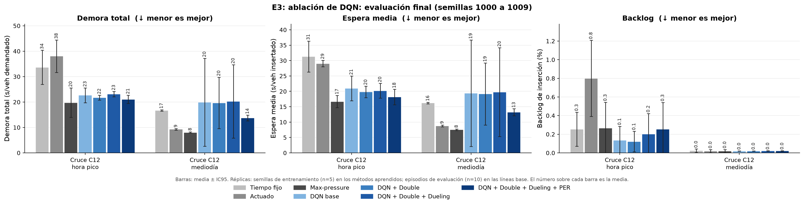
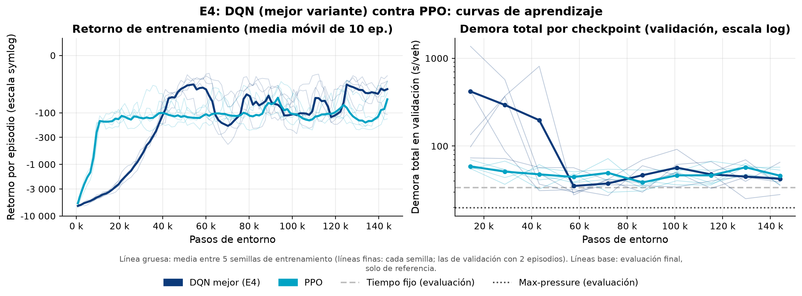
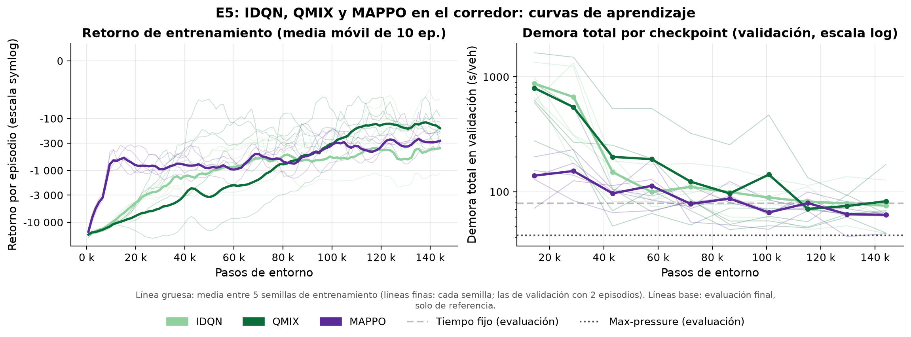
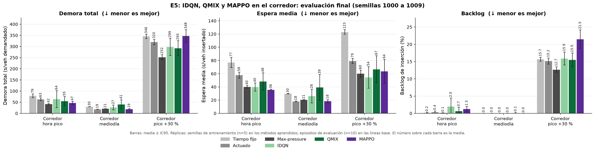
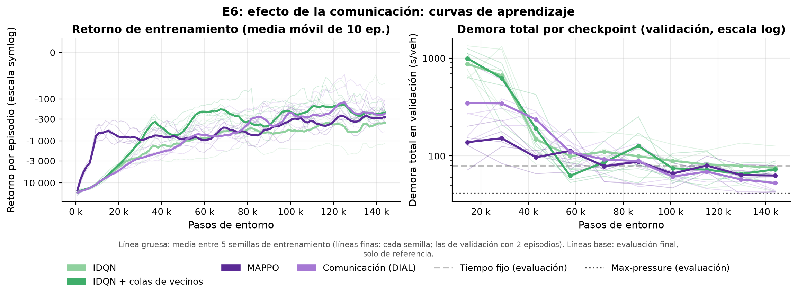
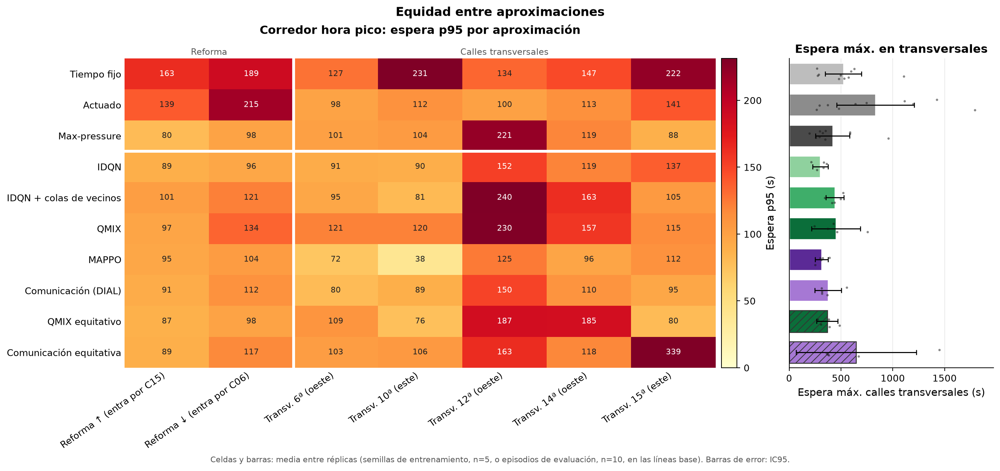

# Semáforos inteligentes en la Avenida La Reforma con aprendizaje por refuerzo multiagente

**Integrantes:** <completar>

**Curso:** CC3104 Aprendizaje por Refuerzo · Universidad del Valle de Guatemala · Ciclo 2, 2026

**Repositorio:** <completar enlace>  ·  **Fecha:** <completar>

<!-- BORRADOR v1. Todo lo marcado con un comentario "RESULTADOS:", "COMPLETAR:" o con "<completar>" depende de las corridas finales
     o de datos de campo y NO debe llenarse con valores inventados. Las figuras se generan con
     `python -m analysis.make_all` en docs/figures/ y las tablas en analysis/results/. -->

---

## Resumen

El control de semáforos con tiempos fijos no se adapta a la demanda real, y en corredores urbanos de la Ciudad de Guatemala eso se traduce en colas largas y esperas que varían mucho a lo largo del día. En este trabajo modelamos en el microsimulador SUMO un corredor de 1.65 km de la Avenida La Reforma (zonas 9 y 10) con cinco intersecciones semaforizadas consecutivas, construido a partir de la geometría de OpenStreetMap. Sobre ese escenario comparamos, con un mismo protocolo (cinco semillas de entrenamiento, diez semillas de evaluación nunca vistas, presupuesto igual de pasos de entorno e intervalos de confianza del 95 %), tres controladores sin aprendizaje (tiempo fijo, actuado y max-pressure) con una escalera de métodos de aprendizaje por refuerzo: Q-Learning y Dyna-Q tabulares y DQN (con las variantes Double, Dueling y PER) y PPO en el cruce más cargado, e IDQN, QMIX, MAPPO y comunicación aprendida entre semáforos en el corredor completo. También evaluamos la generalización ante una hora no vista, una demanda 30 % mayor y un carril cerrado, y la equidad entre la avenida principal y las calles transversales. **Los conteos vehiculares y los tiempos del semáforo fijo usados en esta versión son sintéticos y provisionales**, por lo que los resultados deben leerse como una comparación metodológica y no como una predicción del efecto en la calle.

<!-- RESULTADOS: una o dos frases con el hallazgo principal (mejor método, reducción de espera media ± IC95 frente al tiempo fijo en reforma_pico, y si se mantiene en E7). -->

**Palabras clave:** control de semáforos, aprendizaje por refuerzo multiagente, QMIX, MAPPO, SUMO, Guatemala.

---

## 1. Introducción

### 1.1 El tráfico en la Ciudad de Guatemala

La Ciudad de Guatemala concentra buena parte de la actividad económica del país y recibe cada día a cientos de miles de personas que viajan desde municipios vecinos del área metropolitana. El crecimiento del parque vehicular, la escasez de alternativas de transporte masivo y una red vial con pocos ejes de alta capacidad hacen que la congestión sea uno de los problemas urbanos más visibles. <!-- DATO: agregar una o dos cifras con fuente verificable (p. ej. parque vehicular de la SAT, tiempos de viaje promedio de la Municipalidad o de un estudio publicado). No incluir cifras sin fuente. -->

La Avenida La Reforma es uno de esos ejes. Atraviesa las zonas 9 y 10, conecta el sur de la ciudad (Plaza Obelisco) con el centro y la cruzan calles transversales de una vía que alternan de sentido. Es un bulevar con arriate central y tres carriles por sentido, con semáforos a distancias muy desiguales entre sí (de poco más de cien metros a más de medio kilómetro). En la hora pico, los semáforos de tiempo fijo reparten el verde sin saber cuántos vehículos esperan en cada aproximación, y la coordinación entre cruces consecutivos depende de desfases calculados para una demanda típica que no siempre se cumple.

### 1.2 Motivación

El aprendizaje por refuerzo (RL) ofrece una forma de diseñar controladores que deciden la siguiente fase a partir del estado observado de la intersección (colas, ocupación, fase actual) y que optimizan directamente una medida de desempeño, como el tiempo de espera, por prueba y error en simulación. En la literatura hay muchos resultados favorables en redes sintéticas y en algunas ciudades de Asia, Europa y Norteamérica, pero muy pocos trabajos usan corredores de Centroamérica, con su geometría, su mezcla de calles y sus patrones de demanda. Además, los métodos multiagente con entrenamiento centralizado (CTDE), como QMIX y MAPPO, rara vez se comparan con líneas base fuertes como max-pressure bajo un protocolo con varias semillas e intervalos de confianza.

Este proyecto tiene también un propósito docente: recorre casi todo el temario del curso (bandidos, MDP, programación dinámica, Monte Carlo, TD, aproximación de funciones, gradiente de política, planificación, Deep RL y MARL) en un mismo problema aplicado, con una demo web en vivo que permite a un público no especialista comparar lado a lado el semáforo fijo y el agente.

### 1.3 Pregunta de investigación y contribuciones

> **Pregunta.** ¿Cuánto reduce el RL multiagente el tiempo de espera en un corredor real de Guatemala frente al control actual, y se mantiene esa mejora ante condiciones que no vio en el entrenamiento?

Las contribuciones de este trabajo son:

1. Un escenario reproducible del corredor de la Av. La Reforma en SUMO (5 intersecciones, georreferenciado en UTM 15N), con un generador de demanda estocástico por semilla a partir de conteos por movimiento y con perfiles de hora pico, mediodía, pico +30 % y noche.
2. Una comparación con protocolo uniforme de 3 líneas base y 10 configuraciones de RL, desde Q-Learning tabular hasta QMIX, MAPPO y comunicación aprendida, todas implementadas sobre la misma fábrica de entornos y evaluadas con las mismas métricas.
3. Un análisis de generalización (hora no vista, estrés de demanda e incidente) y de equidad entre la avenida y las calles transversales.
4. Una demo web en vivo (FastAPI + React) con dos simulaciones sincronizadas y la misma demanda, donde se pueden inyectar vehículos, cambiar la hora del día y provocar incidentes.

El resto del informe se organiza así: la sección 2 resume el trabajo relacionado; la 3 formaliza el problema como MDP y Dec-POMDP; la 4 describe el escenario y la demanda; la 5 los métodos; la 6 el protocolo; las secciones 7 y 8 presentan los resultados; la 9 discute ética y limitaciones; la 10 concluye y la 11 declara el uso de herramientas de IA.

---

## 2. Trabajo relacionado

**Control clásico de semáforos.** El diseño de planes de tiempo fijo se basa desde hace décadas en el método de Webster [Webster 1958], que reparte el verde en proporción al grado de saturación de cada grupo de movimientos y fija un ciclo que minimiza la demora esperada. Los controladores actuados extienden el verde mientras los detectores registran vehículos, dentro de un mínimo y un máximo. Max-pressure [Varaiya 2013] elige en cada intervalo la fase cuya "presión" (la diferencia entre los vehículos aguas arriba y aguas abajo de los movimientos que habilita) es mayor. Es una política descentralizada que no necesita conocer la demanda y que, bajo supuestos de capacidad, estabiliza las colas de la red cuando eso es posible. Por eso es una línea base exigente para cualquier método aprendido.

**RL en una intersección.** Los primeros trabajos usaron RL tabular con estados discretizados [Wiering 2000]. Con Deep RL [Mnih et al. 2015] llegaron agentes que aprenden de representaciones más ricas del estado [Genders y Razavi 2016; Wei et al. 2018]. Las mejoras del DQN que usamos en la ablación son el objetivo Double [van Hasselt et al. 2016], la arquitectura Dueling [Wang et al. 2016] y la repetición priorizada de experiencia, PER [Schaul et al. 2016]. Entre los métodos de gradiente de política, PPO [Schulman et al. 2017] con estimación de ventaja generalizada, GAE [Schulman et al. 2016], es el estándar de facto. La base teórica de los métodos tabulares es Q-Learning [Watkins y Dayan 1992], y la de la planificación con modelo aprendido es Dyna [Sutton 1990]; ambas siguen la notación de Sutton y Barto [2018].

**RL multiagente para redes de semáforos.** La forma más simple de escalar a varias intersecciones es entrenar aprendices independientes [Tan 1993], lo que hace que el entorno sea no estacionario desde el punto de vista de cada agente. MA2C [Chu et al. 2020] usa actor-crítico con información de los vecinos y un factor de descuento espacial. PressLight [Wei et al. 2019a] combina RL con una recompensa basada en presión para coordinar un corredor arterial, y CoLight [Wei et al. 2019b] usa atención en grafos para que cada intersección pondere a sus vecinos. Fuera del dominio del tráfico, el paradigma de entrenamiento centralizado con ejecución descentralizada (CTDE) dio lugar a VDN [Sunehag et al. 2018] y a QMIX [Rashid et al. 2018], que factorizan la función de valor conjunta de forma monótona, y a MAPPO [Yu et al. 2022], que muestra que PPO con un crítico centralizado es una línea base sorprendentemente fuerte en juegos cooperativos. La comunicación aprendida entre agentes, con un canal diferenciable entrenado de punta a punta, se propuso en DIAL [Foerster et al. 2016]. El marco formal de estos problemas es el Dec-POMDP [Oliehoek y Amato 2016].

**Herramientas y bancos de prueba.** SUMO [Lopez et al. 2018] es el microsimulador de tráfico abierto más usado en esta línea de investigación. `sumo-rl` [Alegre 2019] lo envuelve con las interfaces de Gymnasium y PettingZoo [Terry et al. 2021] y define la observación y la recompensa que usamos. RESCO [Ault y Sharon 2021] propone un banco de pruebas con escenarios reales y muestra que muchas comparaciones publicadas usan líneas base débiles o protocolos distintos, lo que motiva nuestro énfasis en max-pressure, semillas separadas e intervalos de confianza. Nuestras implementaciones siguen el estilo de un solo archivo de CleanRL [Huang et al. 2022], y PPO de un agente usa Stable-Baselines3 [Raffin et al. 2021].

---

## 3. Formulación

### 3.1 Un cruce como MDP

Para los métodos de un agente modelamos el cruce más cargado (C12, ver sección 4) como un MDP $\langle \mathcal{S}, \mathcal{A}, P, R, \gamma \rangle$. La dinámica $P(s' \mid s, a)$ la define SUMO y es desconocida para el agente: por eso la programación dinámica no se aplica directamente, y solo la usamos como contraste sobre el modelo empírico que aprende Dyna-Q (sección 5.2).

**Observación.** Usamos la observación por defecto de `sumo-rl`. Para un semáforo con $n_g$ fases verdes y $L$ carriles de entrada,

$$
\begin{aligned}
o_t = \big[\, &\underbrace{\mathbb{1}[\text{fase}=1], \dots, \mathbb{1}[\text{fase}=n_g]}_{\text{fase verde actual (one-hot)}},\; \underbrace{\mathbb{1}[\tau_t \ge g_{\min}]}_{\text{verde mínimo cumplido}}, \\
&\underbrace{\rho_1, \dots, \rho_L}_{\text{densidad}},\; \underbrace{q_1, \dots, q_L}_{\text{cola}} \,\big] \in [0,1]^{n_g + 1 + 2L},
\end{aligned}
$$

donde $\tau_t$ es el tiempo transcurrido en la fase actual, $\rho_l$ es el número de vehículos en el carril $l$ dividido entre su capacidad y $q_l$ es el número de vehículos detenidos (velocidad menor que 0.1 m/s) dividido entre la misma capacidad. Para C12, $n_g = 3$ y $L = 10$, así que $o_t \in [0,1]^{24}$.

**Acción.** $a_t \in \{0, \dots, n_g - 1\}$ es el índice de la siguiente fase verde. El agente decide cada $\Delta t = 5$ s. Si elige una fase distinta de la actual, el entorno inserta un amarillo de 3 s antes del nuevo verde, y no se permite cambiar de fase antes de un verde mínimo $g_{\min} = 10$ s. Estas restricciones de seguridad las impone el entorno, no el agente.

**Recompensa.** Usamos la reducción del tiempo de espera acumulado (`diff-waiting-time` de `sumo-rl`):

$$
r_t = W_{t-1} - W_t, \qquad W_t = \frac{1}{100} \sum_{v \in \mathcal{V}_t} w_v(t),
$$

donde $\mathcal{V}_t$ son los vehículos presentes en los carriles de entrada del semáforo y $w_v(t)$ es el tiempo que el vehículo $v$ lleva detenido en esos carriles. La recompensa es positiva si la acción redujo la espera acumulada. Su suma telescópica a lo largo de un episodio es $W_0 - W_T$, de modo que maximizar el retorno no descontado equivale a terminar el episodio con la menor espera acumulada posible.

**Episodio y descuento.** Un episodio dura una hora simulada (3600 s), es decir, 720 decisiones por agente. Usamos $\gamma = 0.99$, cuyo horizonte efectivo $1/(1-\gamma) = 100$ decisiones equivale a unos 8 minutos de tráfico, del orden de varios ciclos semafóricos. El episodio solo se trunca por tiempo, nunca termina en un estado absorbente; por eso todos los algoritmos siguen haciendo *bootstrap* en el último paso (la bandera `terminated` es siempre 0).

### 3.2 Versión tabular

Para Q-Learning y Dyna-Q discretizamos la observación en

$$
s = \big(\text{fase},\; \mathbb{1}[\tau \ge g_{\min}],\; \ell_1, \dots, \ell_A\big), \qquad \ell_k = \begin{cases} 0 \;(\text{baja}) & \bar q_k < 0.15 \\ 1 \;(\text{media}) & 0.15 \le \bar q_k < 0.45 \\ 2 \;(\text{alta}) & \bar q_k \ge 0.45 \end{cases}
$$

donde $\bar q_k$ es la cola media de los carriles de la aproximación $k$ (una aproximación es una arista de entrada). El espacio tiene $n_g \cdot 2 \cdot 3^A$ estados. En C12 hay $A = 3$ aproximaciones (Reforma norte, Reforma sur y la 12 calle, que es de una vía), así que $|\mathcal{S}| = 3 \cdot 2 \cdot 27 = 162$. La tabla Q es un diccionario y solo ocupa memoria para los estados visitados.

### 3.3 El corredor como Dec-POMDP

En el corredor completo hay $n = 5$ agentes, uno por semáforo. Lo modelamos como un Dec-POMDP cooperativo [Oliehoek y Amato 2016]

$$
\big\langle \mathcal{I}, \mathcal{S}, \{\mathcal{A}_i\}_{i \in \mathcal{I}}, P, R, \{\Omega_i\}_{i \in \mathcal{I}}, O, \gamma \big\rangle,
$$

con $\mathcal{I} = \{\text{C15}, \text{C14}, \text{C12}, \text{C10}, \text{C06}\}$. El estado verdadero $s$ incluye la posición y la velocidad de todos los vehículos del corredor; cada agente solo recibe su observación local $o_i$ (sección 3.1). La observabilidad es parcial: un semáforo no ve los pelotones que vienen desde el cruce anterior hasta que entran a sus carriles, y la misma observación local es compatible con estados globales muy distintos. Cada agente recibe su recompensa local $r_i$; para los métodos cooperativos (QMIX, MAPPO) usamos la recompensa de equipo $r = \sum_i r_i$.

En CTDE, durante el entrenamiento se dispone de un estado global $s_t$ que en nuestro caso es la concatenación de las observaciones rellenadas de los cinco agentes más la cola total de cada cruce:

$$
s_t = \big[\tilde o_1, \dots, \tilde o_5,\; Q_1, \dots, Q_5\big], \qquad Q_i = \textstyle\sum_{l} q_{i,l}.
$$

En la ejecución cada semáforo actúa solo con su $o_i$ (y, en los métodos con comunicación, con los mensajes de sus vecinos inmediatos).

### 3.4 Heterogeneidad: relleno y máscaras de acción

Los cruces reales de Reforma no son idénticos. C15 tiene 2 fases verdes y los demás 3; el número de carriles de entrada va de 9 a 11, y las dimensiones de observación son 21, 22, 24, 26 y 22. Para compartir parámetros entre agentes (QMIX, MAPPO y comunicación) aplicamos:

- **Relleno estructurado.** Cada bloque de la observación (fase, bandera, densidad y cola) se rellena con ceros por separado hasta $n_g^{\max} = 3$ y $L^{\max} = 11$, de modo que la columna $k$ significa lo mismo para todos los agentes. La dimensión rellenada es $3 + 1 + 2 \cdot 11 = 26$. Con un relleno al final, la densidad de un cruce caería en la columna de fase de otro.
- **Identificador del agente.** A la entrada de las redes compartidas se agrega un *one-hot* del agente, para que una sola red pueda comportarse distinto en cada cruce.
- **Máscaras de acción.** Las acciones $a \ge n_g^{(i)}$ no existen en el cruce $i$. Se enmascaran con $-10^9$ en el $\arg\max$ greedy, en la exploración $\varepsilon$-greedy, en el máximo del objetivo TD y en los *logits* antes del *softmax* del actor:

$$
\tilde Q_i(o, a) = \begin{cases} Q_i(o, a) & a < n_g^{(i)} \\ -10^{9} & \text{en otro caso.} \end{cases}
$$

IDQN, que por defecto usa una red por agente sin compartir parámetros, no necesita el identificador, pero sí respeta las máscaras.

---

## 4. Escenario

### 4.1 Tramo elegido

El escenario es un tramo de la Avenida La Reforma entre la Plaza Obelisco (16 calle) y la 5a calle, con cinco intersecciones semaforizadas consecutivas (en OpenStreetMap no hay otros semáforos sobre Reforma entre ellas). La Tabla 1 las resume, de sur a norte.

**Tabla 1.** Intersecciones del corredor (de sur a norte). Las fases y carriles son los del modelo en SUMO.

| TLS | Intersección | Transversal (una vía) | Fases verdes | Carriles de entrada | Dim. obs. |
|---|---|---|---|---|---|
| C15 | Reforma y 15 calle | hacia el oeste, 3 carriles | 2 | 9 | 21 |
| C14 | Reforma y 14 calle | hacia el este, 3 carriles | 3 | 9 | 22 |
| C12 | Reforma y 12 calle | hacia el este, 3 carriles | 3 | 10 | 24 |
| C10 | Reforma y 10a calle | hacia el oeste, 4 carriles | 3 | 11 | 26 |
| C06 | Reforma y 6a calle | hacia el este, 3 carriles | 3 | 9 | 22 |

Las distancias entre cruces consecutivos son 123 m, 302 m, 296 m y 547 m, y el corredor mide 1.65 km. Esa desigualdad hace interesante la coordinación: entre C15 y C14 caben muy pocos vehículos, de modo que una cola en C14 bloquea rápidamente a C15, mientras que entre C10 y C06 los pelotones se dispersan. Las transversales son pares de una vía que alternan de sentido, lo típico de las zonas 9 y 10.

Para los métodos de un agente usamos el cruce **C12 (Reforma y 12 calle)**, recortado del corredor. Según los conteos (sintéticos, ver 4.3), la 12 calle es la transversal más cargada. Además, C12 tiene una bahía de giro a la izquierda en el sentido sur.

<!-- FIGURA: captura de la red (sumo-gui o la demo web) con los 5 TLS etiquetados. No la genera analysis.make_all: guardarla a mano como docs/figures/escenario_corredor.png. -->

### 4.2 Construcción de la red a partir de OpenStreetMap

El plan original era importar el área de OSM con `netconvert` y corregirla a mano en `netedit`. Esa importación (que el repositorio conserva como diagnóstico) produce 280 aristas y 18 semáforos en la zona. En OSM, Reforma tiene cuatro calzadas (las dos centrales y dos carriles auxiliares), hay decenas de enlaces y retornos en el arriate central, y la unión automática de semáforos fusiona la 15 y la 14 calle en un solo controlador con un ciclo de 444 s. Limpiar eso a mano habría tomado días, así que aplicamos la mitigación prevista en el plan y construimos el corredor en XML plano con la geometría real. Del extracto de OSM se toman:

- las coordenadas de cada cruce (la media de sus nodos `highway=traffic_signals`) y de los extremos;
- el sentido de cada transversal de una vía;
- el número de carriles (`lanes=*`).

Con eso se generan los archivos de nodos, aristas, conexiones y programas, y `netconvert` proyecta la red a UTM 15N, de modo que la red queda georreferenciada (la demo web muestra latitud y longitud reales).

El modelo de cada cruce es el siguiente. Reforma es un bulevar dividido con tres carriles por sentido a 50 km/h, y cada cruce del bulevar es un solo nodo y un solo semáforo (el arriate queda dentro del área de la intersección). Hay un cuarto carril exclusivo de giro a la izquierda en el sentido sur en C12 y en el sentido norte en C10. Las transversales son de una vía, a 40 km/h, con una cuadra antes (170 m) y una después (150 m) del cruce. Desde Reforma solo existe el giro legal hacia la transversal (a la derecha o a la izquierda según su sentido); desde la transversal se permiten los tres movimientos, y no hay vueltas en U. Las fases verdes son las de la Tabla 1: Reforma con giro permisivo, un adelanto con izquierda protegida en un sentido (excepto en C15) y la transversal.

### 4.3 Demanda: conteos sintéticos y provisionales

> **Advertencia.** Los conteos vehiculares usados en esta versión del informe son **sintéticos y provisionales**. Los generó un script del repositorio (`env/synthetic_counts.py`) con valores plausibles; **no provienen de conteos en campo**. El plan del proyecto prevé reemplazarlos por conteos propios en video de 15 minutos por intersección, en hora pico y a mediodía. <!-- COMPLETAR: si se llegan a hacer los conteos reales, describir aquí fecha, hora, intersecciones, método de conteo y responsables, y quitar esta advertencia. -->

Los conteos tienen formato largo (intersección, aproximación, movimiento, vehículos en 15 minutos). Los valores sintéticos de hora pico son:

- Reforma recibe 1800 veh/h hacia el norte y 1600 veh/h hacia el sur, y entre 12 % y 18 % de ese flujo gira hacia la transversal en cada cruce.
- Las transversales llevan entre 450 y 700 veh/h (la 12 calle es la más cargada), con un reparto de 68/16/16 % entre recto, izquierda y derecha.
- Los flujos son consistentes a lo largo del corredor: lo que llega a un cruce es lo que siguió recto en el anterior más lo que entró desde su transversal.
- El mediodía tiene cerca del 65 % del volumen del pico, con sentidos más parejos y más giros.

**De conteos a rutas.** Usamos un modelo de proporciones de giro, la misma idea de `jtrrouter`, pero resuelto de forma exacta en lugar de por muestreo. Cada arista de entrada al corredor es una fuente con flujo $F_e$ igual a su volumen contado (en veh/h) multiplicado por la escala del perfil. En cada cruce, un vehículo que llega por la aproximación $k$ toma el movimiento $m$ con probabilidad $p_{k,m} = c_{k,m} / \sum_{m'} c_{k,m'}$. Al enumerar todos los caminos, cada ruta $\pi$ (una fuente y una secuencia de movimientos) recibe una tasa

$$
\lambda_\pi = F_{e(\pi)} \prod_{(k, m) \in \pi} p_{k,m},
$$

y sus salidas siguen un proceso de Poisson de tasa $\lambda_\pi$ en $[0, T)$: $N_\pi \sim \text{Poisson}(\lambda_\pi T)$ con tiempos uniformes. Así, el tráfico que sigue recto por Reforma cruza varias intersecciones, y los volúmenes contados aguas abajo se reproducen en valor esperado. La generación es determinista por semilla: semillas distintas dan realizaciones distintas de la misma demanda media. Todos los vehículos son de tipo `passenger` (longitud 4.5 m, aceleración 2.6 m/s², imperfección del conductor $\sigma = 0.5$ y factor de velocidad con distribución normal truncada de media 1 y desviación 0.1).

**Perfiles de demanda.** La Tabla 2 muestra los cuatro perfiles. El entrenamiento usa solo la hora pico; los demás perfiles sirven para evaluar la generalización (E7) y como opciones de la demo.

**Tabla 2.** Perfiles de demanda.

| Perfil | Conteos | Escala | Uso |
|---|---|---|---|
| `pico` | hora pico | 1.0 | entrenamiento |
| `mediodia` | mediodía | 1.0 | evaluación: hora no vista |
| `pico_x13` | hora pico | 1.3 | evaluación: estrés (+30 %) |
| `noche` | hora pico | 0.3 | demo y evaluación extra (sintético) |

### 4.4 Programas de referencia

El **tiempo fijo** debía ser el ciclo medido con cronómetro en campo, es decir, "lo que hay hoy". Mientras no exista esa medición, usamos un ciclo común de 110 s con el verde repartido según Webster, $g_i \propto y_i = q_i / (n_i \cdot 1800)$, a partir de los conteos de hora pico (con verdes mínimos), y desfases que forman una onda verde hacia el norte a 40 km/h. Es, por lo tanto, un **tiempo fijo sintético y provisional**, probablemente mejor ajustado a la demanda que el real (porque usa la misma demanda que el simulador), lo que hace la comparación más exigente para los agentes. <!-- COMPLETAR: reemplazar por los ciclos cronometrados en campo, si se miden. -->

El **actuado** usa las mismas fases con el controlador `actuated` de SUMO: Reforma entre 15 y 70 s, la izquierda protegida entre 8 y 25 s y la transversal entre 10 y 50 s, con un intervalo máximo entre vehículos (*max-gap*) de 3 s.

### 4.5 Calibración y validación

La validación prevista compara el tiempo de viaje simulado del corredor con el que reporta Google Maps a la misma hora. Con tiempo fijo, hora pico y semilla 0, el corredor completo se recorre en unos 160 s en cada sentido, sin teletransportes. La referencia de Google Maps que tiene hoy el script de validación (330 s hacia el norte y 300 s hacia el sur) es un **marcador de posición**, no una consulta real. Si la consulta real confirma un valor de ese orden, la simulación estaría por debajo de la congestión real, y la calibración consistiría en subir la demanda (con conteos reales) o ajustar los parámetros del tipo de vehículo.

<!-- RESULTADOS: tabla de validación (tiempo de viaje NB/SB simulado vs. Google Maps, con día y hora de la consulta) cuando existan conteos y la consulta real. -->

---

## 5. Métodos

Todos los métodos comparten la misma fábrica de entornos (SUMO 1.28 + `sumo-rl` 1.4.5, con `libsumo` para entrenar), la misma interfaz de política (`reset(sumo_env)` y `act(obs) -> {semáforo: fase}`) y el mismo registro de entrenamiento. Los agentes de un cruce trabajan sobre `cruce_pico`, y los multiagente sobre `reforma_pico`.

### 5.1 Líneas base sin aprendizaje

- **Tiempo fijo.** SUMO ejecuta el programa estático de la sección 4.4; el agente no interviene.
- **Actuado.** SUMO ejecuta el programa `actuated` de la sección 4.4.
- **Max-pressure** [Varaiya 2013]. Cada 5 s, y respetando el mismo verde mínimo y el mismo amarillo que los agentes de RL, cada semáforo elige la fase

$$
a_t = \arg\max_{p} \sum_{(i, o) \in \mathcal{M}(p)} \big( n_i(t) - n_o(t) \big),
$$

donde $\mathcal{M}(p)$ son los movimientos (carril de entrada $i$, carril de salida $o$) con verde en la fase $p$ y $n_l(t)$ es el número de vehículos en el carril $l$. En caso de empate se mantiene la fase actual, para no gastar amarillos. Es una versión con pesos unitarios (sin tasas de saturación) de la política original.

### 5.2 Métodos tabulares: Q-Learning y Dyna-Q

**Q-Learning** [Watkins y Dayan 1992] es control TD *off-policy*:

$$
Q(s,a) \leftarrow Q(s,a) + \alpha \Big[ r + \gamma \max_{a'} Q(s', a') - Q(s,a) \Big],
$$

con $\alpha = 0.1$, $\gamma = 0.99$ y exploración $\varepsilon$-greedy con $\varepsilon$ decreciendo linealmente de 1.0 a 0.05 durante el 70 % del entrenamiento (la misma regla de los bandidos multibrazo: explorar mucho al principio y volverse greedy asintóticamente). Ante un estado nunca visto, la política greedy mantiene la fase actual.

**Dyna-Q** [Sutton 1990] agrega un modelo empírico $\hat M(s,a)$ que guarda los últimos 20 resultados $(r, s', \text{term})$ observados para cada par visitado. Después de cada paso real hace $n$ actualizaciones de planificación: muestrea un par $(s,a)$ visitado y uno de sus resultados, y aplica la misma regla de Q-Learning. En E2 variamos $n \in \{5, 10, 50\}$ para medir la eficiencia de muestras. Como contraste con la programación dinámica, al final del entrenamiento se ejecuta iteración de valor sobre el modelo empírico,

$$
Q(s,a) = \frac{1}{|\hat M(s,a)|} \sum_{(r, s') \in \hat M(s,a)} \Big[ r + \gamma \max_{a'} Q(s', a') \Big],
$$

y su política greedy se puede evaluar igual que las demás.

### 5.3 DQN y variantes

La red Q es un perceptrón de dos capas ocultas de 64 unidades con ReLU, entrenado con Adam (tasa de aprendizaje $10^{-3}$), *buffer* de 50 000 transiciones, lotes de 64, copia dura a la red objetivo cada 500 pasos, inicio del aprendizaje a los 1000 pasos, pérdida de Huber, recorte del gradiente en norma 10 y $\varepsilon$ lineal de 1.0 a 0.05 durante el 50 % del presupuesto. El objetivo TD del DQN base [Mnih et al. 2015] es

$$
y = r + \gamma\,(1 - d)\,\max_{a'} Q_{\theta^-}(s', a'),
$$

donde $\theta^-$ son los parámetros de la red objetivo y $d$ es la bandera de estado terminal (siempre 0 aquí, porque el episodio solo se trunca). La ablación E3 agrega tres mejoras de forma acumulativa:

- **Double DQN** [van Hasselt et al. 2016]. La red en línea elige la acción y la red objetivo la evalúa, lo que reduce la sobreestimación del máximo:
$$
y = r + \gamma\,(1-d)\, Q_{\theta^-}\!\Big(s', \arg\max_{a'} Q_\theta(s', a')\Big).
$$
- **Dueling** [Wang et al. 2016]. La red tiene un cuerpo compartido y dos cabezas, una para el valor y otra para la ventaja, combinadas de forma identificable:
$$
Q(s,a) = V(s) + A(s,a) - \frac{1}{|\mathcal{A}|}\sum_{a'} A(s,a').
$$
- **PER** [Schaul et al. 2016]. Las transiciones se muestrean con probabilidad proporcional a su error TD, mediante un árbol de sumas, y el sesgo se corrige con pesos de muestreo por importancia:
$$
P(i) = \frac{p_i^{\alpha}}{\sum_k p_k^{\alpha}}, \qquad p_i = |\delta_i| + \epsilon, \qquad w_i = \frac{\big(N\,P(i)\big)^{-\beta}}{\max_j w_j},
$$
con $\alpha = 0.6$ y $\beta$ que crece linealmente de 0.4 a 1 a lo largo del entrenamiento. Las transiciones nuevas entran con la prioridad máxima vista.

Las configuraciones de E3 son `dqn_vanilla`, `dqn_double`, `dqn_double_dueling` y `dqn_double_dueling_per`.

### 5.4 PPO

PPO [Schulman et al. 2017] (implementación de Stable-Baselines3) optimiza el objetivo recortado

$$
L^{\text{CLIP}}(\theta) = \mathbb{E}_t\Big[\min\big(\rho_t(\theta)\,\hat A_t,\; \operatorname{clip}(\rho_t(\theta), 1-\epsilon, 1+\epsilon)\,\hat A_t\big)\Big], \qquad \rho_t(\theta) = \frac{\pi_\theta(a_t \mid s_t)}{\pi_{\theta_{\text{old}}}(a_t \mid s_t)},
$$

con ventajas GAE [Schulman et al. 2016]

$$
\delta_t = r_t + \gamma V(s_{t+1}) - V(s_t), \qquad \hat A_t = \sum_{l \ge 0} (\gamma\lambda)^l\, \delta_{t+l},
$$

y pérdida total $-L^{\text{CLIP}} + c_v L^{V} - c_e \mathcal{H}[\pi_\theta]$. Los hiperparámetros son $\epsilon = 0.2$, $\lambda = 0.95$, $c_v = 0.5$, $c_e = 0.01$, tasa de aprendizaje $3 \cdot 10^{-4}$, *rollouts* de 720 pasos (un episodio), 10 épocas, lotes de 64 y redes de actor y crítico de 2×64. En la evaluación se usa la moda de la política categórica. Usamos PPO, y no SAC o TD3, porque la acción es discreta: TD3 es un método de gradiente de política determinista y SAC, en su forma original, usa el truco de reparametrización; ambos necesitan diferenciar Q respecto de una acción continua.

### 5.5 IDQN: aprendices independientes

IDQN entrena un Double DQN por semáforo, cada uno con su red (2×128), su optimizador, su *buffer* y su red objetivo, y con la recompensa local $r_i$. Cada agente trata a los demás como parte del entorno, de modo que, desde su punto de vista, $P(o_i' \mid o_i, a_i)$ cambia a medida que los vecinos aprenden. Esto viola el supuesto de Markov del objetivo TD y hace que las transiciones viejas del *buffer* describan vecinos que ya no existen. Aun así, IDQN es una línea base multiagente fuerte en control de tráfico [Chu et al. 2020]. Con la opción `neighbor_obs`, a la observación de cada agente se le agregan los vectores de cola por carril de sus vecinos inmediatos en el corredor (la "comunicación v1" de E6).

### 5.6 QMIX

QMIX [Rashid et al. 2018] aprende una utilidad por agente $Q_i(o_i, a_i)$ con una red compartida (2×128, con observación rellenada e identificador del agente) y las combina en un valor conjunto mediante una red mezcladora cuyos pesos generan hiperredes condicionadas al estado global $s$:

$$
Q_{\text{tot}}(s, \mathbf{a}) = \mathbf{w}_2(s)^{\top}\, \operatorname{ELU}\!\Big( W_1(s)^{\top} \mathbf{Q} + \mathbf{b}_1(s) \Big) + V(s), \qquad \mathbf{Q} = \big[Q_1(o_1,a_1), \dots, Q_n(o_n,a_n)\big],
$$

con $W_1(s) = |\,h_1(s)\,|$ y $\mathbf{w}_2(s) = |\,h_2(s)\,|$ (valor absoluto elemento a elemento). Como los pesos son no negativos y ELU es creciente,

$$
\frac{\partial Q_{\text{tot}}}{\partial Q_i} \ge 0 \quad \forall i \quad\Longrightarrow\quad \arg\max_{\mathbf{a}} Q_{\text{tot}}(s, \mathbf{a}) = \Big( \arg\max_{a_1} Q_1, \dots, \arg\max_{a_n} Q_n \Big),
$$

es decir, cada semáforo puede actuar de forma greedy con su propia $Q_i$ en la ejecución (propiedad IGM), mientras que el entrenamiento usa la recompensa de equipo. El objetivo TD es Double-Q con máscaras sobre transiciones conjuntas:

$$
a_i^{*} = \arg\max_{a \text{ válida}} Q_i(o_i', a; \theta), \qquad y = r + \gamma\,(1-d)\, Q_{\text{tot}}\big(s', \{Q_i(o_i', a_i^{*}; \theta^-)\}_i;\, \theta^-\big),
$$

con pérdida cuadrática $\big(Q_{\text{tot}}(s, \mathbf{a}) - y\big)^2$. A diferencia del artículo original, la red de agente es un perceptrón sin GRU: la observación ya incluye la fase actual y la bandera de verde mínimo, y así el *buffer* sigue siendo por transición. La dimensión de la mezcla es 32 y la de las hiperredes 64; $\varepsilon$ decae de 1.0 a 0.05 durante el 30 % del presupuesto, y la recompensa se escala por 0.1. La misma implementación admite una mezcla aditiva, VDN [Sunehag et al. 2018], o ninguna.

### 5.7 MAPPO

MAPPO [Yu et al. 2022] usa un actor compartido $\pi_\theta(a_i \mid [\tilde o_i, \text{id}_i])$ (2×128, Tanh, con las fases inválidas enmascaradas antes del *softmax*) y un crítico centralizado $V_\phi(s)$ (2×256) sobre el estado global, que solo se usa durante el entrenamiento. Las ventajas se calculan con GAE sobre la recompensa de equipo, con *bootstrap* $V(s_T)$ en la truncación, y se comparten entre agentes. Cada agente aporta un término recortado

$$
L^{\text{CLIP}} = \mathbb{E}_{t,i}\Big[\min\big(\rho_{t,i} \hat A_t,\; \operatorname{clip}(\rho_{t,i}, 1-\epsilon, 1+\epsilon)\, \hat A_t\big)\Big], \qquad \rho_{t,i} = \frac{\pi_\theta(a_{t,i} \mid o_{t,i})}{\pi_{\theta_{\text{old}}}(a_{t,i} \mid o_{t,i})},
$$

más un bono de entropía, una pérdida de valor recortada y una normalización móvil del valor, como recomienda el artículo. En E5, cada *rollout* tiene 240 pasos (3 actualizaciones por episodio), con 5 épocas y 4 minilotes por actualización.

### 5.8 Comunicación aprendida

Siguiendo la idea de DIAL [Foerster et al. 2016], cada semáforo $j$ emite un mensaje continuo de dimensión 6,

$$
m_j = \tanh\big(f_{\text{msg}}([\tilde o_j, \text{id}_j])\big), \qquad Q_i = f_Q\big([\tilde o_i, \text{id}_i, m_{N(i)_1}, m_{N(i)_2}]\big),
$$

donde $N(i)$ son los vecinos inmediatos de $i$ en el corredor (las posiciones vacías de los extremos reciben un mensaje nulo). El *buffer* guarda observaciones, no mensajes: al entrenar, los mensajes se recalculan con el codificador actual, de modo que el gradiente de la pérdida TD del receptor $i$ atraviesa $m_j$ y llega al emisor $j$ (canal diferenciable). El aprendiz es el mismo Double-Q conjunto de QMIX, pero sin mezcladora y con recompensas locales, lo que lo hace comparable con `idqn_neighbor_obs`. Así, E6 compara "colas de los vecinos diseñadas a mano" contra "mensajes aprendidos". La ejecución sigue siendo descentralizada: cada agente solo necesita los mensajes de sus vecinos.

**Nota para la ablación.** `comm` comparte parámetros entre agentes (con identificador) y `idqn_neighbor_obs` no. Una comparación estricta requiere además IDQN con `shared_params: true` y `neighbor_obs: true`. <!-- COMPLETAR: indicar si se corrió esa variante. -->

### 5.9 Detalles comunes de implementación

Los agentes multiagente son implementaciones propias en estilo CleanRL (cada algoritmo cabe en un archivo de 200 a 300 líneas). Preferimos no usar BenchMARL ni EPyMARL por la incompatibilidad de versiones con el entorno de PettingZoo de `sumo-rl` (fijado en la versión 1.24.3) y por la necesidad de relleno estructurado y máscaras en varios puntos de cada algoritmo. Todas las corridas registran una fila por episodio (retorno, espera media, pasos de entorno y tiempo) y guardan la configuración resuelta y la semilla. La Tabla 3 resume la escalera de métodos.

**Tabla 3.** Métodos comparados.

| Método | Familia | Escenario | Implementación | Experimentos |
|---|---|---|---|---|
| Tiempo fijo, actuado | sin RL | ambos | programas de SUMO | E1, E7, E8 |
| Max-pressure | sin RL | ambos | propia (TraCI) | E1, E7, E8 |
| Q-Learning, Dyna-Q ($n$ = 5, 10, 50) | tabular | `cruce_pico` | propia | E2 |
| DQN (vanilla, +Double, +Dueling, +PER) | basado en valor | `cruce_pico` | propia (estilo CleanRL) | E3, E4, E7 |
| PPO | gradiente de política | `cruce_pico` | Stable-Baselines3 | E4, E7 |
| IDQN (± colas de vecinos) | MARL independiente | `reforma_pico` | propia | E5, E6 |
| QMIX | MARL CTDE (valor) | `reforma_pico` | propia | E5 |
| MAPPO | MARL CTDE (actor-crítico) | `reforma_pico` | propia | E5, E7 |
| Comunicación (DIAL) | MARL con mensajes | `reforma_pico` | propia | E6, E7 |

---

## 6. Protocolo experimental

### 6.1 Semillas y presupuesto

- **Semillas de entrenamiento.** Cada configuración de RL se entrena con 5 semillas (0 a 4). Dentro de una corrida, el episodio $e$ usa la semilla de demanda derivada de $(\text{semilla}, e)$, de modo que cada episodio ve una realización distinta, pero reproducible, de la demanda de hora pico.
- **Semillas de evaluación.** La evaluación final usa 10 episodios con las semillas de demanda 1000 a 1009, que nunca se usan en el entrenamiento. La semilla de SUMO coincide con la de demanda.
- **Presupuesto igual.** Todos los métodos de RL de un experimento reciben el mismo número de pasos de entorno: 100 episodios de 3600 s, es decir, $100 \times 720 = 72\,000$ decisiones por agente. PPO usa el mismo número de pasos que DQN. <!-- COMPLETAR: si por tiempo de cómputo se redujo el presupuesto (p. ej. en Colab), indicarlo aquí con el número real de episodios por experimento. -->
- **Selección de modelo.** Se evalúa el último *checkpoint* de cada corrida, sin selección por desempeño. Para E7, de cada familia se toma la semilla con menor espera media en su evaluación final (ver la limitación en la sección 9.3).
- **Cómputo.** El desarrollo se hizo en una Mac (CPU) y los entrenamientos largos en Google Colab. Para entrenar usamos `libsumo` (SUMO enlazado en el mismo proceso), y para la demo web, TraCI por *socket*, porque corre dos simulaciones a la vez. Para evitar bloqueos permanentes, los vehículos detenidos más de 300 s se teletransportan; la cantidad de teletransportes se reporta como métrica. <!-- COMPLETAR: horas de cómputo por experimento y hardware de Colab usado. -->

### 6.2 Métricas

Todas las métricas se calculan igual para todos los métodos (Tabla 4). Los promedios por vehículo incluyen a **todos** los vehículos insertados, tanto los que llegaron como los que seguían en la red al terminar el episodio (SUMO los escribe con su espera y su duración acumuladas). Ignorar a los atascados haría ver mejor a las políticas que congestionan la red.

**Tabla 4.** Métricas de evaluación (por episodio).

| Métrica | Definición | Fuente |
|---|---|---|
| Espera media (s/veh) | media de `waitingTime` por vehículo | `tripinfo` de SUMO |
| Tiempo de viaje medio (s) | media de `duration` por vehículo | `tripinfo` |
| Cola media y máxima (veh) | vehículos detenidos ($v < 0.1$ m/s) en todos los carriles de entrada, muestreados cada 5 s | TraCI |
| Throughput (veh/h) | vehículos que llegaron a su destino por hora | `tripinfo` |
| Paradas por vehículo | media de `waitingCount` | `tripinfo` |
| Espera p95 por aproximación (s) | percentil 95 de la espera, agrupando por arista de entrada | `tripinfo` |
| Espera máxima en transversales (s) | máximo de la espera de los vehículos que entran por una calle distinta de Reforma | `tripinfo` |
| CO₂ (kg) | suma de emisiones del modelo por defecto de SUMO | salida de emisiones |
| Teletransportes | vehículos retirados por bloqueo (>300 s detenidos) | TraCI |

### 6.3 Reporte estadístico

Reportamos la media ± el semiancho del intervalo de confianza del 95 % con la $t$ de Student,

$$
\bar x \pm t_{0.975,\, n-1}\, \frac{s}{\sqrt{n}}.
$$

La unidad de replicación es la **semilla de entrenamiento** cuando un método tiene varias: primero se promedian los 10 episodios de evaluación de cada semilla y luego se calcula el intervalo entre las 5 semillas ($n = 5$). Para las líneas base, que no se entrenan, la unidad es el episodio de evaluación ($n = 10$). Las curvas de aprendizaje muestran la media entre semillas con una banda de ± una desviación estándar.

### 6.4 Matriz de experimentos

**Tabla 5.** Matriz de experimentos.

| Exp. | Compara | Pregunta | Escenario de entrenamiento / evaluación |
|---|---|---|---|
| E1 | Tiempo fijo, actuado y max-pressure | ¿Qué tan bueno es lo actual? | `reforma_{pico, mediodia, pico_x13}`, `cruce_pico` (solo evaluación) |
| E2 | Q-Learning vs. Dyna-Q ($n$ = 5, 10, 50) | ¿Cuánto ayuda planificar? | `cruce_pico` / `cruce_{pico, mediodia}` |
| E3 | DQN vanilla → +Double → +Dueling → +PER | ¿Qué variante aporta más? | `cruce_pico` / `cruce_{pico, mediodia}` |
| E4 | Mejor DQN vs. PPO | ¿Basado en valor o en política? | `cruce_pico` / `cruce_{pico, mediodia}` |
| E5 | IDQN vs. QMIX vs. MAPPO | ¿Ayuda entrenar centralizado? | `reforma_pico` / `reforma_{pico, mediodia, pico_x13}` |
| E6 | IDQN con colas de vecinos vs. mensajes aprendidos | ¿Mejora la coordinación (ola verde) con comunicación? | `reforma_pico` / `reforma_{pico, mediodia, pico_x13}` |
| E7 | Mejores agentes + líneas base | ¿Generalizan a hora no vista, +30 % e incidente? | `pico`, `mediodia`, `pico_x13`, `pico` + incidente |
| E8 | Todos los métodos | ¿Se sacrifica a las calles transversales? | `cruce_pico`, `reforma_pico` |

El incidente de E7 cierra todos los carriles de Reforma hacia el norte entre la 12 y la 10a calle menos el izquierdo (arista `NB_C12_C10`), entre los segundos 900 y 2100 del episodio, como si hubiera un choque. Todas las tablas y figuras se regeneran desde los resultados con un solo comando (`python -m analysis.make_all`).

---

## 7. Resultados

<!-- INSTRUCCIONES: llenar esta sección SOLO con números de analysis/results/*.md y figuras de docs/figures/.
     Formato de celdas: "media ± IC95". Indicar n (semillas o episodios) en cada pie de tabla.
     Marcar en negrita el mejor método por columna solo si su IC no se traslapa con el segundo. -->

### 7.1 E1: líneas base

<!-- RESULTADOS: tabla E1 (analysis/results/E1.md). Filas: fixed, actuated, max_pressure. Columnas: espera media, tiempo de viaje, cola media, throughput, teletransportes. Una sub-tabla por escenario (reforma_pico, reforma_mediodia, reforma_pico_x13, cruce_pico). -->

**Tabla 6.** E1: líneas base en el corredor y en el cruce (media ± IC95, $n = 10$ episodios). <!-- RESULTADOS: tabla E1 -->

<!-- RESULTADOS: 1 párrafo. ¿Max-pressure supera al fijo? ¿El actuado está entre ambos? ¿Cómo cambia el orden en pico_x13? Recordar que el fijo es sintético (Webster con la misma demanda). -->

### 7.2 E2: Q-Learning frente a Dyna-Q

**Tabla 7.** E2: evaluación final en `cruce_pico` y `cruce_mediodia` (media ± IC95, $n = 5$ semillas). <!-- RESULTADOS: tabla E2 -->

<!-- RESULTADOS: eficiencia de muestras (episodios hasta alcanzar X s de espera) en función de n; número de estados visitados; comparación de la política greedy de Dyna-Q con la de iteración de valor sobre el modelo (qtable_vi.npz); costo de cómputo por episodio de n = 50. -->

### 7.3 E3: ablación de DQN

**Tabla 8.** E3: ablación acumulativa de DQN en `cruce_pico` (media ± IC95, $n = 5$ semillas). <!-- RESULTADOS: tabla E3 -->

<!-- RESULTADOS: qué variante aporta más; si Double reduce la sobreestimación (columna q_mean del train_log); efecto de PER en la estabilidad. Decidir aquí la variante "dqn_best" para E4 y E7 (y actualizar experiments/configs/E4/dqn_best.yaml si no es Double+Dueling+PER). -->

### 7.4 E4: DQN frente a PPO

**Tabla 9.** E4: mejor DQN vs. PPO con el mismo número de pasos (media ± IC95, $n = 5$ semillas). <!-- RESULTADOS: tabla E4 -->

<!-- RESULTADOS: comparación basada en valor vs. basada en política: desempeño final, varianza entre semillas, eficiencia de muestras (PPO es on-policy y descarta los datos tras cada actualización), comparación con max-pressure en cruce_pico. -->

### 7.5 E5: IDQN, QMIX y MAPPO en el corredor

**Tabla 10.** E5: métodos multiagente en `reforma_pico`, `reforma_mediodia` y `reforma_pico_x13` (media ± IC95, $n = 5$ semillas), con las líneas base de E1 como referencia. <!-- RESULTADOS: tabla E5 -->

<!-- RESULTADOS: ¿ayuda CTDE frente a aprendices independientes? Estabilidad del entrenamiento de IDQN (no estacionariedad); diferencias entre QMIX (valor) y MAPPO (actor-crítico); comparación contra max-pressure. Si QMIX no aprendió, reportar el diagnóstico (el plan lo considera un resultado válido). -->

### 7.6 E6: comunicación entre semáforos

**Tabla 11.** E6: IDQN, IDQN con colas de vecinos y mensajes aprendidos (media ± IC95, $n = 5$ semillas). <!-- RESULTADOS: tabla E6 -->

<!-- RESULTADOS: ¿mejora la coordinación? Medir el efecto en el tiempo de viaje de punta a punta del corredor (ola verde) además de la espera media; número de paradas por vehículo en Reforma. Mencionar la nota de ablación (comparte o no parámetros). -->

---

## 8. Robustez y equidad

### 8.1 E7: generalización

**Tabla 12.** E7: degradación de cada método respecto de su desempeño en `pico` (media ± IC95). Variantes: hora no vista (`mediodia`), demanda +30 % (`pico_x13`) e incidente (`pico_incident`). <!-- RESULTADOS: tabla E7 (analysis/results/E7.md) -->

<!-- RESULTADOS: ¿el orden de los métodos se mantiene fuera de la distribución de entrenamiento? ¿Algún agente cae por debajo del tiempo fijo con +30 % o con el incidente? Cantidad de teletransportes en pico_x13 (indicador de bloqueo). Responder aquí la segunda mitad de la pregunta de investigación. -->

### 8.2 E8: equidad entre la avenida y las transversales

Un controlador que minimiza la espera media puede lograrlo dando casi todo el verde a Reforma, que lleva la mayor parte del flujo, y dejando esperar mucho a los pocos vehículos de las transversales. Por eso E8 reporta, además de la media, la espera p95 por aproximación y la espera máxima en las calles transversales.

**Tabla 13.** E8: espera p95 por aproximación y espera máxima en transversales en `cruce_pico` y `reforma_pico` (media ± IC95). <!-- RESULTADOS: tabla E8 (analysis/results/E8.md) -->

<!-- RESULTADOS: ¿algún método sacrifica a las transversales (p95 o máximo mucho mayor que el del tiempo fijo)? Si es así, el plan prevé entrenar una variante con recompensa penalizada, r_t - λ · (espera máxima transversal), y reportar la curva espera media vs. espera máxima para λ ∈ {0, 0.25, 0.5, 1}. Esa variante NO está implementada en esta versión del código: indicar si se agregó. -->

---

## 9. Ética y limitaciones

### 9.1 Lo que el modelo no ve

- **Peatones.** El modelo no incluye peatones. En Reforma cruzan muchas personas, y un controlador que optimiza solo la espera vehicular puede acortar o eliminar en la práctica las ventanas en que cruzar es seguro. Cualquier despliegue tendría que imponer fases peatonales mínimas como restricción dura, no como un término más de la recompensa.
- **Vehículos de emergencia.** Las ambulancias y los bomberos necesitan prioridad, y el agente no sabe que existen. La prioridad para emergencias debe ser una capa por encima del agente, que lo anule, y no algo que se espere que aprenda.
- **Transporte público.** Reforma tiene rutas de buses urbanos y extraurbanos que no modelamos. Una persona en un bus lleno vale lo mismo que una persona en un carro, pero la recompensa cuenta vehículos, no personas, y tiende a favorecer el modo que más vehículos tiene. Una versión más justa ponderaría la espera por ocupación.
- **Motocicletas.** En Guatemala las motos son una fracción importante del tránsito y circulan entre carriles, algo que el modelo de seguimiento vehicular de SUMO con un solo tipo `passenger` no representa.
- **El resto de la red.** No se modelan los carriles auxiliares de Reforma ni las transversales sin semáforo (13, 11 y 9a–7a calle), que en la realidad meten y sacan tráfico a media cuadra, ni las rutas alternas que la gente tomaría si el corredor mejora (demanda inducida).

### 9.2 Datos sintéticos y brecha simulación-realidad

Los conteos, el ciclo del tiempo fijo y la referencia de validación de esta versión son **sintéticos o marcadores de posición**. En consecuencia:

- la magnitud de cualquier mejora reportada depende de una demanda inventada, aunque plausible, y no debe citarse como "el RL reduce X % la espera en Reforma";
- el tiempo fijo de referencia no es el real; al estar calculado con Webster sobre la misma demanda del simulador, probablemente es más eficiente que el semáforo actual, y eso juega en contra de los agentes;
- la simulación sin calibrar recorre el corredor más rápido que la referencia provisional (sección 4.5), lo que sugiere que la congestión simulada es menor que la real.

Aun con datos reales quedaría la brecha entre simulación y realidad: los detectores reales tienen ruido y fallas, el comportamiento de los conductores no es el de un modelo de seguimiento vehicular, y una política entrenada en SUMO puede explotar artefactos del simulador. Un despliegue requeriría, como mínimo, validación con datos de detectores, pruebas en sombra (el agente propone, el semáforo actual decide) y límites duros de seguridad.

### 9.3 Limitaciones metodológicas

- **Presupuesto y semillas.** Cinco semillas dan intervalos de confianza anchos; diferencias pequeñas entre métodos pueden no ser significativas.
- **Selección para E7.** La mejor semilla de cada familia se elige por su espera media en las mismas semillas de evaluación (1000 a 1009) que luego se usan en E7 para la variante sin perturbación, lo que introduce un sesgo optimista en esa columna. Las variantes perturbadas no comparten ese problema de la misma forma, porque cambian la demanda o la red.
- **Hiperparámetros.** No hubo una búsqueda sistemática de hiperparámetros: se usaron valores estándar de la literatura y del plan, iguales para todas las semillas. Un método podría salir perjudicado por una configuración poco afortunada.
- **Max-pressure simplificado.** Nuestra implementación usa pesos unitarios por vehículo y no las tasas de saturación de la formulación original.
- **QMIX sin recurrencia.** La red de agente no tiene memoria (GRU), lo que limita su capacidad de inferir el estado oculto en un Dec-POMDP.

### 9.4 ¿Quién gana y quién pierde?

Optimizar la espera media es una elección de valores, no una decisión técnica neutral. Si el agente aprende a priorizar Reforma, ganan quienes la recorren de punta a punta y pierden los residentes de las transversales y quienes cruzan a pie; E8 existe para hacer visible ese intercambio. Una mejora en el corredor también puede atraer más tráfico (demanda inducida) y trasladar la congestión a otras calles que no simulamos. Por último, un sistema de control adaptativo concentra decisiones que hoy son públicas y auditables (un plan de tiempos) en un modelo que es difícil de explicar. Si algo de esto llegara a implementarse, las métricas de equidad, la prioridad para peatones y emergencias y la posibilidad de auditar las decisiones deberían definirse con la Municipalidad y con la ciudadanía, no solo con el equipo técnico.

---

## 10. Conclusiones y trabajo futuro

Construimos un escenario reproducible de un corredor real de la Ciudad de Guatemala en SUMO y un marco experimental común que permite comparar, con las mismas métricas, semillas y presupuesto, desde un Q-Learning tabular hasta QMIX, MAPPO y comunicación aprendida, contra líneas base sin aprendizaje, incluida max-pressure. El código separa con claridad el entorno, la demanda, los agentes, la evaluación y el análisis, y una demo web permite mostrar en vivo la diferencia entre el semáforo fijo y una política entrenada.

<!-- RESULTADOS: 3–5 frases que respondan la pregunta de investigación con los números de E5 y E7:
     (1) reducción de la espera del mejor método frente al tiempo fijo y frente a max-pressure en reforma_pico (media ± IC95);
     (2) si CTDE (QMIX/MAPPO) supera a IDQN; (3) si la comunicación ayuda; (4) si la mejora se mantiene en mediodía, +30 % e incidente;
     (5) el costo en equidad (E8). Evitar extrapolar a la calle real: los datos son sintéticos. -->

**Trabajo futuro.**

1. Sustituir los conteos sintéticos por conteos en video, cronometrar los ciclos reales y validar contra tiempos de viaje medidos (sección 4.5).
2. Agregar buses, motos y peatones, y ponderar la recompensa por personas en lugar de vehículos.
3. Implementar la variante con penalización de equidad prevista en el protocolo y estudiar el intercambio entre espera media y espera máxima.
4. Incluir agentes recurrentes (QMIX con GRU) y métodos con atención entre vecinos, como CoLight.
5. Probar la robustez ante ruido y fallas de los detectores, y ante incidentes en otras aristas.
6. Ampliar el corredor con las transversales sin semáforo y los carriles auxiliares.

<!-- RESULTADOS: ajustar la lista según lo que se haya logrado y lo que falló. -->

---

## 11. Declaración del uso de inteligencia artificial

Este proyecto usó herramientas de IA generativa de forma intensiva, y lo declaramos según el requisito del curso.

**Herramientas.** Claude Code (Anthropic), un asistente de programación por línea de comandos, usado con varios agentes en paralelo, cada uno en su propia rama y *worktree* de git (entorno y red, líneas base y evaluación, métodos tabulares, DQN/PPO, MARL, infraestructura de experimentos, backend y frontend de la demo, e informe). Un documento de contratos entre módulos (`docs/ARCHITECTURE.md`) fijó las interfaces para que las ramas se pudieran integrar sin conflictos. <!-- COMPLETAR: otras herramientas usadas (ChatGPT, Copilot, etc.), si las hubo. -->

**Tareas en que se usó.**

- Generación de la mayor parte del código: construcción de la red desde OSM, generador de demanda, líneas base, métricas, los diez algoritmos, la infraestructura de experimentos, el análisis y la demo web.
- Redacción de las pruebas automáticas (más de cien) y de la documentación de cada módulo.
- Redacción del primer borrador de este informe a partir del código y de los README del repositorio.

**Qué verificamos a mano.** <!-- COMPLETAR por el equipo, de forma honesta y específica. Sugerencias de lo que conviene haber revisado:
  - que las ecuaciones de la sección 5 coinciden con las líneas del código (objetivo TD, Double, Dueling, PER, clip de PPO, GAE, mezcla monótona de QMIX);
  - que la red de SUMO corresponde al tramo real (posición de los cruces, sentidos de las transversales, número de carriles) contra OSM o un recorrido;
  - que los conteos están marcados como sintéticos en todo el informe;
  - que ningún número de las secciones 7–8 se escribió sin salir de analysis/results/;
  - que todas las referencias existen y dicen lo que se les atribuye;
  - que la demo funciona en la computadora de la presentación. -->

**Tabla 14.** Ejemplos de uso de IA. <!-- COMPLETAR por el equipo: 4–8 filas reales. -->

| Tarea | Prompt resumido | Por qué funcionó (o qué hubo que corregir) |
|---|---|---|
| <completar: p. ej. construir la red del corredor> | <completar> | <completar> |
| <completar: p. ej. implementar QMIX con agentes heterogéneos> | <completar> | <completar> |
| <completar: p. ej. definir las métricas y la evaluación homogénea> | <completar> | <completar> |
| <completar: p. ej. demo web con dos simulaciones sincronizadas> | <completar> | <completar> |
| <completar: p. ej. borrador del informe> | <completar> | <completar> |

**Responsabilidad.** Los integrantes revisamos, ejecutamos y entendemos el código y el texto entregados, y asumimos la responsabilidad por su contenido, incluidos los errores que pudieran quedar.

---

## Referencias

- Alegre, L. N. (2019). *SUMO-RL*. Repositorio de GitHub. https://github.com/LucasAlegre/sumo-rl
- Ault, J., y Sharon, G. (2021). Reinforcement learning benchmarks for traffic signal control. En *Proceedings of the Neural Information Processing Systems Track on Datasets and Benchmarks*.
- Chu, T., Wang, J., Codecà, L., y Li, Z. (2020). Multi-agent deep reinforcement learning for large-scale traffic signal control. *IEEE Transactions on Intelligent Transportation Systems*, 21(3), 1086–1095. (Publicado en línea en 2019.)
- Foerster, J. N., Assael, Y. M., de Freitas, N., y Whiteson, S. (2016). Learning to communicate with deep multi-agent reinforcement learning. En *Advances in Neural Information Processing Systems 29* (NIPS 2016).
- Genders, W., y Razavi, S. (2016). Using a deep reinforcement learning agent for traffic signal control. *arXiv:1611.01142*.
- Huang, S., Dossa, R. F. J., Ye, C., Braga, J., Chakraborty, D., Mehta, K., y Araújo, J. G. M. (2022). CleanRL: High-quality single-file implementations of deep reinforcement learning algorithms. *Journal of Machine Learning Research*, 23(274), 1–18.
- Lopez, P. A., Behrisch, M., Bieker-Walz, L., Erdmann, J., Flötteröd, Y.-P., Hilbrich, R., Lücken, L., Rummel, J., Wagner, P., y Wießner, E. (2018). Microscopic traffic simulation using SUMO. En *21st International Conference on Intelligent Transportation Systems (ITSC)*, 2575–2582. IEEE.
- Mnih, V., Kavukcuoglu, K., Silver, D., et al. (2015). Human-level control through deep reinforcement learning. *Nature*, 518, 529–533.
- Oliehoek, F. A., y Amato, C. (2016). *A Concise Introduction to Decentralized POMDPs*. Springer.
- Raffin, A., Hill, A., Gleave, A., Kanervisto, A., Ernestus, M., y Dormann, N. (2021). Stable-Baselines3: Reliable reinforcement learning implementations. *Journal of Machine Learning Research*, 22(268), 1–8.
- Rashid, T., Samvelyan, M., Schroeder de Witt, C., Farquhar, G., Foerster, J., y Whiteson, S. (2018). QMIX: Monotonic value function factorisation for deep multi-agent reinforcement learning. En *Proceedings of the 35th International Conference on Machine Learning (ICML)*.
- Schaul, T., Quan, J., Antonoglou, I., y Silver, D. (2016). Prioritized experience replay. En *International Conference on Learning Representations (ICLR)*.
- Schulman, J., Moritz, P., Levine, S., Jordan, M., y Abbeel, P. (2016). High-dimensional continuous control using generalized advantage estimation. En *International Conference on Learning Representations (ICLR)*.
- Schulman, J., Wolski, F., Dhariwal, P., Radford, A., y Klimov, O. (2017). Proximal policy optimization algorithms. *arXiv:1707.06347*.
- Sunehag, P., Lever, G., Gruslys, A., et al. (2018). Value-decomposition networks for cooperative multi-agent learning based on team reward. En *Proceedings of the 17th International Conference on Autonomous Agents and Multiagent Systems (AAMAS)*.
- Sutton, R. S. (1990). Integrated architectures for learning, planning, and reacting based on approximating dynamic programming. En *Proceedings of the Seventh International Conference on Machine Learning*, 216–224.
- Sutton, R. S., y Barto, A. G. (2018). *Reinforcement Learning: An Introduction* (2.ª ed.). MIT Press.
- Tan, M. (1993). Multi-agent reinforcement learning: Independent vs. cooperative agents. En *Proceedings of the Tenth International Conference on Machine Learning*, 330–337.
- Terry, J. K., Black, B., Grammel, N., et al. (2021). PettingZoo: Gym for multi-agent reinforcement learning. En *Advances in Neural Information Processing Systems 34* (NeurIPS 2021).
- van Hasselt, H., Guez, A., y Silver, D. (2016). Deep reinforcement learning with double Q-learning. En *Proceedings of the AAAI Conference on Artificial Intelligence*, 30(1).
- Varaiya, P. (2013). Max pressure control of a network of signalized intersections. *Transportation Research Part C: Emerging Technologies*, 36, 177–195.
- Wang, Z., Schaul, T., Hessel, M., van Hasselt, H., Lanctot, M., y de Freitas, N. (2016). Dueling network architectures for deep reinforcement learning. En *Proceedings of the 33rd International Conference on Machine Learning (ICML)*.
- Watkins, C. J. C. H., y Dayan, P. (1992). Q-learning. *Machine Learning*, 8(3–4), 279–292.
- Webster, F. V. (1958). *Traffic Signal Settings*. Road Research Technical Paper No. 39. Her Majesty's Stationery Office, Londres.
- Wei, H., Zheng, G., Yao, H., y Li, Z. (2018). IntelliLight: A reinforcement learning approach for intelligent traffic light control. En *Proceedings of the 24th ACM SIGKDD International Conference on Knowledge Discovery & Data Mining*.
- Wei, H., Chen, C., Zheng, G., Wu, K., Gayah, V., Xu, K., y Li, Z. (2019a). PressLight: Learning max pressure control to coordinate traffic signals in arterial network. En *Proceedings of the 25th ACM SIGKDD International Conference on Knowledge Discovery & Data Mining*.
- Wei, H., Xu, N., Zhang, H., Zheng, G., Zang, X., Chen, C., Zhang, W., Zhu, Y., Xu, K., y Li, Z. (2019b). CoLight: Learning network-level cooperation for traffic signal control. En *Proceedings of the 28th ACM International Conference on Information and Knowledge Management (CIKM)*.
- Wiering, M. (2000). Multi-agent reinforcement learning for traffic light control. En *Proceedings of the 17th International Conference on Machine Learning (ICML)*, 1151–1158.
- Yu, C., Velu, A., Vinitsky, E., Gao, J., Wang, Y., Bayen, A., y Wu, Y. (2022). The surprising effectiveness of PPO in cooperative multi-agent games. En *Advances in Neural Information Processing Systems 35* (NeurIPS 2022), Datasets and Benchmarks Track.
- Datos de mapa © colaboradores de OpenStreetMap, disponibles bajo la licencia ODbL.

<!-- PENDIENTE: verificar a mano cada referencia (autores, año, páginas) antes de entregar. -->
